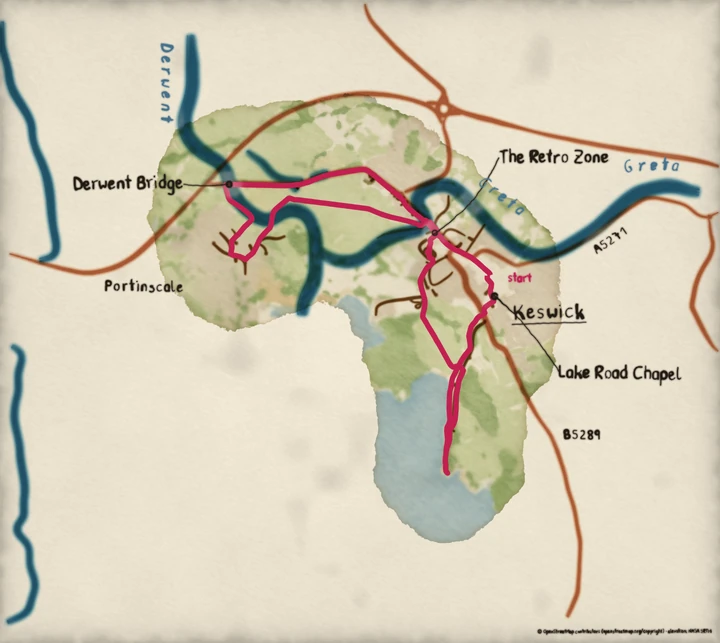

# Data policy: the licences behind a map

The code of pyntpot is MIT. The data a route map is painted from is not. It comes from
volunteers and from public services, under licences and usage limits that stay with you
when you run the library. This page says who owes what. It is a plain description and not
legal advice; where it matters, read the licence itself.

The `ink` and `letters` layers read no data and touch no network, and nothing on this page
applies to a wash, a brush stroke or a lettered name painted on its own.

## A route map is a Produced Work

The features of a route map, its roads, rivers, woods and names, come from OpenStreetMap
through the Overpass API. OpenStreetMap's data is licensed under the Open Database Licence
(ODbL). An image painted from it is what the ODbL calls a Produced Work. A Produced Work may
be shared under any licence you choose, pyntpot's own included, but when you use it
publicly it must credit OpenStreetMap and make clear that the data is under the ODbL. The
OpenStreetMap Foundation's guidelines for [Produced Works][produced-work] and for
[attribution][attribution] say how.

pyntpot draws that credit for you. `compose` writes it at the bottom right of the card,
lettered in the style's hand. It joins each source's short credit with a middle dot:
"© OpenStreetMap contributors (openstreetmap.org/copyright) · elevation: NASA SRTM". The
line carries the URL because the guidelines ask for it on a static or printed image, where a
link cannot be followed.

*Painted by `examples/place_card.py`. The credit is the small line at the bottom right.*

The elevation is NASA's SRTM data, served by OpenTopoData. SRTM carries no use restriction.
It is credited anyway, and OpenTopoData's public service has its own limits, below.

## Turning the credit off moves the duty to you

`compose` takes `attribution=False`, and the command line takes `--no-attribution`. Either
leaves the credit off the image. The duty to credit OpenStreetMap does not go with it; it
passes to whoever publishes the image. Put the credit beside the image, in a caption or a
footnote or the acknowledgements of the work it appears in, and in that order of
preference. The text to use is the credit each provider carries: `Credit.text` is the full
form, `Credit.url` the link and `Credit.short` the line pyntpot would have drawn, and the
basemap holds them in `basemap.credits`.

## The cache and the exports are Derivative Databases if you publish them

A Produced Work is the image. Other things pyntpot hands you are the data itself, in another
form:

- the fetch cache, the directory that holds the Overpass payloads and the elevation grids as
  they came;
- `vector_layers`, the basemap's areas, lines, landmarks and places as SVG path data;
- `candidate_export`, the settlements a track passes, its climbs and its landmark candidates.

Using these on your own machine asks nothing of you. If you publish a substantial extract of
one, you are publishing a Derivative Database, and the ODbL asks that you offer it under the
same licence, with the same credit. The painted image is the Produced Work above; the extracts in
the list are not.

## The providers' usage limits

The public servers are run by volunteers, and pyntpot keeps to their published limits unless
you change it.

| Provider | What pyntpot does by default |
| --- | --- |
| Overpass (`OverpassFeatures`) | One request at a time. A pause before the next endpoint after a 429. A size bound on every response. At most 100 queries per instance. |
| OpenTopoData (`OpenTopoData`) | 100 locations a call, one call a second, at most 1000 calls per instance. |

Both providers require a contact string, which travels in the User-Agent so an operator can
reach you if your use causes a problem. The budgets are counts of calls per provider
instance. Nothing is shared between instances or between processes, so a new process starts
a new count: the budget stops a loop from running away and does not limit your daily use
for you. The fetch cache is what spares the servers, because a track whose box is already
cached makes no request.

For heavy use, run your own Overpass and OpenTopoData servers and pass their addresses to the
providers: `OverpassFeatures` takes `endpoints` and `OpenTopoData` takes `endpoint`. The
public servers are not for bulk work.

## The credit has to be readable

The OpenStreetMap guidelines ask that the credit be easy to read. pyntpot letters it in the
default ink, `#241c14`, on the paper's colour, `#f3ead6`, which is a contrast of 14 to 1 by
the WCAG formula. The ink is laid with the paper's grain in it, so the painted line is a
little lighter than that number. The credit is written straight onto the card at the bottom
right, with no backing wash under it, so where the card is dark there, its legibility is
the ground's. Look at the corner of an image before you publish it. A theme that changes the
ink, or a card whose ground is dark in that corner, can take the credit below a readable
contrast, and `attribution=False` with a credit beside the image is the way out.

[produced-work]: https://osmfoundation.org/wiki/Licence/Community_Guidelines/Produced_Work_-_Guideline
[attribution]: https://osmfoundation.org/wiki/Licence/Attribution_Guidelines
