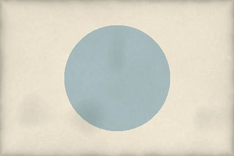
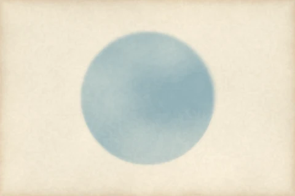
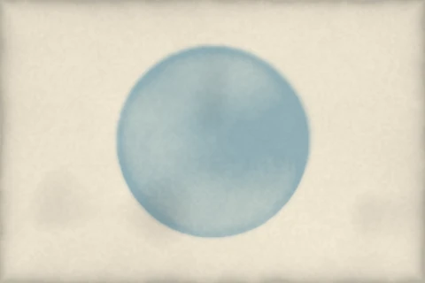
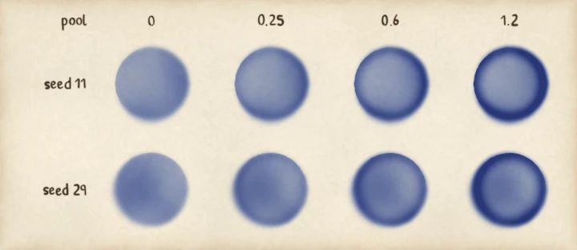
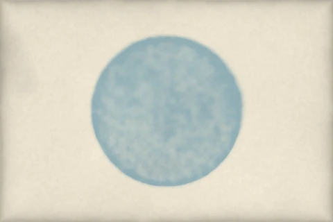
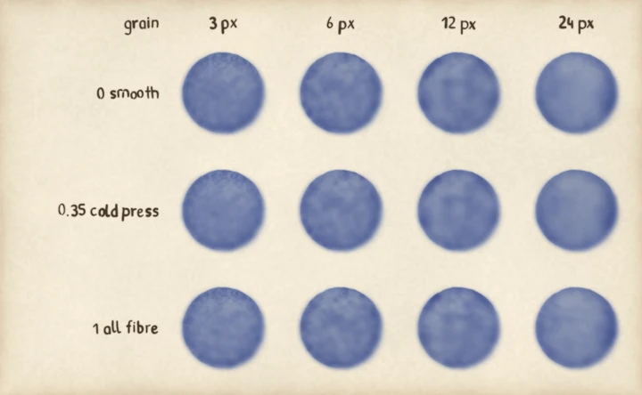
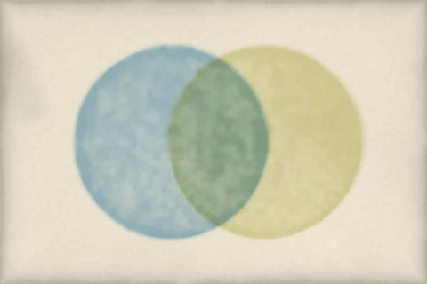

# How the wash works

A watercolourist does not apply a look. The painter wets an area, lays pigment into it, and
the pigment does the rest: it pools at the edge as the water dries, it settles into the
hollows of the paper, it shows through the wash laid over it. pyntpot paints a wash by
following that order of events, one behaviour at a time, and the code for each one cites
the paper or book it comes from. This page builds one wash the same way, a stage at a
time, so you can see what each stage adds and which call carries it.

Every figure below is painted from the same sheet, seed 11, so the paper, the wobble of the
edge and the slow drift of tone are identical from one figure to the next. When a figure
differs from the one before, the stage is the only reason. A `Sheet` is the paper's noise
fields, not the paper itself; `paper_plate` paints the paper from it.

## A flat fill is not a wash

Start with what a wash is not. A coverage mask is a disc of ones in a field of zeros. Laid
as density in water blue and multiplied over the paper, it is a flat fill: an even tone, a
hard edge, nothing that says water was ever there.

*Painted by `examples/wash_stages.py` (seed 11, `figure="mask"`).*

The fill is the mask times 0.8, composited by multiplying: each colour channel of the paper
is scaled by what the pigment transmits, which is the compositing a stack of transparent
washes needs.

Source: `multiply-compositing` in [references](references.md).

## The body: an edge that gives way, a tone that drifts

`wash(cover, sheet, base, pool, options)` takes the coverage mask and returns a density;
`options`, a `WashOptions`, from `pyntpot.ink`, is optional, and this page leaves it out.
With `pool` at 0 it lays the body alone, and already the disc is a different thing. The
mask is blurred, then cut against two scales of noise from the sheet, so the edge is soft
and wavers instead of following the circle. The tone drifts slowly across the wash,
because a second noise field varies it, and the paper's own height lightens it where the
tooth is high. A last blur, more or less strong from place to place, keeps some edges
sharper than others.

*Painted by `examples/wash_stages.py` (seed 11, `figure="body"`).*

Not every part of this is separable with the public names. The drift, the tooth and the
grain come with every call, and the sheet's `gran_px` only sets the size of the grain. This
figure uses a 60 pixel cell, large enough that the grain reads as a slow mottle. The finer
grain is the stage after next.

The noise is value noise summed over several scales (fractional Brownian motion), and the
blur is a Gaussian built from three box passes.

Source: `value-noise`, `fbm` and `box-blur` in [references](references.md).

## Edge darkening: pigment gathers where the water stopped

As a wash dries, water evaporates fastest at the edge and carries pigment out to it. The dry
wash is darker in a band just inside the edge than in its middle. `pool` is the amount of
extra density that band carries.

*Painted by `examples/wash_stages.py` (seed 11, `figure="rim"`).*

How much the band carries is `pool`. The grid below paints one ultramarine disc at four values of it,
on two sheets that differ only in their seed, so the two rows show what is the paper's doing and
what is the setting's. The wash's body is 0.4 here, not the 0.8 of the figures above, so there is room
above it for the band to read: on a heavy body the band runs into the ceiling of 1 and the larger
values look alike.

*Painted by `examples/setting_grids.py` (figure pool). The labels read 0, 0.25, 0.6 and 1.2 across, and seed 11 and seed 29 down. The value is `pool`, the extra density at the edge.*

At 0 the edge is only as dark as the body, soft and a little uneven. At 0.25 a thin line begins to
collect inside it. At 0.6 the disc is outlined by its own pigment, the look of a wash left to dry
flat. At 1.2 the ring is much darker than the middle, which reads as a stain rather than
a wash. Nothing but `pool` moves along a row.

The band here is the wash's mask minus a blur of itself, scaled so its strongest point is 1
and multiplied by `pool`; the wash is then 0.8 of body plus 0.55 of band. It is one width
wherever the edge is. The truer form, an outward flow that decays inward and is wider on a
large wash than a small one, is in the wash options, which this page leaves out. The
painter that lays washes for a whole picture reaches it through its wash style.

Source: `edge-darkening` in [references](references.md).

## Granulation: the pigment finds the paper

Some pigments are coarse. They settle out of the water into whatever the paper offers, and a
dry wash shows the paper's grain as speckle. `Sheet` takes the grain's size, `gran_px`, and
the wash multiplies its body by a noise field of that cell.

*Painted by `examples/wash_stages.py` (seed 11, `figure="grain"`; a 6 pixel grain against the 60 pixel mottle of the stage before).*

The grid below paints that one disc with grain cells of 3, 6, 12 and 24 pixels across, and with
the paper's `fibre` at 0, 0.35 and 1 down. The fibre is how much of the paper's tooth is a
laid fibre rather than an even noise; it runs from 0 to 1, and 0.35 is `PaperStyle`'s
`paper_fibre_mix` default, the cold press of the other figures.

*Painted by `examples/setting_grids.py` (figure granulation). The labels read 3, 6, 12 and 24 across, and 0, 0.35 and 1 down. The grain is `gran_px` in pixels and the rows are the sheet's `fibre`; the pool is 0.25 throughout.*

A small `gran_px` is a fine speckle, and a large one stops being a grain at all and becomes
the slow cloud of tone the wash already has. The fibre barely moves the speckle. It changes
the tooth the wash is lightened by, so the rows differ in the streaks and the way the edge
breaks, and the bottom row, all fibre, shows the paper's laid lines.

Here the grain is its own noise field, drawn from the sheet's seed. In a real wash the
grain follows the paper: pigment settles in the hollows the dry brush skips over. The wash
has a form that does this, taking granulation from the paper's pits. That too sits behind
the wash options, so no figure here shows it.

Source: `granulation` in [references](references.md).

## Two washes: multiply, then glaze

A wash is rarely alone. Lay a second, farmland, over the first and the overlap shows how the
two are combined. Given `PaperStyle(km_glazing=False)`, as here, `composite` multiplies
them, as the single wash was, and where they cross each channel is scaled twice. The
overlap goes darker and quieter.

*Painted by `examples/wash_stages.py` (seed 11, `figure="overlap"`).*

Multiply has transmission and no scattering. A real glaze has both: light enters the top
layer, is partly scattered back and partly passes to the layer beneath. Kubelka and Munk
described that with two numbers per pigment, how much it absorbs and how much it scatters.
pyntpot gets them from two things it already holds for each pigment: the colour over white,
the hex in `PIGMENTS`, and what the pigment shows over black as a share of that, in
`TRANSPARENCY`. Water is 0.04, a stain that lets nearly everything beneath it through;
farmland is 0.10. `PaperStyle(km_glazing=True)` makes `composite` glaze the layers in
order.

Two stains do not show the difference. Both pigments above are stains, and Kubelka-Munk with
a transparency near 0 is very close to multiply: the same two washes, glazed, come out the
colour they did multiplied. The difference needs a covering pigment on top.

*Painted by `examples/wash_stages.py` (seed 11, `figure="glaze"`). The labels read 0.04, 0.2, 0.5 and 0.9 across, and multiply and glazed down.*

A blue stain, ultramarine at 0.06, lies under burnt sienna, whose transparency steps from
0.04 across to 0.9. Each `PigmentLayer` can carry its own transparency as a third member,
and that is what the figure changes. Multiply ignores the number, so the top row is the same
picture four times. Glazing reads it: a sienna that is a stain at 0.04 lets the blue
through, and a sienna that covers at 0.9 hides it. The washes have not changed between the
rows; only the compositing has.

Source: `kubelka-munk` and `multiply-compositing` in [references](references.md).

## What the figures leave out

Four more behaviours are in the wash code, and a theme's wash group turns each on.
Backruns and bleed are fields of the `WashOptions` that `wash` takes besides a body and a
pool, which the map painter builds from the theme. Pigment separation and the shallow-water
pass are not: they act on what washes produce, one wash's density and then the whole stack
of layers, and the map painter runs them after its washes. They are `separated` and
`fluid_modulate`, from `pyntpot.ink`, and both read their settings from `WashStyle`, the
theme's wash group, because those settings belong to a plate rather than to one wash. This
page shows none of them as a figure.

- Backruns. A second front of water pushes deposited pigment out ahead of it: the centre
  goes pale and the front dries as a dark, crenellated ridge. Source: `backruns`.
- Bleed. Washes that lie side by side in one shared wet area flow into each other, and the
  wet area gives up most of the rim between them. Source: `wet-area-bleed`.
- Pigment separation. A tube green is two pigments, a staining one and a heavier one that
  drops into the hollows as the wash dries. With glazing on, the two stay distinct. Source:
  `pigment-separation`.
- The shallow-water pass. One coarse pass of water over the whole picture that modulates the
  densities already laid, which makes the drying directional. Source: `shallow-water`.

See [references](references.md) for each source.
