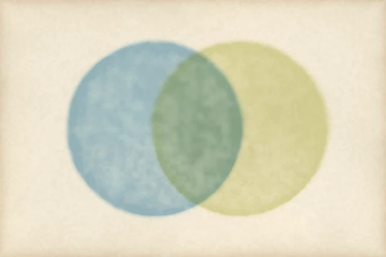

# How the wash works

A watercolourist does not apply a look. The painter wets an area, lays pigment into it, and
the pigment does the rest: it pools at the edge as the water dries, it settles into the
hollows of the paper, it shows through the wash laid over it. pyntpot paints a wash by
following that order of events, one behaviour at a time, and the code for each one cites
the paper or book it comes from. This page builds one wash the same way, a stage at a
time, so you can see what each stage adds and which call carries it.

Every figure below is painted from the same sheet, seed 11, so the paper, the wobble of the
edge and the slow drift of tone are identical from one figure to the next. When a figure
differs from the one before, the stage is the only reason. A `Sheet` is the paper's noise
fields, not the paper itself; `paper_plate` paints the paper from it.

## A flat fill is not a wash

Start with what a wash is not. A coverage mask is a disc of ones in a field of zeros. Laid
as density in water blue and multiplied over the paper, it is a flat fill: an even tone, a
hard edge, nothing that says water was ever there.

*Painted by `examples/wash_stages.py` (seed 11, `figure="mask"`).*

The fill is the mask times 0.8, composited by multiplying: each colour channel of the paper
is scaled by what the pigment transmits, which is the compositing a stack of transparent
washes needs.

Source: `multiply-compositing` in [references](references.md).

## The body: an edge that gives way, a tone that drifts

`wash(cover, sheet, base, pool)` takes the mask and returns a density. With `pool` at 0 it
lays the body alone, and already the disc is a different thing. The mask is blurred, then
cut against two scales of noise from the sheet, so the edge is soft and wavers instead of
following the circle. The tone drifts slowly across the wash, because a second noise field
varies it, and the paper's own height lightens it where the tooth is high. A last blur,
more or less strong from place to place, keeps some edges sharper than others.

*Painted by `examples/wash_stages.py` (seed 11, `figure="body"`).*

Not every part of this is separable with the public names. The drift, the tooth and the
grain come with every call, and the sheet's `gran_px` only sets the size of the grain. This
figure uses a 60 pixel cell, large enough that the grain reads as a slow mottle. The finer
grain is the stage after next.

The noise is value noise summed over several scales (fractional Brownian motion), and the
blur is a Gaussian built from three box passes.

Source: `value-noise`, `fbm` and `box-blur` in [references](references.md).

## Edge darkening: pigment gathers where the water stopped

As a wash dries, water evaporates fastest at the edge and carries pigment out to it. The dry
wash is darker in a band just inside the edge than in its middle. `pool` is the amount of
extra density that band carries.

*Painted by `examples/wash_stages.py` (seed 11, `figure="rim"`).*

The band here is the wash's mask minus a blur of itself, scaled so its strongest point is 1
and multiplied by `pool`; the wash is then 0.8 of body plus 0.55 of band. It is one width
wherever the edge is. The truer form, an outward flow that decays inward and is wider on a
large wash than a small one, is in the wash options, and `pyntpot.ink` does not export
them. The painter that lays washes for a whole picture reaches it through its wash style.

Source: `edge-darkening` in [references](references.md).

## Granulation: the pigment finds the paper

Some pigments are coarse. They settle out of the water into whatever the paper offers, and a
dry wash shows the paper's grain as speckle. `Sheet` takes the grain's size, `gran_px`, and
the wash multiplies its body by a noise field of that cell.

*Painted by `examples/wash_stages.py` (seed 11, `figure="grain"`; a 6 pixel grain against the 60 pixel mottle of the stage before).*

Here the grain is its own noise field, drawn from the sheet's seed. In a real wash the
grain follows the paper: pigment settles in the hollows the dry brush skips over. The wash
has a form that does this, taking granulation from the paper's pits. That too sits behind
the options `pyntpot.ink` does not export, so no figure here shows it.

Source: `granulation` in [references](references.md).

## Two washes: multiply, then glaze

A wash is rarely alone. Lay a second, farmland, over the first and the overlap shows how the
two are combined. By default `composite` multiplies them, as the single wash was, and
where they cross each channel is scaled twice. The overlap goes darker and quieter.

*Painted by `examples/wash_stages.py` (seed 11, `figure="overlap"`).*

Multiply has transmission and no scattering. A real glaze has both: light enters the top
layer, is partly scattered back and partly passes to the layer beneath. Kubelka and Munk
described that with two numbers per pigment, how much it absorbs and how much it scatters.
pyntpot gets them from two things it already holds for each pigment: the colour over white,
the hex in `PIGMENTS`, and what the pigment shows over black as a share of that, in
`TRANSPARENCY`. Water is 0.04, a stain that lets nearly everything beneath it through;
farmland is 0.10. `PaperStyle(km_glazing=True)` makes `composite` glaze the layers in
order.

*Painted by `examples/wash_stages.py` (seed 11, `figure="glaze"`).*

The washes themselves have not changed between these two figures; only the compositing has.

Source: `kubelka-munk` and `multiply-compositing` in [references](references.md).

## What the figures leave out

Four more behaviours are in the wash code, and a theme's wash group turns each on. The
public `wash` takes a body and a pool and nothing else, so none has a figure here.

- Backruns. A second front of water pushes deposited pigment out ahead of it: the centre
  goes pale and the front dries as a dark, crenellated ridge. Source: `backruns`.
- Bleed. Washes that lie side by side in one shared wet area flow into each other, and the
  wet area gives up most of the rim between them. Source: `wet-area-bleed`.
- Pigment separation. A tube green is two pigments, a staining one and a heavier one that
  drops into the hollows as the wash dries. With glazing on, the two stay distinct. Source:
  `pigment-separation`.
- The shallow-water pass. One coarse pass of water over the whole picture that modulates the
  densities already laid, which makes the drying directional. Source: `shallow-water`.

See [references](references.md) for each source, and
[the feature note](../features/ink-public-wash-options.md) for what exposing them would
take.
