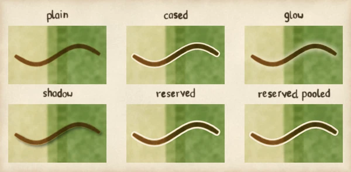

# Line effects: why they work on colours, not as glazes

A line effect is a casing, a glow or a shadow laid round a line: a road that stands clear of the wash it crosses, a river that lifts out of dark woodland, a route that sits above the page. pyntpot paints everything else as glazes of pigment, so it is fair to ask why these are not glazes too. This page says why they are not, in what order they are drawn, and where they appear. For how to set one, see [Case, light or shadow a line](../how-to/case-light-or-shadow-a-line.md); for every field and value, see [Line effects](../reference/line-effects.md).

## Why a line effect is not a glaze

A wash is a pigment laid as a glaze. Glazing, or multiplying, can only keep a colour as it is or darken it, because a layer of pigment lets some light through and stops the rest. That is exactly right for a wash over a wash. It cannot make a casing. A casing in the paper's colour has to lay cream over a dark wood, and a glaze at the default transparency lets the wood show through almost whole. Multiplying cannot lighten at all, so it cannot make a glow either.

So an effect does not glaze. It is a plain function of the colours beneath it: `casing(rgb, mask, effect, *, threshold, paper)` takes the picture so far, the line's mask and a `Casing`, and blends a ring round the line toward the casing's colour as it would look laid over the paper. The ring's width is measured from the line's edge, not from its centre, and its outer edge is anti-aliased, so it has no stair steps. `glow(rgb, mask, effect, *, threshold, paper)` lifts the colours round the line toward the paper, and never darkens them. `shadow(rgb, mask, effect, *, azimuth_deg, threshold)` darkens beside the line, away from the light. Each knows nothing of maps: it takes an array, a mask and its own small value type.

*Painted by `examples/line_effect_reasons.py` (figure glaze-or-rgb). The labels read casing and glow across, and glaze and RGB down. Each cell is the same wash and the same stroke; the top row lays the effect's ring as a cream glaze and the bottom row lays it through the `casing` and `glow` primitives.*

The departure is limited to effects. Lines and washes still glaze, and an effect is laid before the line it belongs to, so the line is still glazed over it.

### Why the line's own pixels are left alone

A casing and a glow change only the pixels outside the line: where the mask is at or above the threshold, they leave the colour as it was. This is on purpose. A line is a translucent stroke, so a casing laid under it would show through it and tint it, and a glow would wash it out. Leaving the line's own pixels untouched means the stroke keeps its colour, whatever the effect and whatever the width. A shadow likewise never darkens the line that casts it.

## Casings first: the draw order

Where two lines meet, the order the casings and the lines go down in matters. Case each road and draw it in turn, and the second road's casing is laid over the first road's line, so a pale seam cuts across the first road at the fork. Lay every casing first and then every line, and the casings all lie under all the lines: the fork reads as one road, and a road over a river reads as a crossing.

*Painted by `examples/line_effect_reasons.py` (figure draw-order). The labels read each stroke cased, casings first and casings as a union. All three cells lay the river first and plain; only how the two roads' casings are laid differs.*

The painter follows the second order. It draws the water group, then the road group, and within a group lays the effects of every class on what lies beneath it before it lays the group's lines. The full order, class by class, is in [Line effects](../reference/line-effects.md).

## One ring round a junction: casing unions

Casings first is enough when the lines are opaque, because a line laid over a ring covers it. A glaze does not cover. Every road is a translucent stroke, so the second road's ring, laid under the first road's line, shows through the first road's glaze as a faint pale band inside it. In the middle cell the band is there where the second road meets the first.

A casing union removes it. A union cases a set of classes as one: the ring goes round the union of their footprints, and the mask for it is, at each pixel, the larger of the members' densities. Nothing inside any member's footprint is ringed, so the right-hand cell has one outline round the whole fork and no ring inside a road. A union of one class is that class's own casing. The members share one colour and one strength, since there is one ring; `route` never joins. The key is `casing_unions`, set out in [Line effects](../reference/line-effects.md) and shown in [Case, light or shadow a line](../how-to/case-light-or-shadow-a-line.md). A picture painted in Python gets the same result from `casing` by passing it the larger of the two densities.

## A reserve: the paper laid back

A painter who wants a line to stand clear of a wash paints the line's outline with masking fluid first: the paper stays bare there, whatever is washed over it. A reserve is that. It lays the paper itself back in a ring round the line and lifts every pigment beneath the ring, so where the reserve is whole the picture is the bare paper plate. The ring's width is measured from the line's edge.

A casing is a colour blended toward the paper's colour, and a white casing is only the paper's colour in wash space. A reserve is not a white casing and not a lighter wash: it takes the paper plate's own grain and fibre, so nothing of the wash shows. That is why it is its own kind and a stack takes a casing or a reserve, not both.

Where pigment is lifted, a wet wash gathers at the edge of the dry paper. The pool is that: a number from 0 to 1 that deepens the wash just outside the ring toward a faint darker line. It only ever darkens a pixel that is already darker than the paper, and bare paper stays bare, so a pooled reserve is never lighter than the same reserve with no pool and has no drawn outline.

*Painted by `examples/cased_stroke.py`. The names are plain, cased, glow, shadow, reserved and reserved, pooled. The reserved cells lay bare paper round the stroke; the pooled cell gathers a faint edge outside it.*

## Where a route's effects appear

A basemap line's effects are laid when the base plates are painted, so changing one paints the plates again. The route's effects are laid when `compose` draws the route, above the whole base plate, from the route's mask. So a route effect repaints nothing: it costs one compose. It also means a route effect exists only in the pixels `compose` returns.

A page that draws the route itself, as an SVG laid over the card, does not get the route's effects. The SVG is not in those pixels, and `compose` never sees it. If you want a casing round a route you draw yourself, case it where you draw it, as [Cased strokes](../tutorials/painting-with-python/cased-strokes.md) does for a free stroke.

## What line effects do not do

They are not laid on lettering or its leaders, so no effect moves the lettering digest. A glow has no colour of its own. A pen casing has no theme key: it is an `ink` primitive for a picture painted in Python. Pigment separation keeps its own transparency and is not an effect.
