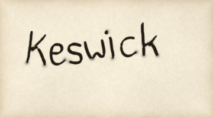
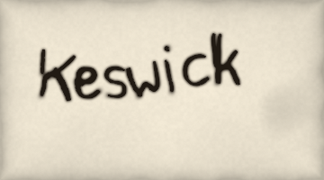

# The hand and the nib

Handwriting is two jobs. The hand decides where the pen goes: which way each letter leans,
how the baseline wanders, how the pen is tilted this time. The nib decides what the pen
leaves behind: a line that is thick across the nib and thin along it, a blot where it
touches down, a stroke that thins as the ink runs low. pyntpot keeps the two apart. A `Hand`
writes a `Setting` as a list of `Mark`s, and `nib_plate` strokes the marks onto a plate
through the same ink engine that lays a brush's line.

This page follows one name, "Keswick", from the line it is set along to the ink on the paper,
then follows one pen stroke on its own. Every figure is painted from the same paper seed (7),
and the hand's seed is fixed, so the figures differ only in the stage.

## The line the name follows

A setting says what to write and where. Set along a path, the name starts at the path's
first point and each glyph sits on the tangent of the line beneath it. The hand does not
choose the line, reverse it or lift the name off it: whoever builds the setting does.

*Painted by `examples/nib_stages.py` (seed 7, `figure="line"`).*

## The hand: a skeleton, written a little differently each time

The face gives the proportions. pyntpot uses the vendored Patrick Hand, a face somebody
drew by hand, and not a stroke font somebody plotted. A glyph becomes something a pen can
follow by thinning its filled shape to a one pixel skeleton, walking the skeleton into
chains and pruning the spurs that thinning grows. That is the `centreline` route; the
`outline` route draws round the contour instead, and the two are different letters, not a
choice and a fallback.

What the hand adds is what a font cannot say, because a font is the same shape every time.
Each letter leans a shade differently in every word, the baseline drifts, and the pen is
never held at quite the same angle twice. Each of those draws comes from one generator, so
one seed and one setting write the same marks.

*Painted by `examples/nib_stages.py` (seed 7, `figure="centreline"`). The text reads "Keswick".*

This is the hand's marks stroked by a nib that is one width the whole way round
(`NibStyle.label_pen_thin` set to 0). It is correct and it reads as plotted. The letters are
the right shape and the wrong writing.

Source: `zhang-suen` in [references](references.md).

## The nib: thick across, thin along

A broad nib held at one angle draws its full width across itself and almost nothing along
itself. That one fact is most of what separates a written letter from a plotted one. Along a stroke, a point drawn straight along the nib keeps `1 - label_pen_thin` of the width, a
point drawn straight across it keeps all of it, and the angles between follow the sine. The
default angle is 38 degrees anticlockwise from the page's horizontal, and the default
`label_pen_thin` is 0.52.

*Painted by `examples/nib_stages.py` (seed 7, `figure="broad"`).*

Hold the pen at the other slant and the thick and thin strokes change places.

*Painted by `examples/nib_stages.py` (seed 7, `figure="turned"`; the nib at 38 degrees clockwise).*

The nib's angle is fixed to the page and not to the line. For a name set along a steep line,
the thick and thin strokes stay where the page puts them, not where the letter would have
put them. [A feature note](https://github.com/findlaywebb/pyntpot/blob/main/docs/features/letters-nib-follows-writing-line.md) records the
alternative.

Source: `nib` in [references](references.md).

## A ground to write on

The nib plate is its own RGBA plate and is laid over the paper normally, by its alpha, and
not multiplied. A multiply can only darken, and a backing needs to lighten. Over a dark
wash the name sits in the ground rather than on it.

*Painted by `examples/nib_stages.py` (seed 7, `figure="ground"`; `Setting(wash=False)`).*

A setting can ask for a backing wash: a soft, paper-coloured blot, laid through the wash
machinery with a pooled rim and a granulated body, lifted under the marks that ask for one.
It exists only where the ground is dark enough to need it, so a name on bare paper has none.
It reads as paint lifted before the name was written.

*Painted by `examples/nib_stages.py` (seed 7, `figure="backing"`).*

## How the nib lays ink

A nib is a brush with a narrow, firm tip. Row 6 of the brush sheet is a pen: six bristles
with no gaps, a solid core under them and little dryness. Each stamp along the path
lays bristle weights into an accumulator, bilinearly, and the accumulator becomes ink in
three steps. The ink saturates, so two strokes crossing do not double. It is gated on the
paper's tooth, so a mark breaks where the paper's tooth is low. And the
edge bleeds out a little, because paper wicks.

Where a pen touches down it leaves more than where it travels: a blot, and a little extra
ink that runs out over the first few widths. Lettering turns both right down, because a blot
on the crossbar of a t is a blob and not character; the figure uses the pen as the sheet
makes it.

*Painted by `examples/nib_stages.py` (seed 7, `figure="set-down"`).*

Source: `bristle-brush` in [references](references.md).

## When the nib runs dry

A nib does not break when its ink runs low. The line thins and lightens over a long run and
comes back full at the reload. `BrushStyle.pen_starve` turns that on, with the reservoir's
length (`pen_reservoir`, in nib widths), how much the line loses (`pen_thin`) and how often
it is dipped (`ink_dip_mult`).

*Painted by `examples/nib_stages.py` (seed 7, `figure="runs-dry"`). The reservoir is set to 22 nib widths, far shorter than the default, so the thinning shows in a small figure.*

Source: `ink-reservoir` in [references](references.md).

## What the hand and the nib do not do

The hand does not choose names or places, and does not draw furniture. The nib does not
decide what is written, in which ink a class of feature is set, or how dark the ground is: the
marks and the surface it writes on arrive from the caller. Neither reads a theme. The figures above
set their own styles by hand to make each stage show.
