# Gallery

Every picture in these docs is painted by pyntpot from a script in `examples/`, and each is pinned to that script, so a picture here is the one the script paints. Each picture is shown under the page it illustrates; the caption names its script.

## Tutorials

### [Paint a watercolour](tutorials/paint-a-watercolour.md)

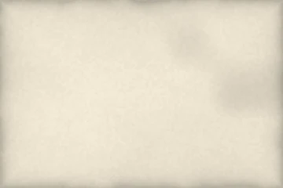

*Painted by `examples/paper.py` (seed 11).*

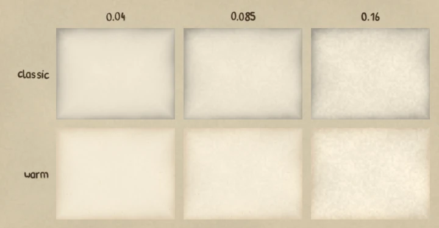

*Painted by `examples/tutorial_grids.py` (figure paper). The labels read 0.04, 0.085 and 0.16 across, and classic and warm down.*

*Painted by `examples/wash.py` (seed 11).*

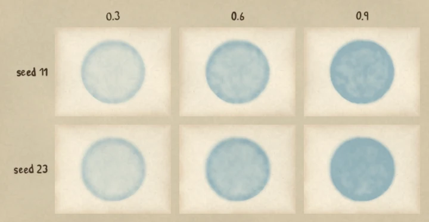

*Painted by `examples/tutorial_grids.py` (figure wash). The labels read 0.3, 0.6 and 0.9 across, and seed 11 and seed 23 down.*

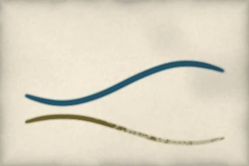

*Painted by `examples/brush_stroke.py` (seed 11).*

*Painted by `examples/tutorial_grids.py` (figure brush). The labels read RIV1-a, MAJ3-b, TRK4-d and MAJ7-e across, and 3 px, 6 px and 12 px down.*

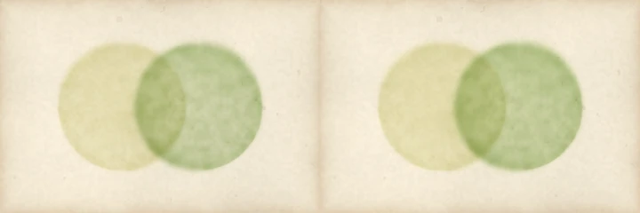

*Painted by `examples/pigments.py` (seed 11).*

*Painted by `examples/tutorial_grids.py` (figure pigments). The labels read 1 to 4 across, and multiply and glazed down.*

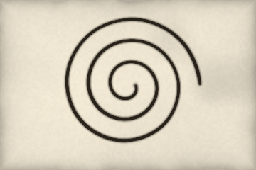

*Painted by `examples/nib_line.py` (seed 11).*

*Painted by `examples/tutorial_grids.py` (figure nib). The name is Keswick. The labels read -38, 0, 38 and 90 across, and 0, 0.52 and 0.85 down.*

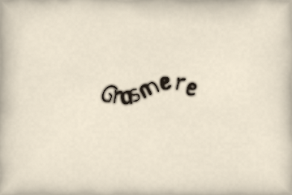

*Painted by `examples/lettering.py` (seed 7).*

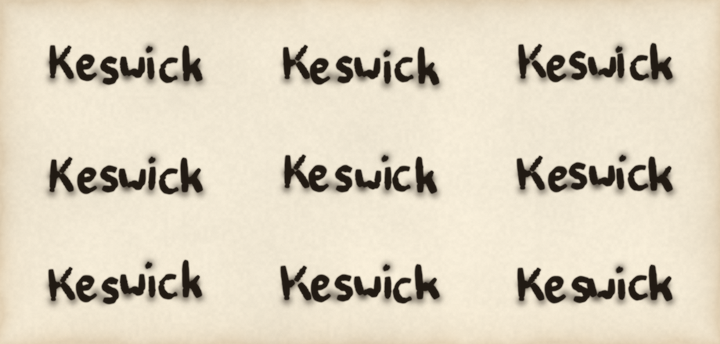

*Painted by `examples/tutorial_grids.py` (figure lettering). The name is Keswick; the nine copies are nine hand seeds.*

*Painted by `examples/composition.py` (seed 7).*

*Painted by `examples/tutorial_grids.py` (figure composition). The name is Keswick. The labels read seed 1, seed 2 and seed 3 across, and off and on down.*

### [First map](tutorials/first-map.md)

*Painted by `examples/route_map.py`.*

## Painting with Python

### [Curves: a rose and a spirograph in brush, a Lissajous figure in pen](tutorials/painting-with-python/curves.md)

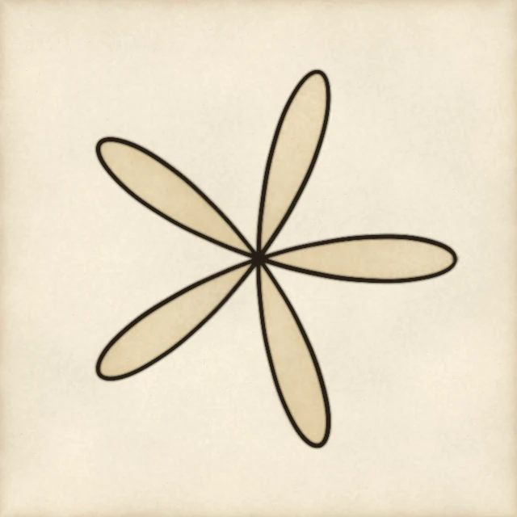

*Painted by `examples/curves.py` (seed 5, figure rose).*

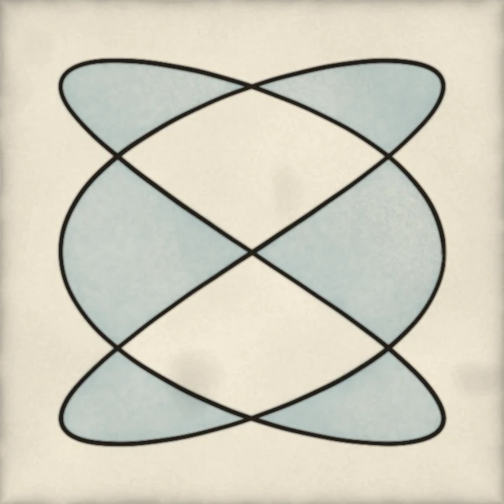

*Painted by `examples/curves.py` (seed 5, figure lissajous).*

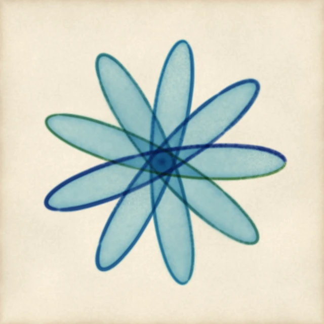

*Painted by `examples/curves.py` (seed 5, figure spirograph).*

### [Symmetry: one motif, repeated by mirror and rotation](tutorials/painting-with-python/symmetry.md)

*Painted by `examples/kaleidoscope.py` (seed 9).*

### [Fractals: a fern, a family of ferns and a tree](tutorials/painting-with-python/fractals.md)

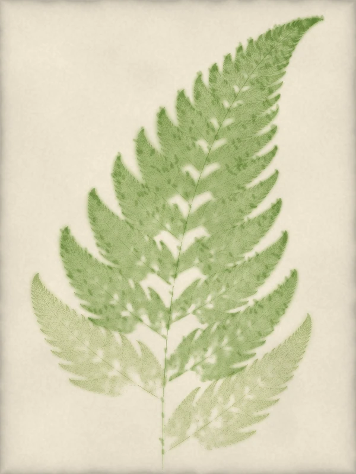

*Painted by `examples/fern.py` (seed 7).*

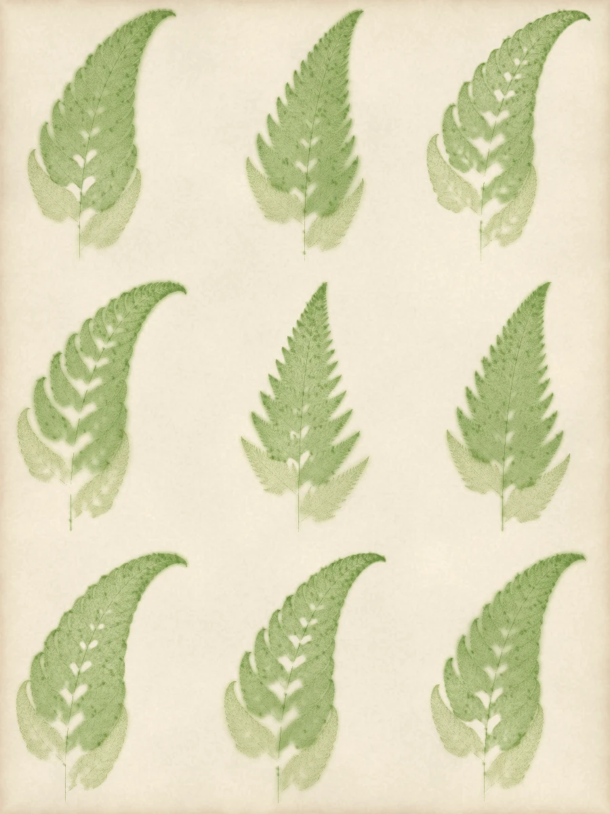

*Painted by `examples/fern_family.py` (seed 7).*

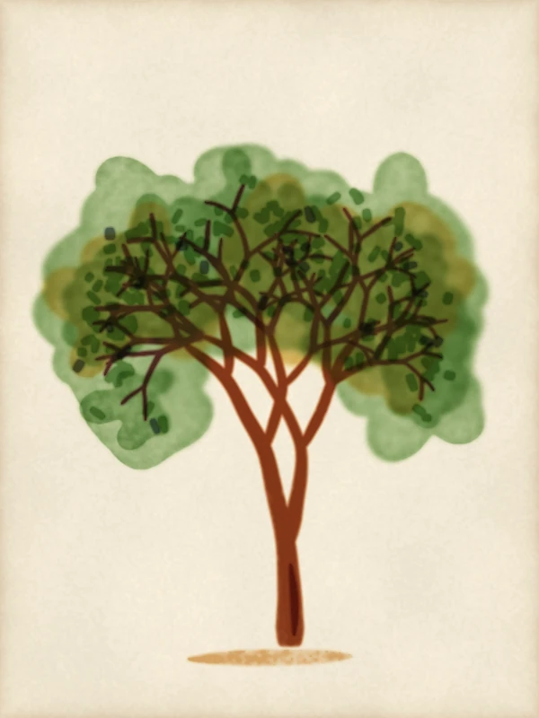

*Painted by `examples/trees.py` (seed 4, figure tree).*

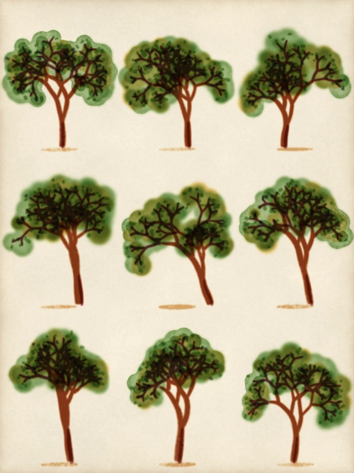

*Painted by `examples/trees.py` (seed 4, figure family).*

### [Pictures: layered hill washes and a lettered Derwentwater](tutorials/painting-with-python/pictures.md)

*Painted by `examples/derwentwater.py` (seed 21).*

### [Vector drawing: a small drawing, its filled shapes washed and its strokes inked](tutorials/painting-with-python/vector-drawing.md)

*Painted by `examples/svg_drawing.py` (seed 5).*

## How-to guides

### [Write a theme](how-to/write-a-theme.md)

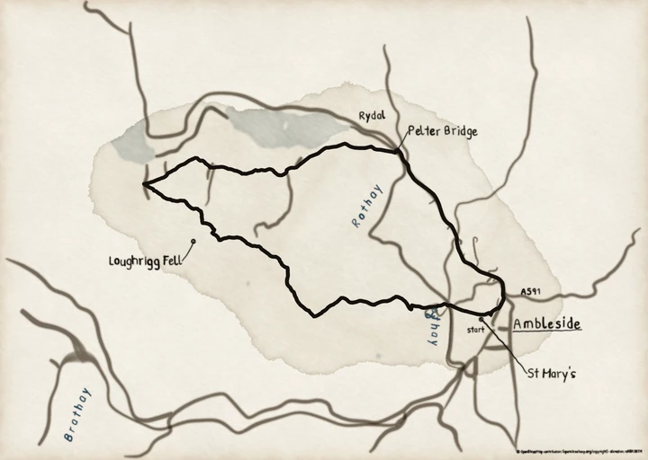

*Painted by `examples/map_styles.py` (figure pen-and-ink).*

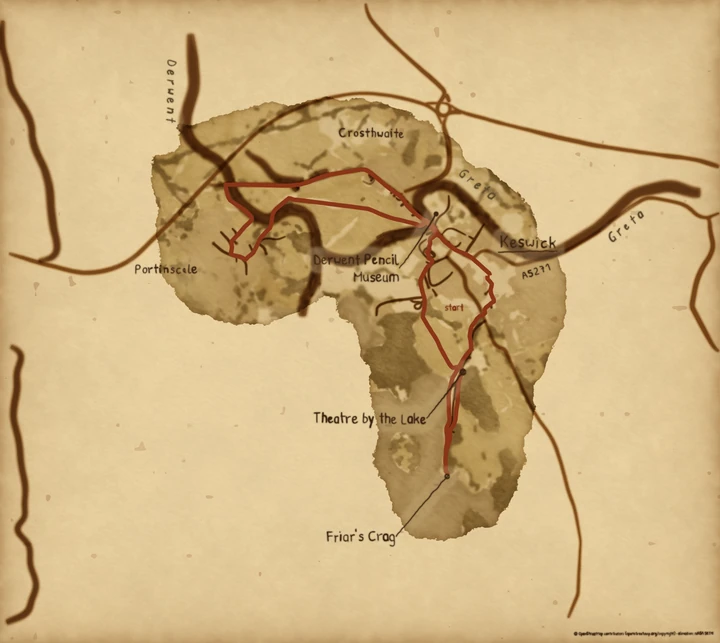

*Painted by `examples/map_styles.py` (figure sepia).*

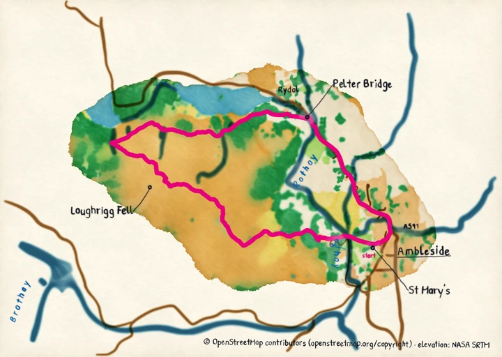

*Painted by `examples/map_styles.py` (figure bold).*

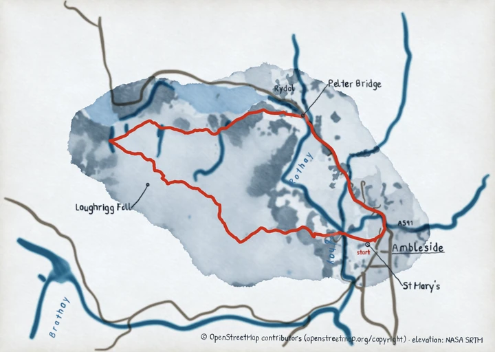

*Painted by `examples/map_styles.py` (figure winter).*

### [Change the route ink](how-to/change-the-route-ink.md)

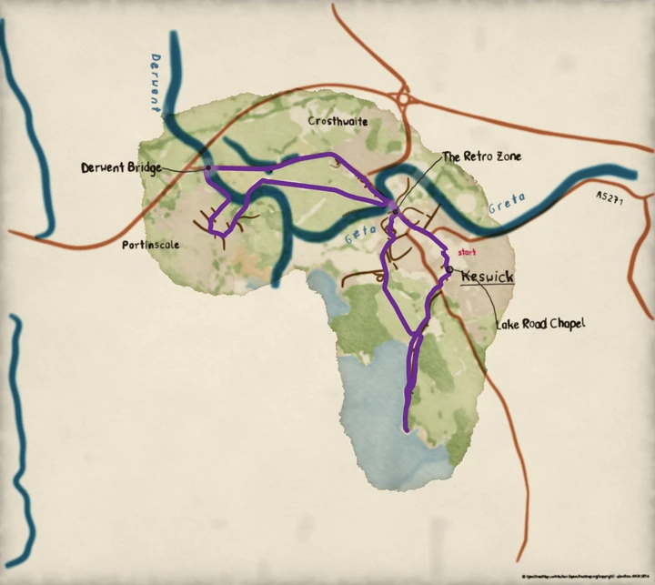

*Painted by `examples/how_to_route_ink.py`.*

### [Paint your own shapes](how-to/paint-your-own-shapes.md)

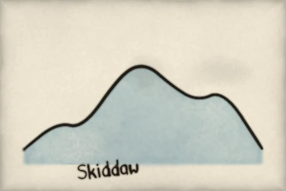

*Painted by `examples/how_to_own_shapes.py` (seed 5).*

### [Map from the command line](how-to/map-from-the-command-line.md)

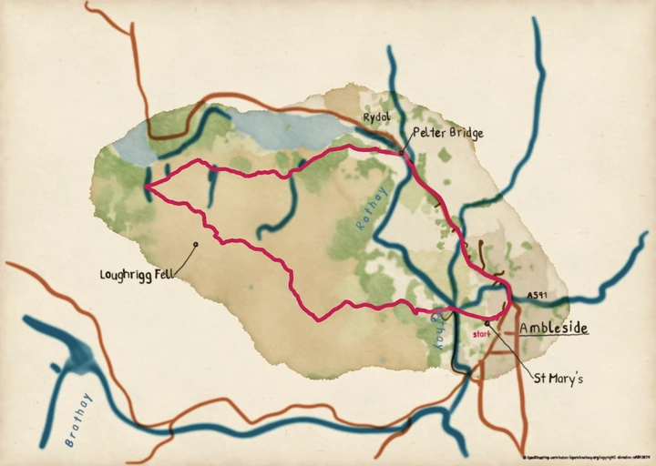

*Painted by `examples/route_map.py`.*

## Reference

### [Pigments](reference/pigments.md)

*Painted by `examples/pigment_swatches.py` (seed 11).* Each key is lettered under its strip, in the order of the page's table.

### [Brushes](reference/brushes.md)

*Painted by `examples/brush_sheet.py` (seed 11, figure grid).* The labels read the treatment numbers 1 to 8 across, the widths 3 px, 6 px and 12 px down, and wet, soft, gritty, dry, nib, pen, driest and fine nib under the columns.

## Explanation

### [How the wash works](explanation/how-the-wash-works.md)

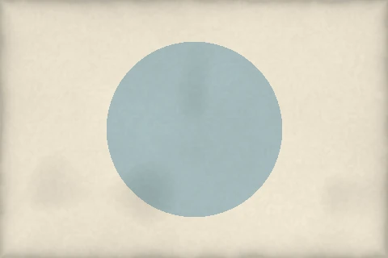

*Painted by `examples/wash_stages.py` (seed 11, figure mask, size 480).*

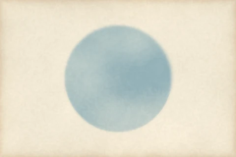

*Painted by `examples/wash_stages.py` (seed 11, figure body, size 480).*

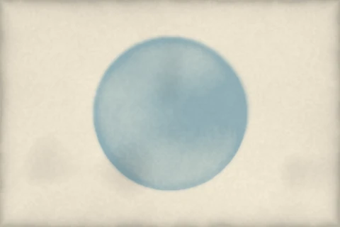

*Painted by `examples/wash_stages.py` (seed 11, figure rim, size 480).*

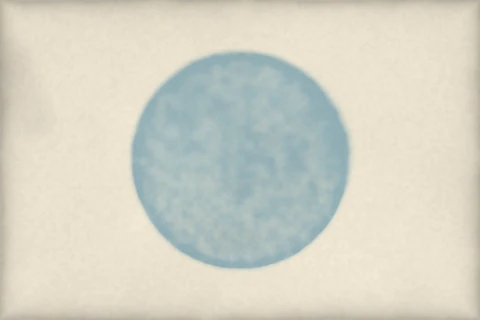

*Painted by `examples/wash_stages.py` (seed 11, figure grain, size 480).*

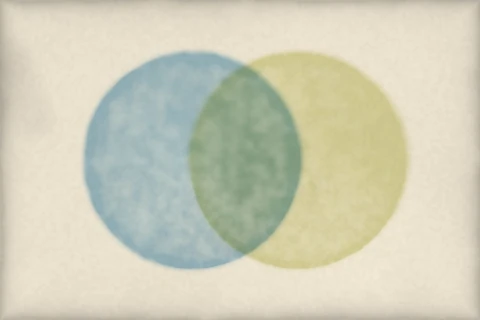

*Painted by `examples/wash_stages.py` (seed 11, figure overlap, size 480).*

*Painted by `examples/wash_stages.py` (seed 11, figure glaze, size 800). The labels read 0.04, 0.2, 0.5 and 0.9 across, and multiply and glazed down.*

### [The hand and the nib](explanation/the-hand-and-the-nib.md)

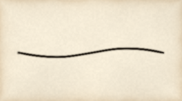

*Painted by `examples/nib_stages.py` (seed 7, figure line, size 360).*

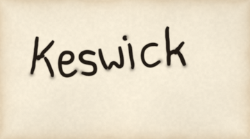

*Painted by `examples/nib_stages.py` (seed 7, figure centreline, size 360).*

*Painted by `examples/nib_stages.py` (seed 7, figure angles, size 840). The name is Keswick. The labels read -38, 0, 38 and 90 across, and 0, 0.52 and 0.85 down.*

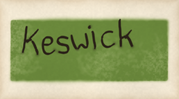

*Painted by `examples/nib_stages.py` (seed 7, figure ground, size 360).*

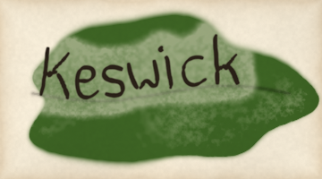

*Painted by `examples/nib_stages.py` (seed 7, figure backing, size 360).*

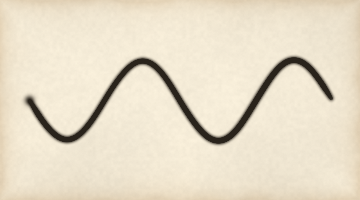

*Painted by `examples/nib_stages.py` (seed 7, figure set-down, size 360).*

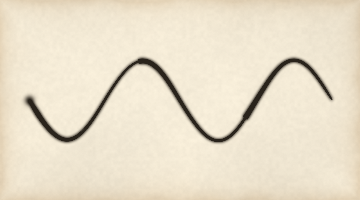

*Painted by `examples/nib_stages.py` (seed 7, figure runs-dry, size 360).*

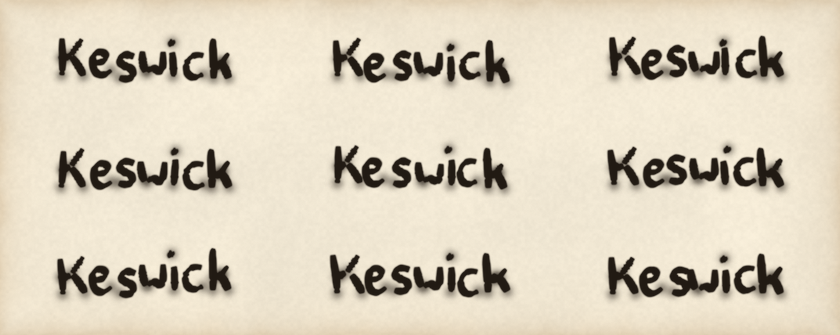

*Painted by `examples/nib_stages.py` (seed 7, figure hands, size 840). The name is Keswick; the nine copies are nine hand seeds.*

## Places

The five focus places, each painted from a recorded fixture by one script. Every route is invented along public paths: it follows public OpenStreetMap ways, is traced from no recorded activity and marks no home or personal route. Each card links its fixture.

### [Keswick and Derwentwater](https://github.com/findlaywebb/pyntpot/tree/main/tests/fixtures/keswick)

*Painted by `examples/place_card.py`.* Among the names it letters are Keswick, Portinscale, Crosthwaite, Derwent Bridge, Lake Road Chapel, Derwent, Greta and A5271; the list is not complete.

### [The Quiraing, Trotternish, Skye](https://github.com/findlaywebb/pyntpot/tree/main/tests/fixtures/trotternish)

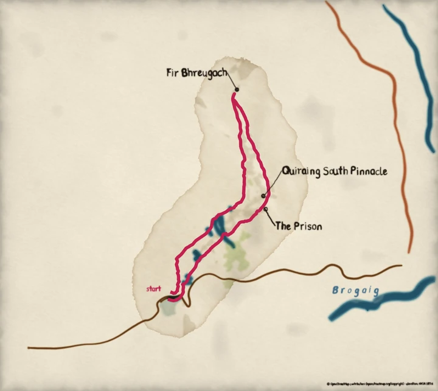

*Painted by `examples/place_card.py`.* Among the names it letters are Fir Bhreugach, Quiraing South Pinnacle, The Prison, Brogaig; the list is not complete.

### [Over Crib Goch to the summit of Yr Wyddfa, Eryri](https://github.com/findlaywebb/pyntpot/tree/main/tests/fixtures/yr-wyddfa)

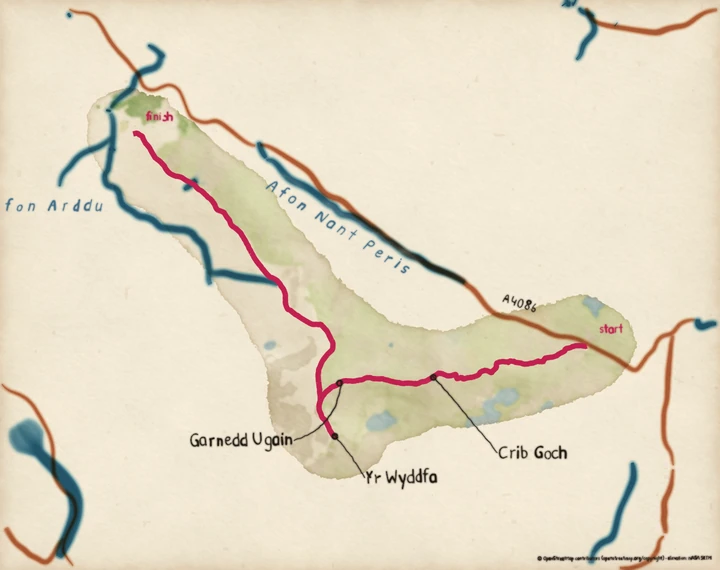

*Painted by `examples/place_card.py`.* Among the names it letters are Llanberis, Garnedd Ugain, Yr Wyddfa, Crib Goch; the list is not complete.

### [Central Oxford](https://github.com/findlaywebb/pyntpot/tree/main/tests/fixtures/oxford)

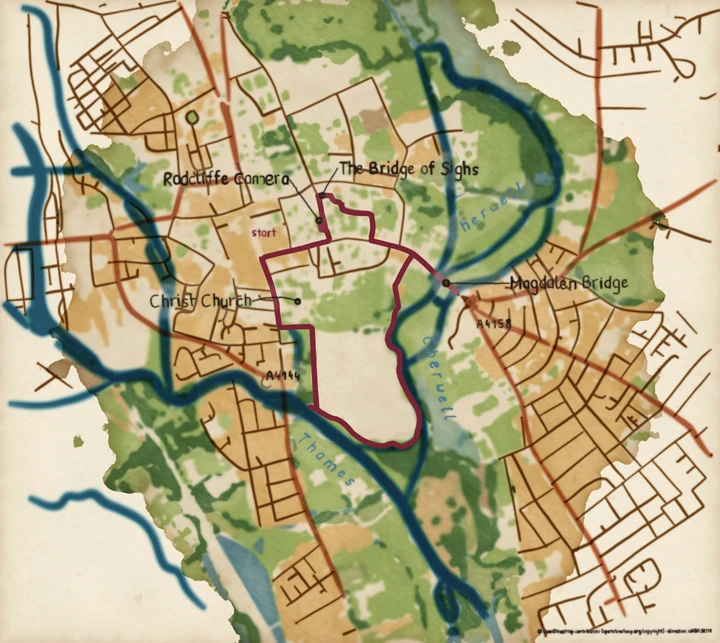

*Painted by `examples/place_card.py`.* Among the names it letters are Christ Church, Tom Tower, Magdalen Tower, Cherwell; the list is not complete.

### [Y Fenni](https://github.com/findlaywebb/pyntpot/tree/main/tests/fixtures/y-fenni)

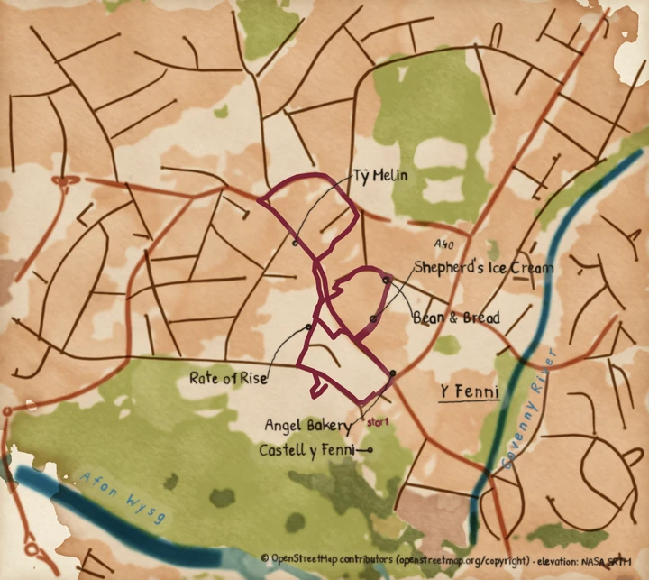

*Painted by `examples/place_card.py` with `examples/themes/y-fenni.toml`.* Among the names it letters are Y Fenni, Afon Wysg, Llan-ffwyst, Gavenny River, Borough Theatre and A40; the list is not complete.

## The README

The pictures that open the [README](https://github.com/findlaywebb/pyntpot#readme), and the preview GitHub shows for the repository.

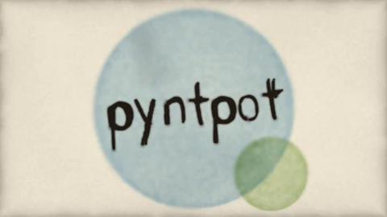

*Painted by `examples/word.py`. The word is pyntpot.*

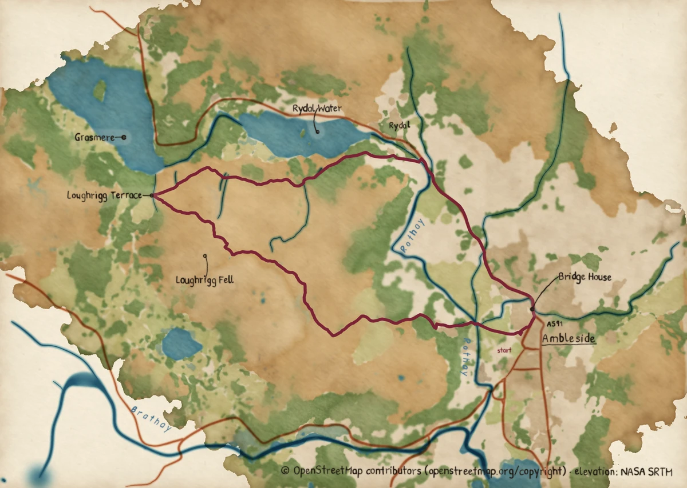

*Painted by `examples/place_card.py` (size 1200).*

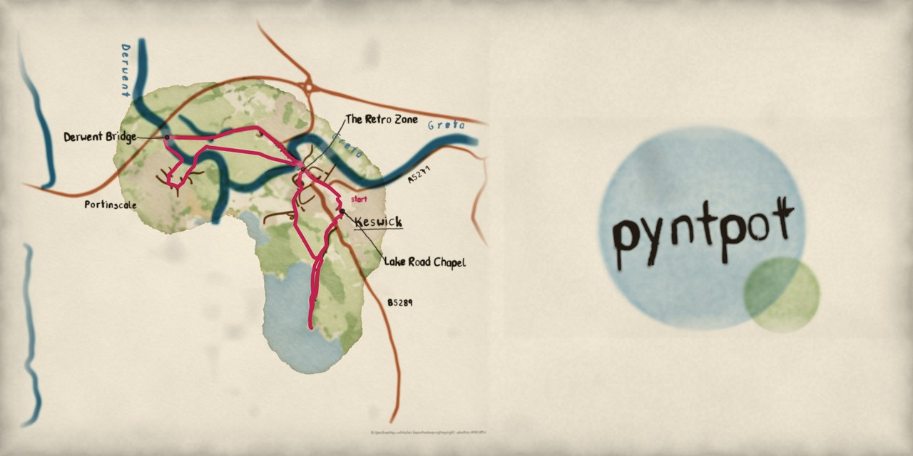

*Painted by `examples/social_preview.py`. The word is pyntpot.*

### The strip of eight

The README's strip is one thumbnail for each rung of the [tutorials](tutorials/index.md), from the paper to the route map.

*Painted by `examples/paper.py` (seed 11).*

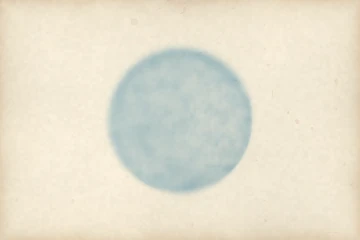

*Painted by `examples/wash.py` (seed 11).*

*Painted by `examples/brush_stroke.py` (seed 11).*

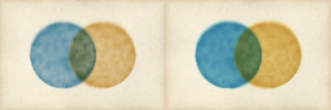

*Painted by `examples/pigments.py` (seed 11).*

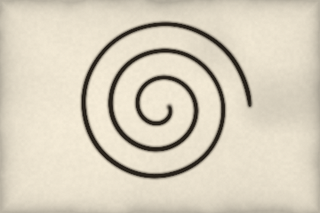

*Painted by `examples/nib_line.py` (seed 11).*

*Painted by `examples/lettering.py` (seed 7).*

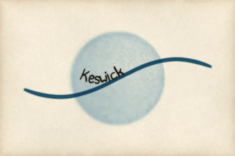

*Painted by `examples/composition.py` (seed 7).*

*Painted by `examples/route_map.py`.*
