# Gallery

Every picture in these docs is painted by pyntpot from a script in `examples/`, and each is pinned to that script, so a picture here is the one the script paints. Each picture is shown under the page it illustrates; the caption names its script.

## Tutorials

### [Paint a watercolour](tutorials/paint-a-watercolour.md)

*Painted by `examples/paper.py` (seed 11).*

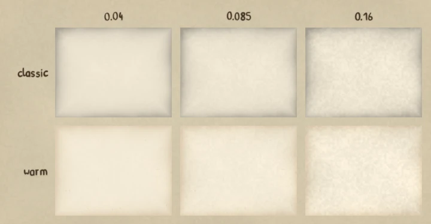

*Painted by `examples/tutorial_grids.py` (figure paper). The labels read 0.04, 0.085 and 0.16 across, and classic and warm down.*

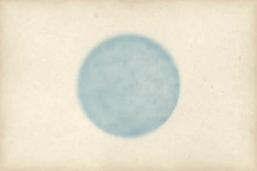

*Painted by `examples/wash.py` (seed 11).*

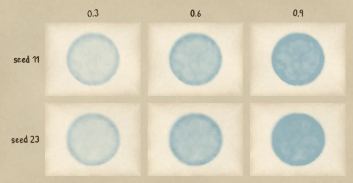

*Painted by `examples/tutorial_grids.py` (figure wash). The labels read 0.3, 0.6 and 0.9 across, and seed 11 and seed 23 down.*

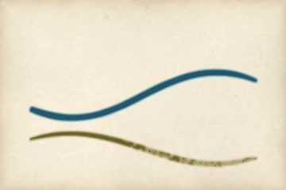

*Painted by `examples/brush_stroke.py` (seed 11).*

*Painted by `examples/tutorial_grids.py` (figure brush). The labels read RIV1-a, MAJ3-b, TRK4-d and MAJ7-e across, and 3 px, 6 px and 12 px down.*

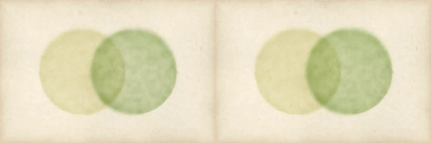

*Painted by `examples/pigments.py` (seed 11).*

*Painted by `examples/tutorial_grids.py` (figure pigments). The labels read 1 to 4 across, and multiply and glazed down.*

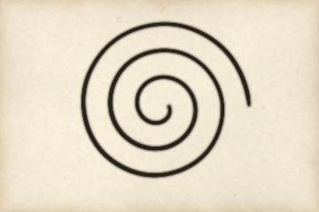

*Painted by `examples/nib_line.py` (seed 11).*

*Painted by `examples/tutorial_grids.py` (figure nib). The name is Ambleside. The labels read -38, 0 and 90 across, and 0.5 and 0.85 down.*

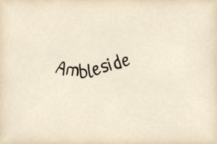

*Painted by `examples/lettering.py` (seed 7).*

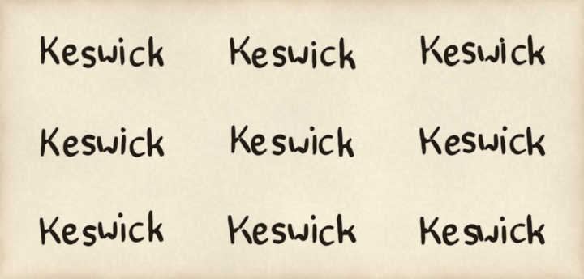

*Painted by `examples/tutorial_grids.py` (figure lettering). The name is Keswick; the nine copies are nine hand seeds.*

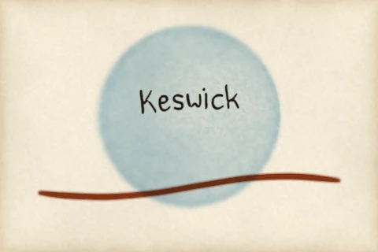

*Painted by `examples/composition.py` (seed 7).*

*Painted by `examples/tutorial_grids.py` (figure composition). The name is Keswick. The labels read seed 1, seed 2 and seed 3 across, and off and on down.*

### [First map](tutorials/first-map.md)

*Painted by `examples/route_map.py`.*

## Painting with Python

### [Curves: a rose and a spirograph in brush, a Lissajous figure in pen](tutorials/painting-with-python/curves.md)

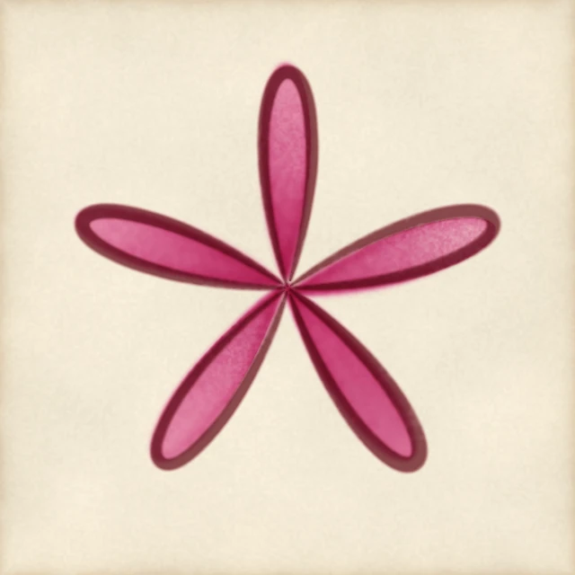

*Painted by `examples/curves.py` (seed 5, figure rose).*

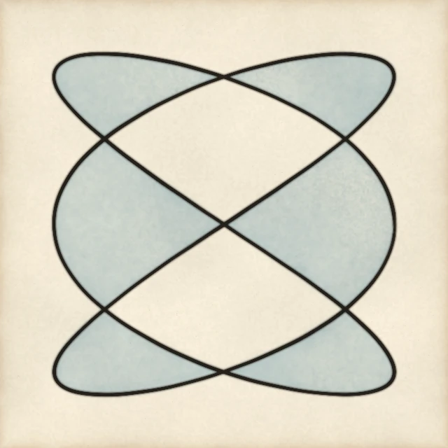

*Painted by `examples/curves.py` (seed 5, figure lissajous).*

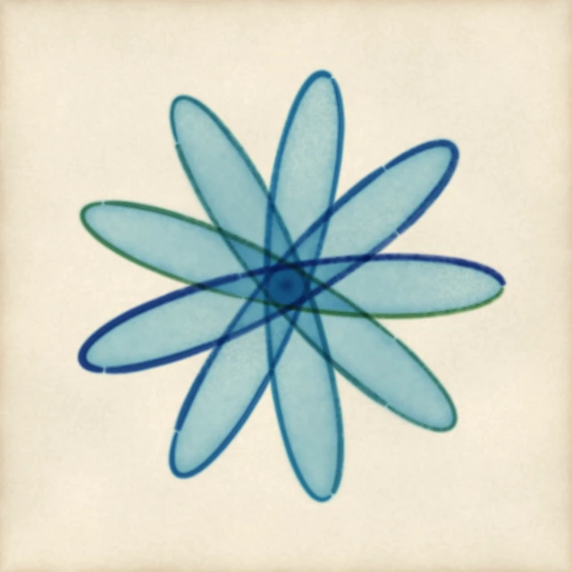

*Painted by `examples/curves.py` (seed 5, figure spirograph).*

### [Symmetry: one motif, repeated by mirror and rotation](tutorials/painting-with-python/symmetry.md)

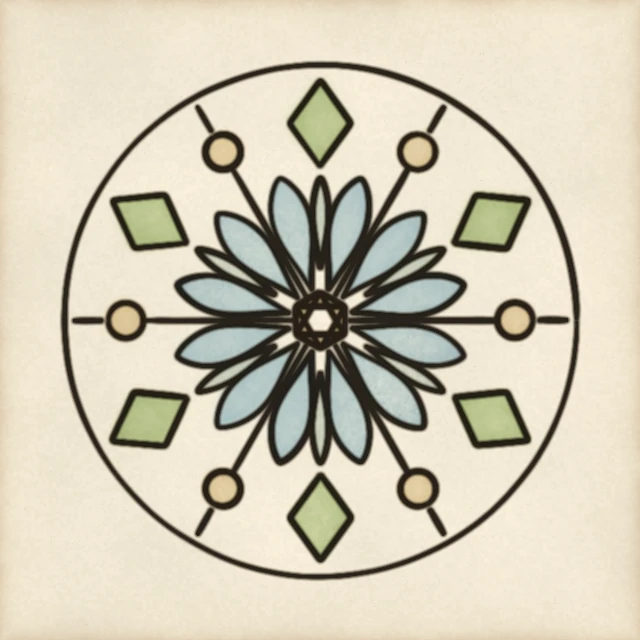

*Painted by `examples/kaleidoscope.py` (seed 9).*

### [Fractals: a fern, a family of ferns and a tree](tutorials/painting-with-python/fractals.md)

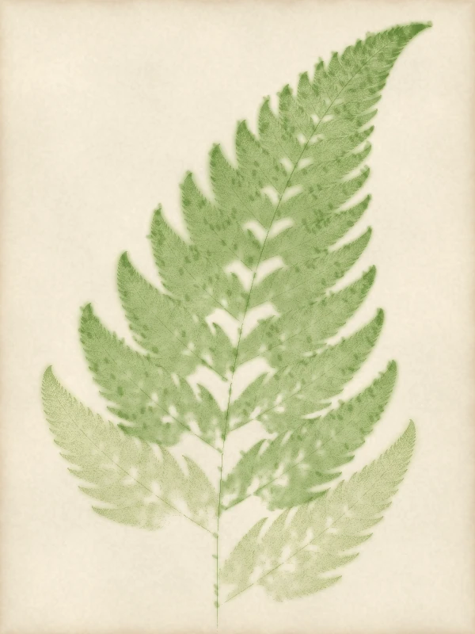

*Painted by `examples/fern.py` (seed 7).*

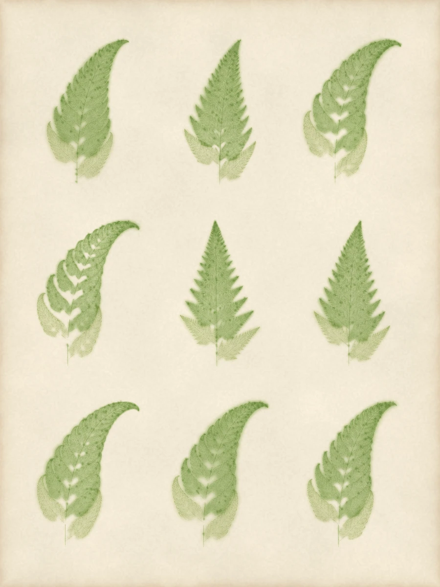

*Painted by `examples/fern_family.py` (seed 7).*

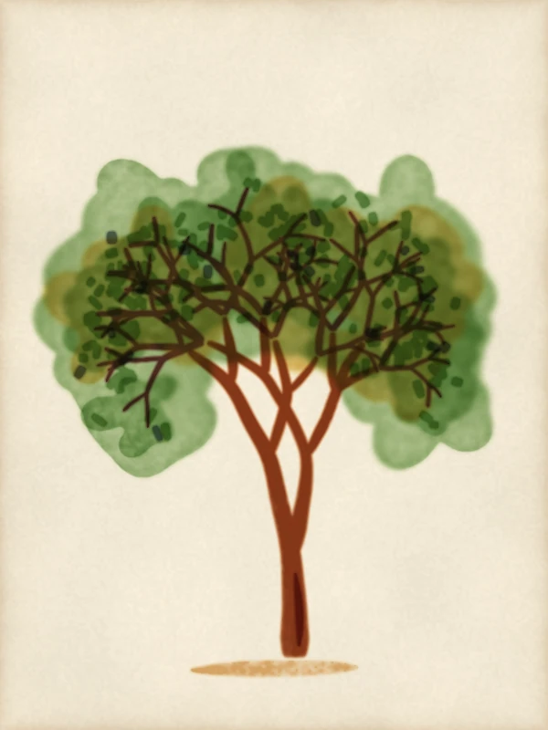

*Painted by `examples/trees.py` (seed 4, figure tree).*

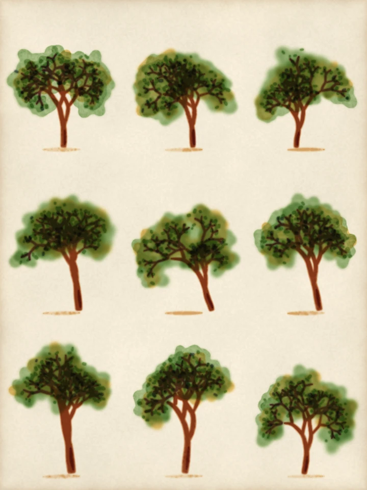

*Painted by `examples/trees.py` (seed 4, figure family).*

### [Pictures: layered hill washes and a lettered Derwentwater](tutorials/painting-with-python/pictures.md)

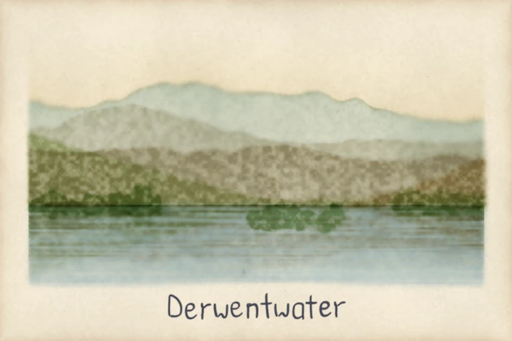

*Painted by `examples/derwentwater.py` (seed 21).*

### [Vector drawing: a small drawing, its filled shapes washed and its strokes inked](tutorials/painting-with-python/vector-drawing.md)

*Painted by `examples/svg_drawing.py` (seed 5).*

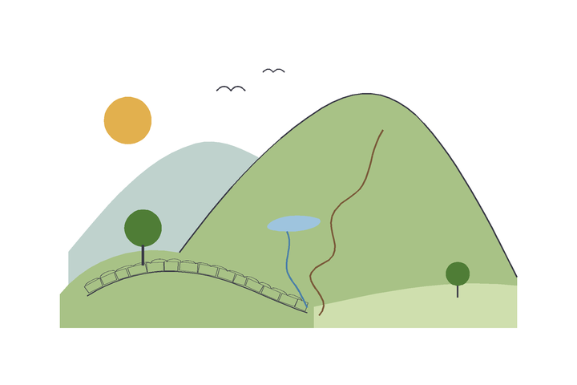

*Painted by `examples/svg_drawing.py` (seed 5, figure flat).*

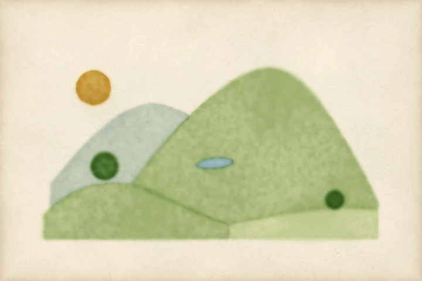

*Painted by `examples/svg_drawing.py` (seed 5, figure washes).*

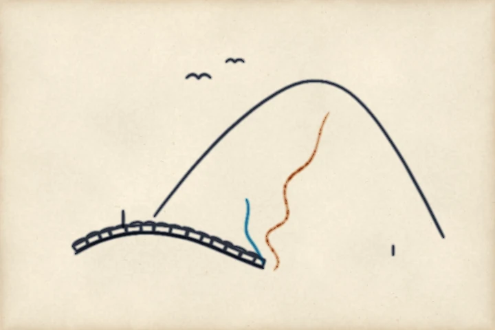

*Painted by `examples/svg_drawing.py` (seed 5, figure ink).*

### [Cased strokes: case, light and shadow one stroke, and a pen casing](tutorials/painting-with-python/cased-strokes.md)

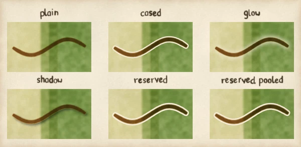

*Painted by `examples/cased_stroke.py`. The names are plain, cased, glow and shadow.*

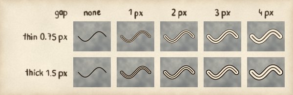

*Painted by `examples/line_effect_grids.py` (figure pen-casing). The labels read 1, 2, 3 and 4 across, and 0.75 and 1.5 down.*

## How-to guides

### [Write a theme](how-to/write-a-theme.md)

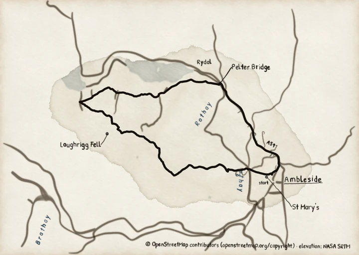

*Painted by `examples/map_styles.py` (figure pen-and-ink).*

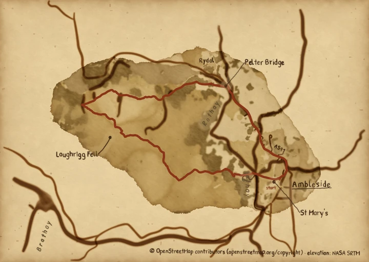

*Painted by `examples/map_styles.py` (figure sepia).*

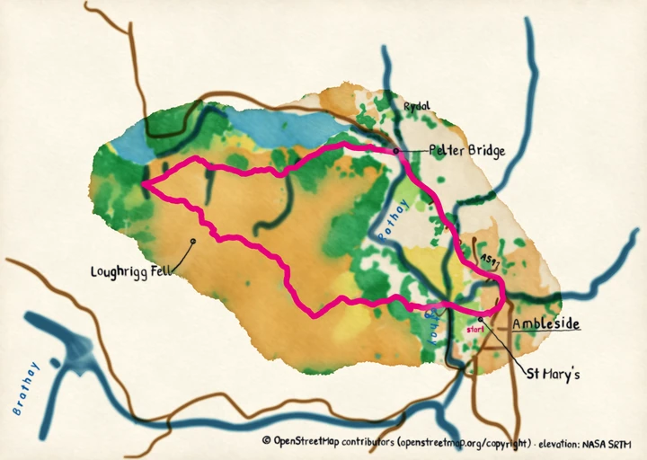

*Painted by `examples/map_styles.py` (figure bold).*

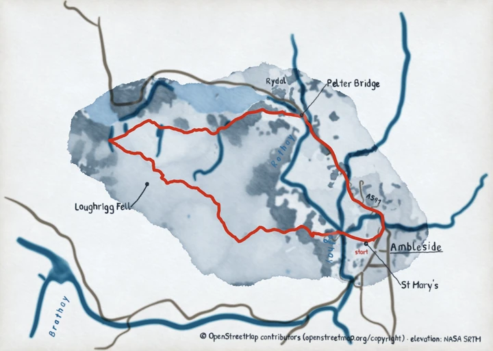

*Painted by `examples/map_styles.py` (figure winter).*

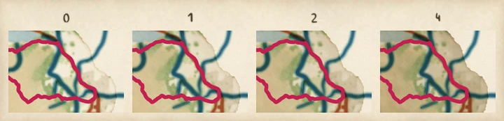

*Painted by `examples/relief_grid.py` (the Ambleside fixture, the default style). The labels read 0, 2, 4 and 8 across.*

### [Map from the command line](how-to/map-from-the-command-line.md)

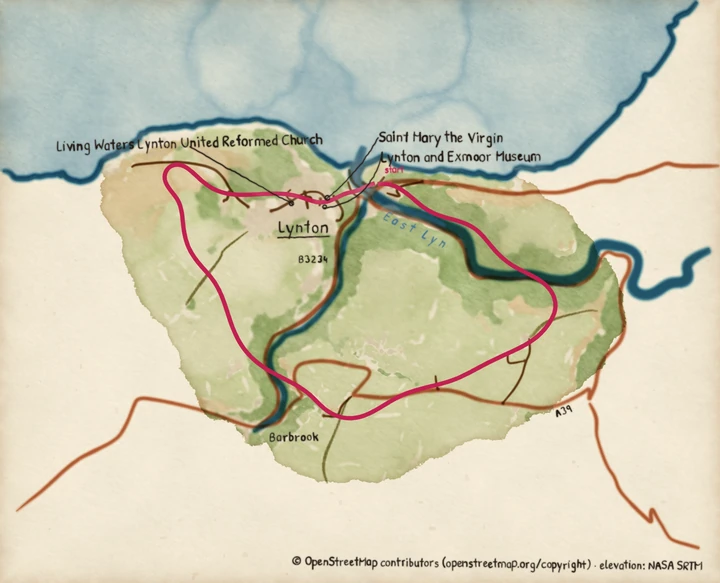

*Painted by `examples/route_map.py`, which makes the same map as the command.*

### [Change the route ink](how-to/change-the-route-ink.md)

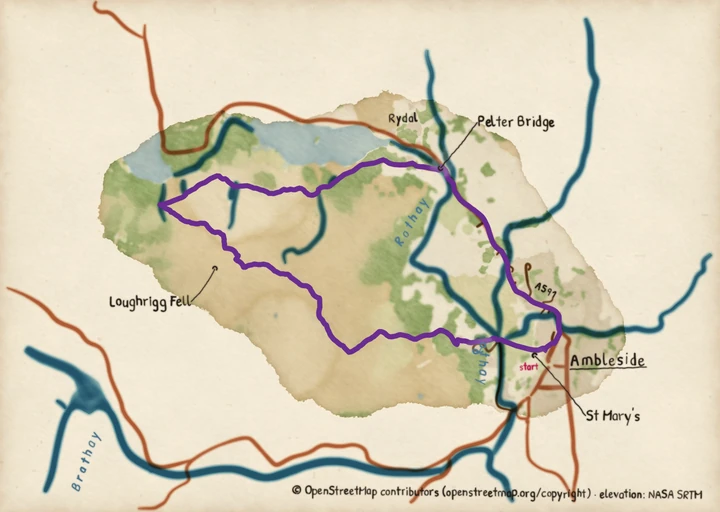

*Painted by `examples/how_to_route_ink.py`.*

*Painted by `examples/how_to_route_ink.py` (figure grid, theme `examples/themes/ambleside.yaml`). The rows are a wet pen (brush `MAJ1-e`) and a dry pen (brush `MAJ3-e`). The columns are the maroon `#7b2335`, indigo and burnt sienna, the last two from `PAINTERS_PIGMENTS`. The route is drawn in the normal blend, so it keeps its colour over water.*

### [Case, light or shadow a line](how-to/case-light-or-shadow-a-line.md)

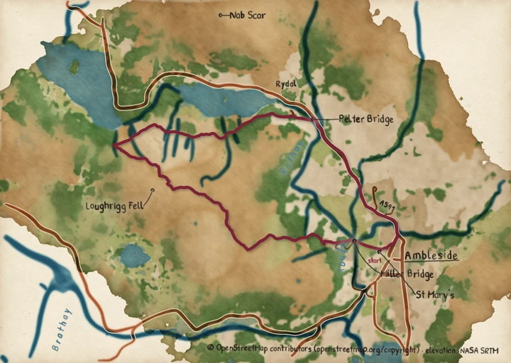

*Painted by `examples/how_to_line_effects.py` (figure card, theme `examples/themes/ambleside-cased.yaml`).*

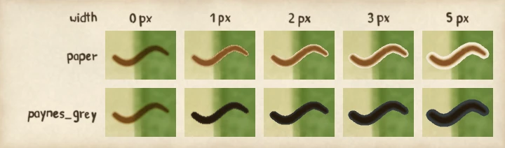

*Painted by `examples/line_effect_grids.py` (figure casing). The labels read 0, 1, 2, 3 and 5 across, and paper and paynes_grey down.*

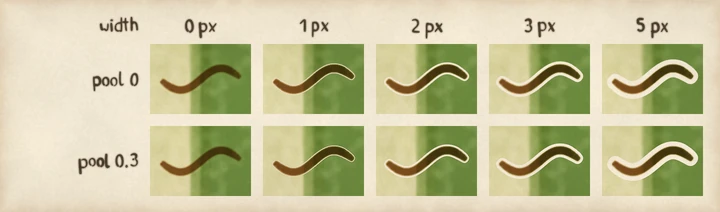

*Painted by `examples/line_effect_grids.py` (figure reserve). The labels read 0, 1, 2, 3 and 5 across, and pool 0 and pool 0.3 down.*

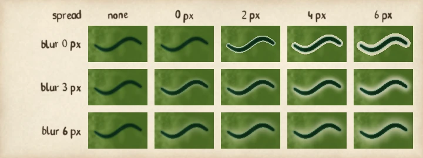

*Painted by `examples/line_effect_grids.py` (figure glow). The labels read none, 0, 2, 4 and 6 across, and 0, 3 and 6 down.*

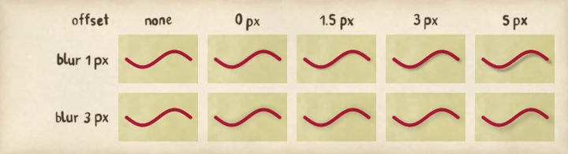

*Painted by `examples/line_effect_grids.py` (figure shadow). The labels read 0, 1.5, 3 and 5 across, and 1 and 3 down.*

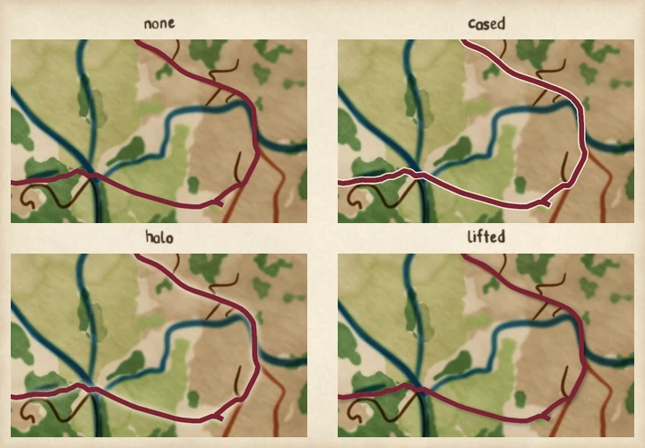

*Painted by `examples/how_to_line_effects.py` (figure presets). The names are none, cased, halo and lifted; each cell is the same close window on the loop.*

### [Letter your own landmarks](how-to/letter-your-own-landmarks.md)

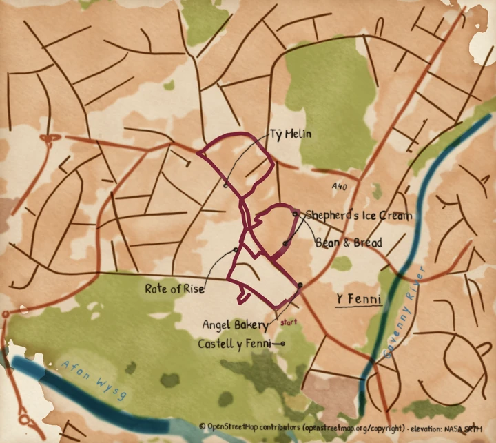

*Painted by `examples/place_card.py` with `examples/themes/y-fenni.yaml` and the landmarks of `examples/places.toml`. The landmarks are Tŷ Melin, Castell y Fenni, Angel Bakery, Bean & Bread, Rate of Rise and Shepherd's Ice Cream.*

### [Paint your own shapes](how-to/paint-your-own-shapes.md)

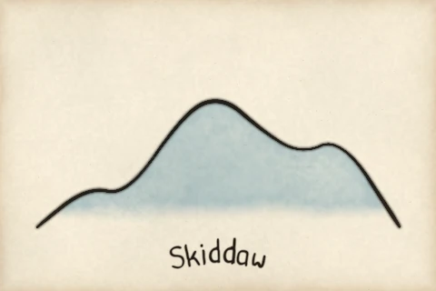

*Painted by `examples/how_to_own_shapes.py` (seed 5).*

## Reference

### [Pigments](reference/pigments.md)

*Painted by `examples/pigment_gallery.py` (`figure="roles"`), seed 7.* The labels read 0.3, 0.6 and 0.9 across, and the pigment's key down, in the order of the page's table.

### [Pigment gallery](reference/pigment-gallery.md)

*Painted by `examples/pigment_gallery.py` (`figure="painters"`), seed 7.* The labels read 0.3, 0.6 and 0.9 across, and the pigment's key down.

![Eighteen pairs of overlapping watercolour discs in three rows of six. Each column is one pair, named on two lines above it: cerulean with yellow ochre, cerulean with burnt sienna, ultramarine with yellow ochre, yellow ochre with indigo, yellow ochre with perylene maroon, and cerulean with quinacridone rose. The top row multiplies the two; the middle row glazes the first over the second and the bottom row the second over the first, and the overlap is plainly a different colour in each row: the pigment laid on top shows more of itself.](images/reference/pigment-gallery-glazes.webp)

*Painted by `examples/pigment_gallery.py` (`figure="glazes"`), seed 7.* Each column is one pair, and the rows read multiply, A over B and B over A down.

*Painted by `examples/pigment_gallery.py` (`figure="palettes"`), seed 7.* Each swatch has its alias above and the pigment it names below.

### [Brushes](reference/brushes.md)

*Painted by `examples/brush_sheet.py` (seed 11, figure grid).* The labels read the treatment numbers 1 to 8 across, the widths 3 px, 6 px and 12 px down, and wet, soft, gritty, dry, nib, pen, driest and light nib under the columns.

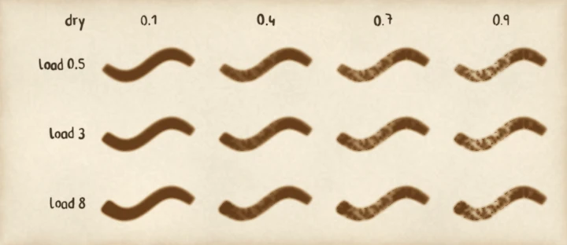

*Painted by `examples/setting_grids.py` (figure dryness). The labels read 0.1, 0.4, 0.7 and 0.9 across, and load 0.5, 3 and 8 down.*

### [Brush gallery](reference/brush-gallery.md)

*Painted by `examples/brush_gallery.py` (`figure="riv-str-lan"`), seed 7.* Each cell is lettered with its id; the treatments run 1 wet to 8 light nib down.

*Painted by `examples/brush_gallery.py` (`figure="maj"`), seed 7.* The five ink columns `a` to `e`.

*Painted by `examples/brush_gallery.py` (`figure="trk"`), seed 7.* The six ink columns `a` to `f`.

### [Letters](reference/letters.md)

*Painted by `examples/glyph_sheet.py`, seed 11, with the default face, hand, nib and ink: each glyph alone at 32 px, then running at the 14 px of a map label. Every cell and every running line is a render of its own, seeded from its character or its line, so a change to one glyph moves only its cell and the lines that hold it.*

## Explanation

### [How the wash works](explanation/how-the-wash-works.md)

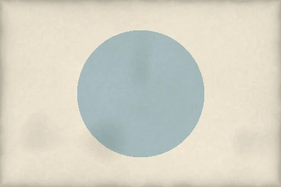

*Painted by `examples/wash_stages.py` (seed 11, figure mask, size 480).*

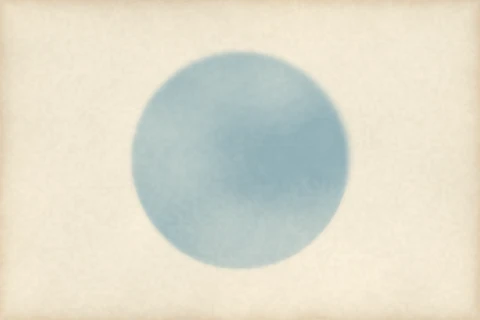

*Painted by `examples/wash_stages.py` (seed 11, figure body, size 480).*

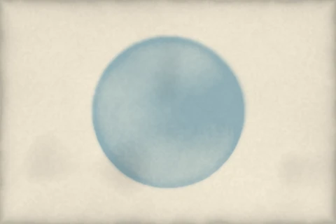

*Painted by `examples/wash_stages.py` (seed 11, figure rim, size 480).*

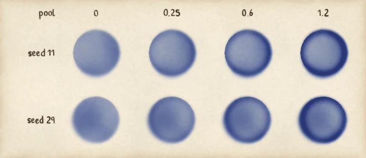

*Painted by `examples/setting_grids.py` (figure pool). The labels read 0, 0.25, 0.6 and 1.2 across, and seed 11 and seed 29 down.*

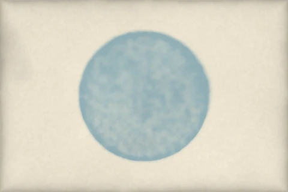

*Painted by `examples/wash_stages.py` (seed 11, figure grain, size 480).*

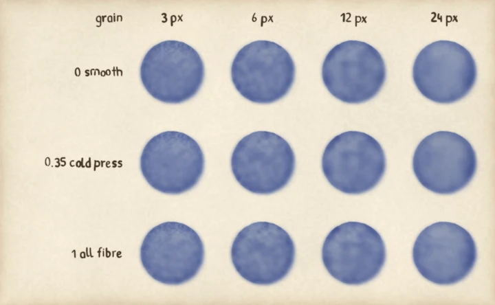

*Painted by `examples/setting_grids.py` (figure granulation). The labels read 3, 6, 12 and 24 across, and 0, 0.35 and 1 down.*

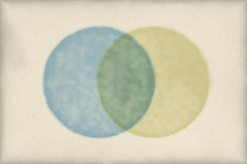

*Painted by `examples/wash_stages.py` (seed 11, figure overlap, size 480).*

*Painted by `examples/wash_stages.py` (seed 11, figure glaze, size 800). The labels read 0.04, 0.2, 0.5 and 0.9 across, and multiply and glazed down.*

### [The hand and the nib](explanation/the-hand-and-the-nib.md)

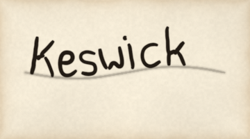

*Painted by `examples/nib_stages.py` (seed 7, figure centreline, size 360).*

*Painted by `examples/nib_stages.py` (seed 7, figure angles, size 840). The name is Keswick. The labels read -38, 0, 38 and 90 across, the nib's angle in degrees, and 0, 0.52 and 0.85 down, `label_pen_thin`.*

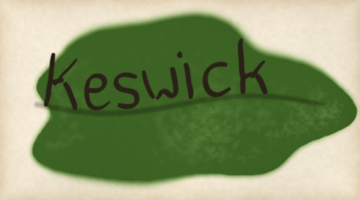

*Painted by `examples/nib_stages.py` (seed 7, figure ground, size 360).*

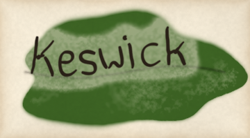

*Painted by `examples/nib_stages.py` (seed 7, figure backing, size 360).*

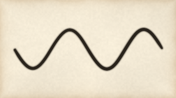

*Painted by `examples/nib_stages.py` (seed 7, figure set-down, size 360).*

*Painted by `examples/nib_stages.py` (seed 7, figure runs-dry, size 360).*

*Painted by `examples/nib_stages.py` (seed 7, figure hands, size 840). The name is Keswick; the nine copies are nine hand seeds.*

### [Line effects: why they work on colours, not as glazes](explanation/line-effects.md)

*Painted by `examples/line_effect_reasons.py` (figure glaze-or-rgb). The labels read casing and glow across, and glaze and RGB down.*

*Painted by `examples/line_effect_reasons.py` (figure draw-order). The labels read each stroke cased and casings first.*

## Places

The five showcase maps, each painted from a recorded fixture by one script, `examples/place_card.py`, in its own theme with its curated landmarks. Every route follows public OpenStreetMap ways. Each map links its fixture.

### [Ambleside, the Lake District](https://github.com/findlaywebb/pyntpot/tree/main/tests/fixtures/ambleside)

*Painted by `examples/place_card.py` with `examples/themes/ambleside.yaml`.* The hero: a fell walk. Among the names it letters are Ambleside, Grasmere, Rydal Water, Loughrigg Terrace, Loughrigg Fell, Bridge House, Rothay and Brathay; the list is not complete.

### [Skye](https://github.com/findlaywebb/pyntpot/tree/main/tests/fixtures/skye)

*Painted by `examples/place_card.py` with `examples/themes/skye.yaml`.* An island road trip with journal notes: each day of the trip is a sentence of the walker's own pinned to a point, Monday to Thursday.

### [Over Crib Goch to the summit of Yr Wyddfa, Eryri](https://github.com/findlaywebb/pyntpot/tree/main/tests/fixtures/yr-wyddfa)

*Painted by `examples/place_card.py` with `examples/themes/yr-wyddfa.yaml`.* A mountain ridge: Crib Goch, Garnedd Ugain and the lakes below them. Among the names it letters are Crib Goch, Garnedd Ugain, Glaslyn, Llyn Llydaw and Afon Nant Peris; the list is not complete.

### [Central Oxford](https://github.com/findlaywebb/pyntpot/tree/main/tests/fixtures/oxford)

*Painted by `examples/place_card.py` with `examples/themes/oxford.yaml`.* A city of colleges and bridges. Among the names it letters are Radcliffe Camera, Christ Church, Magdalen Bridge, The Bridge of Sighs, Cherwell and Thames; the list is not complete.

### [Y Fenni](https://github.com/findlaywebb/pyntpot/tree/main/tests/fixtures/y-fenni)

*Painted by `examples/place_card.py` with `examples/themes/y-fenni.yaml`.* A food tour in a Welsh-named market town: the town is lettered Y Fenni where OpenStreetMap carries the Welsh name. Among the names it letters are Tŷ Melin, Castell y Fenni, Angel Bakery, Bean & Bread, Rate of Rise, Shepherd's Ice Cream, Afon Wysg and Llan-ffwyst; the list is not complete.

## The README

The pictures that open the [README](https://github.com/findlaywebb/pyntpot#readme), and the preview GitHub shows for the repository.

*Painted by `examples/word.py`. The word is pyntpot.*

*Painted by `examples/place_card.py` (size 1200, theme `examples/themes/ambleside-hero.yaml`, place `ambleside`).*

*Painted by `examples/social_preview.py` (theme `examples/themes/ambleside-hero.yaml`, place `ambleside`). The word is pyntpot.*

### The strip of eight

The README's strip is one thumbnail for each rung of the [tutorials](tutorials/index.md), from the paper to the route map.

*Painted by `examples/paper.py` (seed 11).*

*Painted by `examples/wash.py` (seed 11).*

*Painted by `examples/brush_stroke.py` (seed 11).*

*Painted by `examples/pigments.py` (seed 11).*

*Painted by `examples/nib_line.py` (seed 11).*

*Painted by `examples/lettering.py` (seed 7).*

*Painted by `examples/composition.py` (seed 7).*

*Painted by `examples/place_card.py` in `examples/themes/ambleside.yaml`, with the curated landmarks of `examples/places.toml`.*
