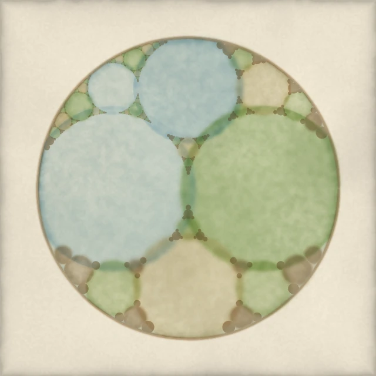
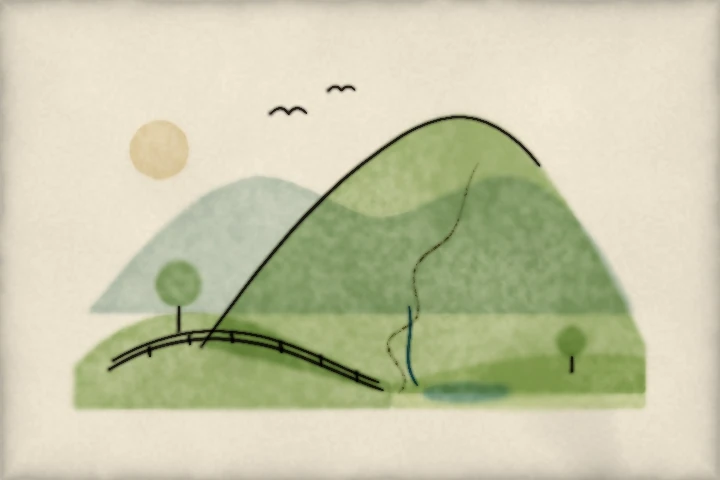

# Gallery

Every picture in these docs is painted by pyntpot from a script in `examples/`, and each is pinned to that script, so a picture here is the one the script paints. Each picture is shown under the page it illustrates; the caption names its script.

## Tutorials

### [Paint a watercolour](tutorials/paint-a-watercolour.md)

*Painted by `examples/paper.py`.*

*Painted by `examples/wash.py`.*

*Painted by `examples/brush_stroke.py`.*

*Painted by `examples/pigments.py`.*

*Painted by `examples/nib_line.py`.*

*Painted by `examples/lettering.py`.*

*Painted by `examples/composition.py`.*

### [First map](tutorials/first-map.md)

*Painted by `examples/route_map.py`.*

## Painting with Python

### [Curves: a rose, a Lissajous figure and a spirograph](tutorials/painting-with-python/curves.md)

*Painted by `examples/curves.py` (figure rose).*

*Painted by `examples/curves.py` (figure lissajous).*

*Painted by `examples/curves.py` (figure spirograph).*

### [Symmetry: one motif, repeated by mirror and rotation](tutorials/painting-with-python/symmetry.md)

*Painted by `examples/kaleidoscope.py`.*

### [Fractals: a fern and a gasket](tutorials/painting-with-python/fractals.md)

*Painted by `examples/fern.py`.*

*Painted by `examples/gasket.py`.*

### [Pictures: layered hill washes and a lettered Derwentwater](tutorials/painting-with-python/pictures.md)

*Painted by `examples/derwentwater.py`.*

### [Vector drawing: a small drawing, its filled shapes washed and its strokes inked](tutorials/painting-with-python/vector-drawing.md)

*Painted by `examples/svg_drawing.py`.*

## How-to guides

### [Write a theme](how-to/write-a-theme.md)

*Painted by `examples/map_styles.py` (figure pen-and-ink).*

*Painted by `examples/map_styles.py` (figure sepia).*

*Painted by `examples/map_styles.py` (figure bold).*

*Painted by `examples/map_styles.py` (figure winter).*

### [Change the route ink](how-to/change-the-route-ink.md)

*Painted by `examples/how_to_route_ink.py`.*

### [Paint your own shapes](how-to/paint-your-own-shapes.md)

*Painted by `examples/how_to_own_shapes.py`.*

### [Map from the command line](how-to/map-from-the-command-line.md)

*Painted by `examples/route_map.py`.*

## Reference

### [Pigments](reference/pigments.md)

*Painted by `examples/pigment_swatches.py`.*

### [Brushes](reference/brushes.md)

*Painted by `examples/brush_sheet.py`.*

## Explanation

### [How the wash works](explanation/how-the-wash-works.md)

*Painted by `examples/wash_stages.py` (figure mask, size 480).*

*Painted by `examples/wash_stages.py` (figure body, size 480).*

*Painted by `examples/wash_stages.py` (figure rim, size 480).*

*Painted by `examples/wash_stages.py` (figure grain, size 480).*

*Painted by `examples/wash_stages.py` (figure overlap, size 480).*

*Painted by `examples/wash_stages.py` (figure glaze, size 480).*

### [The hand and the nib](explanation/the-hand-and-the-nib.md)

*Painted by `examples/nib_stages.py` (figure line, size 360).*

*Painted by `examples/nib_stages.py` (figure centreline, size 360).*

*Painted by `examples/nib_stages.py` (figure broad, size 360).*

*Painted by `examples/nib_stages.py` (figure turned, size 360).*

*Painted by `examples/nib_stages.py` (figure ground, size 360).*

*Painted by `examples/nib_stages.py` (figure backing, size 360).*

*Painted by `examples/nib_stages.py` (figure set-down, size 360).*

*Painted by `examples/nib_stages.py` (figure runs-dry, size 360).*

## Places

The five focus places, each painted from a recorded fixture by one script. Every route is invented along public paths: it follows public OpenStreetMap ways, is traced from no recorded activity and marks no home or personal route. Each card links its fixture.

### [Keswick and Derwentwater](https://github.com/findlaywebb/pyntpot/tree/main/tests/fixtures/keswick)

*Painted by `examples/place_card.py`.* The card letters Keswick, Portinscale, Crosthwaite, Derwent, Greta.

### [The Quiraing, Trotternish, Skye](https://github.com/findlaywebb/pyntpot/tree/main/tests/fixtures/trotternish)

*Painted by `examples/place_card.py`.* The card letters Fir Bhreugach, Quiraing South Pinnacle, The Prison, Brogaig.

### [Over Crib Goch to the summit of Yr Wyddfa, Eryri](https://github.com/findlaywebb/pyntpot/tree/main/tests/fixtures/yr-wyddfa)

*Painted by `examples/place_card.py`.* The card letters Llanberis, Garnedd Ugain, Yr Wyddfa, Crib Goch.

### [Central Oxford](https://github.com/findlaywebb/pyntpot/tree/main/tests/fixtures/oxford)

*Painted by `examples/place_card.py`.* The card letters Christ Church, Tom Tower, Magdalen Tower, Cherwell.

### [Y Fenni](https://github.com/findlaywebb/pyntpot/tree/main/tests/fixtures/y-fenni)

*Painted by `examples/place_card.py` with `examples/themes/y-fenni.toml`.* The card letters Y Fenni, Afon Wysg, Llan-ffwyst.

## The README

The pictures that open the [README](https://github.com/findlaywebb/pyntpot#readme), and the preview GitHub shows for the repository.

*Painted by `examples/word.py`. The word is pyntpot.*

*Painted by `examples/place_card.py` (size 1200).*

*Painted by `examples/social_preview.py`. The word is pyntpot.*

### The strip of eight

The README's strip is one thumbnail for each rung of the [tutorials](tutorials/index.md), from the paper to the route map.

*Painted by `examples/paper.py`.*

*Painted by `examples/wash.py`.*

*Painted by `examples/brush_stroke.py`.*

*Painted by `examples/pigments.py`.*

*Painted by `examples/nib_line.py`.*

*Painted by `examples/lettering.py`.*

*Painted by `examples/composition.py`.*
