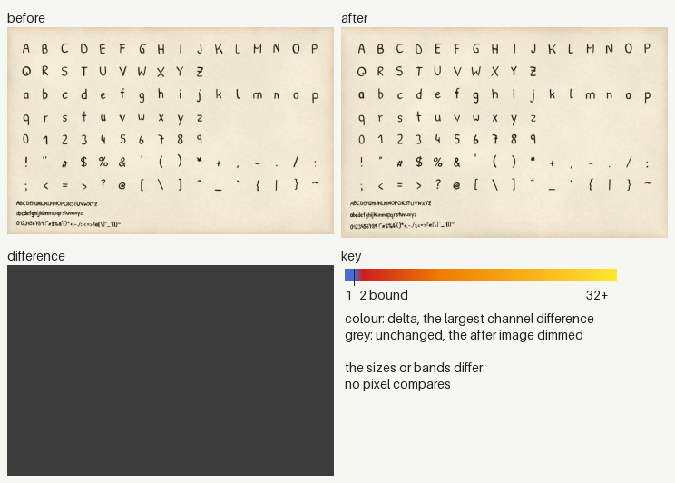
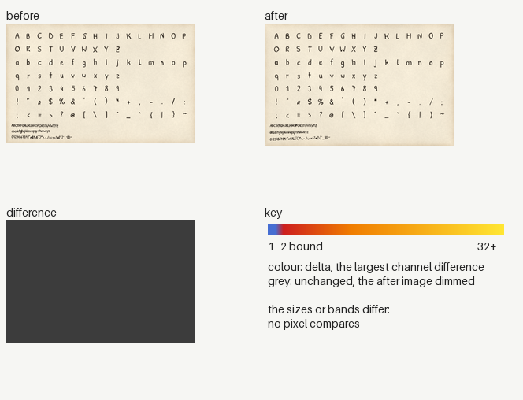

### Image changes

Before: `origin/main`. After: `working tree`. 2 changed, 0 added, 0 removed.
Changed counts the pixels past channel delta 2; the parity gate bounds it at 0.005 (ADR 0030). Local: the box covers at most a quarter of the image.

| File | Size | Changed | Max delta | Box | Extent |
|---|---|---|---|---|---|
| `docs/images/reference/glyph-sheet.webp` | 720x464 | 1.000000 (size differs) | | | widespread |
| `tests/golden/docs/reference/glyph-sheet.png` | 240x155 | 1.000000 (size differs) | | | widespread |

<code>docs/images/reference/glyph-sheet.webp</code>: widespread, 1.000000

<code>tests/golden/docs/reference/glyph-sheet.png</code>: widespread, 1.000000

