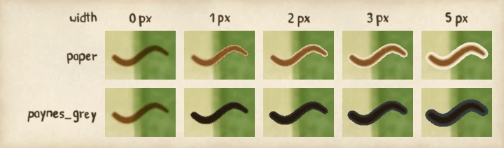
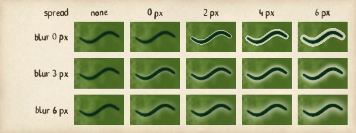
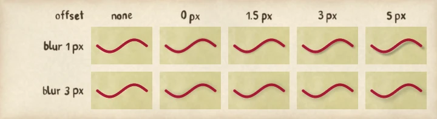

# Case, light or shadow a line

Make a line read against what it crosses: a casing round a road, a glow round a river, or a
shadow that falls from a route. Each is a line effect, set in a theme per line class.

*Painted by `examples/line_effect_grids.py` (figure casing). The labels read 0, 1, 2, 3 and 5 across, and paper and paynes_grey down. Each width is in pixels at scale 1.*

**Before you start:** you need a theme file. [Write a theme](write-a-theme.md) shows how to
make one and describes the `line_effects:` key in its "Line effects" section. A width, spread,
blur or offset in a theme is in display pixels, from 0 to 16, so the sweeps below, painted at
scale 1, show what the same number does in a theme at scale 1.

## Case a line

A casing is a ring of one colour round a line. A casing in the paper's colour cuts a road out of
a busy wash; one in a dark pigment outlines it. Casing width 0 draws nothing, and 2 or 3 pixels
reads as a ring without becoming a border. The sweep above shows both colours.

## Lift a line with a glow

A glow lifts the colours round a line toward the paper. It never darkens, and it has no colour of
its own, so it suits a river through dark woodland. A spread sets how far the hard core reaches
and a blur how softly it falls away.

*Painted by `examples/line_effect_grids.py` (figure glow). The labels read 0, 2, 4 and 6 across, and 0, 3 and 6 down. The first column has no glow. The spreads and the blurs are in pixels.*

## Cast a shadow

A shadow darkens the colours beside a line, on the side away from the light, which is the
north-west, so it falls to the south-east. It never darkens the line itself. An offset moves it
away from the line, and a blur softens its edge.

*Painted by `examples/line_effect_grids.py` (figure shadow). The labels read 0, 1.5, 3 and 5 across, and 1 and 3 down. The first column has no shadow. The offsets and the blurs are in pixels.*
