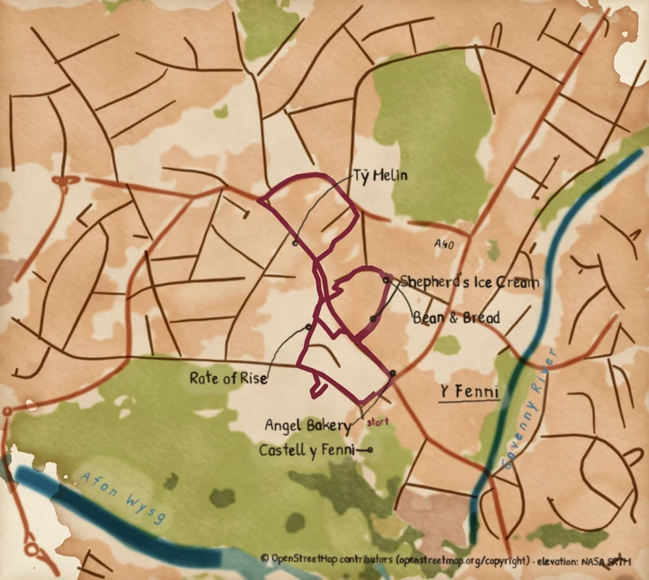

# Letter your own landmarks

Choose the names on your map yourself: the bridge you crossed, the café you stopped at,
or a shop the map data has no name for. Pass `letter` an `Annotations` value and it
letters your landmarks, even where its own ranking would have picked something else.

**Before you start:** you need a script that calls `fetch`, `paint`, `letter` and
`compose`, such as `examples/route_map.py` from the [First map](../tutorials/first-map.md)
tutorial. The command line has no option for landmarks.

## Steps

1. Write the landmarks down. A landmark is a name, lettered exactly as you write it, and the
   latitude and longitude of the thing. Take the point from OpenStreetMap: a node's own
   point, or the centre of a way. The example place maps keep theirs in
   [`examples/places.toml`](https://github.com/findlaywebb/pyntpot/blob/main/examples/places.toml),
   one table per place. This is Oxford's:

   ```toml
   [oxford]
   landmarks = [
       { name = "Radcliffe Camera", lat = 51.753461, lng = -1.254001 },
       { name = "Magdalen Bridge", lat = 51.750908, lng = -1.24568 },
       { name = "Christ Church", lat = 51.75016, lng = -1.255386 },
       { name = "The Bridge of Sighs", lat = 51.754478, lng = -1.253782 },
   ]
   ```

   Put the landmarks in priority order. The theme's `label_max` caps how many names the map
   letters, so the first ones win. The default is 3. The placer can also drop a name that
   has nowhere to sit without crossing the route.

2. Pass them to `letter` as an `Annotations` value, where the script passed `None`:

   ```python
   annotations = Annotations.model_validate({"landmarks": landmarks})
   lettering = letter(plates, basemap, annotations, style)
   ```

   `landmarks` is the list of tables from the file, read with `tomllib`. `Annotations`
   refuses a field it does not know, so a misspelt key stops the run at this line.
   `examples/place_card.py` does this, reading its place's table from `examples/places.toml`
   by the `place` option.

   `Annotations` checks each table as a `Landmark`, from `pyntpot.maps`.

3. Run the script. The plates are current in the cache, so nothing is repainted. Only the
   lettering and the composition run.

## A name the map data does not hold

A landmark does not need to be in OpenStreetMap under that name. The Y Fenni map letters
"Tŷ Melin", a bakery that the data holds only as a vacant shop at its street address. Its
entry is a name and a point like any other, with the point set by hand:

```toml
[y-fenni]
landmarks = [
    { name = "Tŷ Melin", lat = 51.8238632, lng = -3.0202249 },
    { name = "Castell y Fenni", lat = 51.819851, lng = -3.017884 },
    { name = "Angel Bakery", lat = 51.8213392, lng = -3.0171742 },
]
```

The map letters the name in the entry, accents included. A landmark with no coordinates is
looked up by name among the map's own candidates. Use that to ask for a landmark the map
already knows, without placing it yourself.

## Result



*Painted by `examples/place_card.py` with `examples/themes/y-fenni.yaml`. The landmarks are
Tŷ Melin, Castell y Fenni, Angel Bakery, Bean & Bread, Rate of Rise and Shepherd's Ice
Cream, read from `examples/places.toml`. That theme sets `label_max` to 6, so all six are
lettered.*

Run it with your track, a cache directory, an output directory and a contact. Name the
place and the theme:

```bash
uv run python examples/place_card.py y-fenni/track.gpx y-fenni/ out/ you@example.org --theme examples/themes/y-fenni.yaml --place y-fenni
```

## When it goes wrong

- `ValidationError: ... Extra inputs are not permitted`: a landmark has a key
  `Annotations` does not have. The name and the point are `name`, `lat` and `lng`.
- A landmark is missing from the map: the map letters at most `label_max` names, and the
  placer drops a name that cannot be set without crossing the route or another name. Put
  the names you most want first, or raise `label_max` in your theme
  ([Write a theme](write-a-theme.md)).
- A name sits in the wrong place: the point is where the leader line ends. Check the
  latitude and longitude against the thing itself, and that you have not swapped them.
