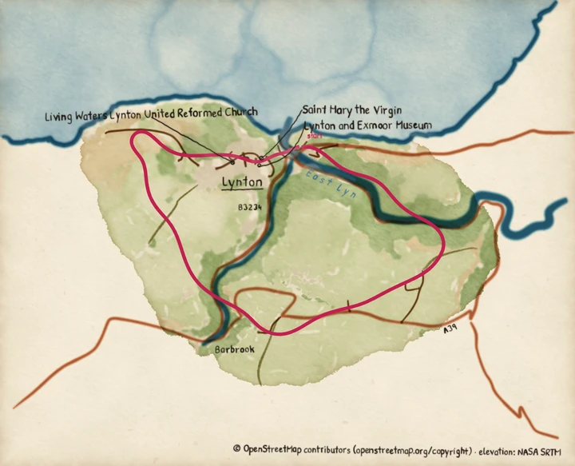

# Map from the command line

Turn a GPX file of a walk, ride or run into a painted PNG map with one command,
`pyntpot map`. No Python needed.

**Before you start:** install pyntpot, and have a GPX file with at least two track points
(`trkpt` elements). The first run needs a network connection; later runs do not.

## Steps

1. Run the command with your track, an output file, a cache directory and a contact:

   ```bash
   pyntpot map route.gpx -o out/route.png --cache cache/ --contact https://example.org/your-project
   ```

   `--contact` lets the operators of the public Overpass and OpenTopoData servers reach you
   if your requests cause them trouble. Give a web address for your project, or an email
   address. pyntpot sends it in each request's `User-Agent` and keeps it nowhere else. From
   a checkout of the repository, write `uv run pyntpot` for `pyntpot`.

2. Wait for the first run. It asks Overpass for the map features and the land cover, asks
   OpenTopoData for a grid of elevations, and paints the plates. That takes a minute or
   two, mostly pauses that the public servers ask for. The log goes to standard error:

   ```text
   cached overpass-f173b2f7a20bb9d4.json, 839288 bytes
   cached landcover-f173b2f7a20bb9d4.json, 1102966 bytes
   elevation 100/6400
   elevation 200/6400
   ...
   cached elevation-f173b2f7a20bb9d4.json, 44543 bytes
   wrote out/route.png
   ```

   The 16 characters in the file names are the cache key for your route's box. The byte
   counts differ for every route. These are the sizes of the Lynmouth track's payloads as
   the repository stores them, trimmed to what pyntpot reads, so a fresh fetch of the same
   route reports larger ones.

3. Open `out/route.png`. It is the route map: washes for the land, pen lines for roads
   and water, names lettered by hand, your route in pink and the data credit at the bottom
   right.

4. Run the same command again. The cache holds the payloads and the painted plates, so
   nothing is fetched or repainted. The map is composed in a few seconds:

   ```text
   plates in cache/plates/f173b2f7a20bb9d4 are current, nothing repainted
   wrote out/route.png
   ```

To paint in a packaged theme, add `--style` and its name, such as `--style sepia`. To
paint with your own theme, add `--style my-theme.yaml` ([Write a theme](write-a-theme.md)). To leave the credit off the map, add
`--no-attribution`. Read [Credit the map data](credit-the-map-data.md) first, because the
duty to credit is then yours.

## Result



*Painted by `examples/route_map.py`, which makes the same map as the command.*

## When it goes wrong

Find the line that matches your error.

- `pyntpot map: error: the following arguments are required: track, -o/--output, --cache, --contact`: You left out a required argument. The track, `-o`, `--cache` and `--contact` are all needed. `pyntpot map --help` lists them, and [the command line reference](../reference/cli.md) describes each.
- `pyntpot: error: the following arguments are required: command`: You ran `pyntpot` alone. Add the `map` command.
- `FileNotFoundError: [Errno 2] No such file or directory: 'route.gpx'`: The track path is wrong for the directory you ran the command in. Paths are relative to where you run it.
- `xml.etree.ElementTree.ParseError: syntax error: line 1, column 0`: The file is not GPX, or not XML at all. Open it in a text editor. A GPX file starts with `<?xml` or `<gpx`.
- `ValueError: a track needs at least two points`: The file has fewer than two `trkpt` elements. pyntpot reads track points only, so a planned route (`rte`) or waypoints (`wpt`) count as no track. Export the recorded track instead.
- `ValueError: GPX time '2026-10-24T09:30:00' has no time zone`: A point's `time` has no zone. GPX times end in `Z` or an offset such as `+01:00`. Add one, or remove the `time` elements.
- `FetchError: a provider could not answer: every Overpass endpoint refused the query`: Overpass was busy or unreachable. The log above the error says why, for example a 429 for too many requests. After a 429 pyntpot waits 30 seconds before it tries the next server. Run the same command again later. Payloads fetched before the failure are in the cache, so the rerun fetches only what is missing.
- `FetchError: a provider could not answer: opentopodata-srtm30m ...`: OpenTopoData failed after Overpass had answered. Rerun the command. The features and land cover are not fetched again. The public OpenTopoData server allows 1000 calls a day and one map takes 64, so a day of heavy use can spend them.
- `ValueError: Overpass needs a contact string, such as an email address`: `--contact` was empty. Give a web address or an email address.
- `pyntpot map: /home/you/maps/my-theme.yaml:4: wash.blom: unknown key; did you mean blooms?`: Your `--style` theme has a problem. The command prints one line per problem, each with the file, the line and the dotted key, and exits with status 2 before it fetches anything. [Write a theme](write-a-theme.md#when-a-theme-does-not-load) reads the messages.
- `pyntpot map: nope: no theme named 'nope'; available: bold, default, pen-and-ink, sepia, winter`: `--style` was given a name that is not a packaged theme. A theme file must end in `.yaml`.
- The map has no credit at the bottom right: You passed `--no-attribution`, or the picture was scaled down until you cannot read the credit. [Credit the map data](credit-the-map-data.md) says where else to put it.
