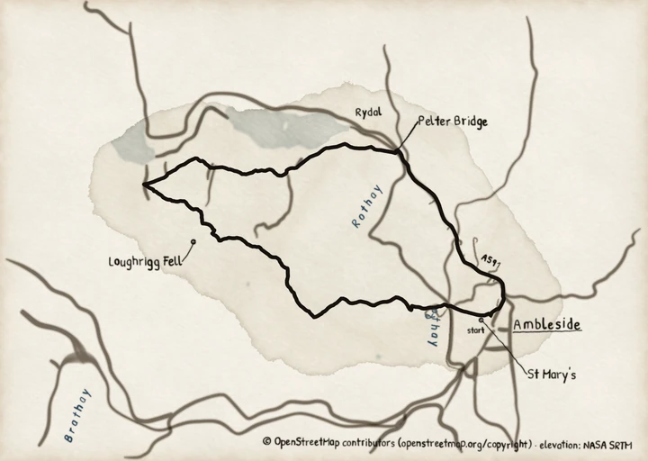
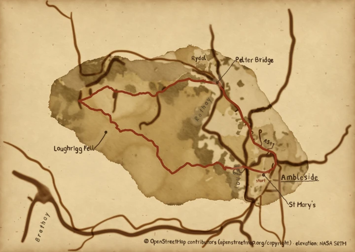
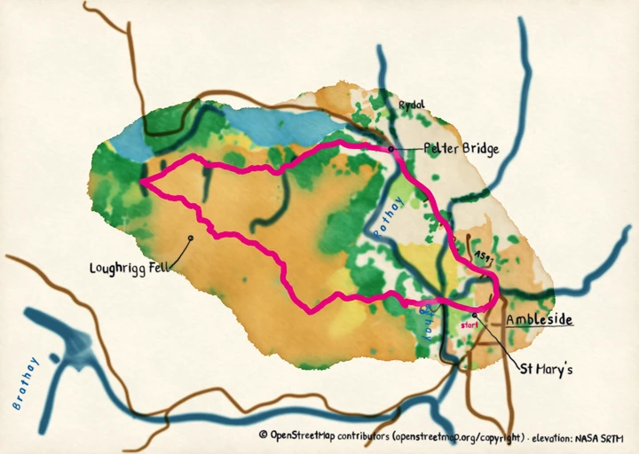
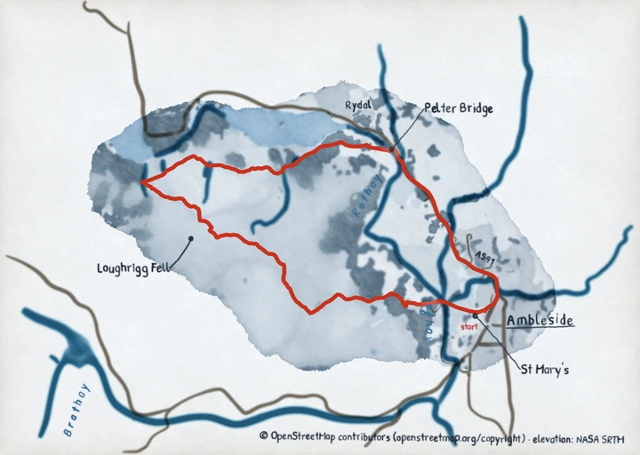

# Write a theme

A theme is a YAML file that names a base theme and gives only the style fields it changes.
Every field it leaves out keeps the base theme's value. This guide writes a theme over
`sepia`, loads it, sets up editor completion and reads a load error. You need a first map
from the [tutorial](../tutorials/index.md). Every field a theme can set is on the
[style fields](../reference/style-fields.md) page.

## Steps

1. Write `my-theme.yaml` beside your track. This one starts from the packaged `sepia`
    theme, makes the route maroon and gives the wood a greener wash:

    ```yaml
    # yaml-language-server: $schema=https://findlaywebb.github.io/pyntpot/reference/theme.schema.json
    extends: sepia
    route_ink:
      colour: "#7b2335"
    cover:
      pigments:
        wood: "#8f9f6a"
    ```

    The first line points your editor at the theme schema (see
    [Editor completion](#editor-completion)); pyntpot reads it as a comment. Quote every
    colour: in YAML an unquoted `#` starts a comment.

2. Load it, and paint with it instead of `Style.default()`:

    ```python
    from pathlib import Path

    from pyntpot.maps import Style

    style = Style.from_yaml(Path("my-theme.yaml"))
    ```

    Pass `style` to `fetch`, `paint`, `letter` and `compose`, as
    [`examples/route_map.py`](https://github.com/findlaywebb/pyntpot/blob/main/examples/route_map.py)
    does with the default. Plates painted in another style are painted again, so your
    change always shows.

    From the command line, pass the file to `--style`:

    ```bash
    pyntpot map route.gpx -o out/route.png --cache cache/ --contact https://example.org/your-project --style my-theme.yaml
    ```

3. Check that the theme took. The wood is yours and every other pigment is still sepia's:

    ```python
    style.cover.pigments["wood"]  # '#8f9f6a'
    style.cover.pigments["water"] == Style.named("sepia").cover.pigments["water"]  # True
    ```

## Choose a theme by name

The package ships five themes. `Style.themes()` lists their names:

```python
Style.themes()  # ('bold', 'default', 'pen-and-ink', 'sepia', 'winter')
```

`Style.named("sepia")` loads one by name. `default` is the default look, the same style as
`Style()` and `Style.default()`. When a value may be either a name or a file, as an
argument to your own script might be, use `Style.from_theme`: a value ending in `.yaml`
is a file, read from the current directory or from `relative_to=`, and any other value is
a name.

```python
style = Style.from_theme("sepia")
style = Style.from_theme("my-theme.yaml")
```

The command line takes a name the same way:

```bash
pyntpot map route.gpx -o out/route.png --cache cache/ --contact https://example.org/your-project --style sepia
```

## What a theme can say

- **`extends`** names the base theme: a packaged theme's name, or a `.yaml` path read from
  the directory of the file that names it. Without `extends`, the base is `default`. The
  base may extend another theme in turn, and so on down to `default`; a chain that comes
  back to a file it has already read is an error that names the cycle.
- **Groups merge.** A group you name, such as `route_ink`, keeps every field you leave
  out from the base.
- **Table fields merge per entry.** Naming `cover.pigments.wood` changes the wood and keeps
  every other pigment. An entry that is itself a table, such as `brush.brush_overrides.lane`,
  merges the same way.
- **Everything else replaces.** A number, a string, a colour or a list is taken whole:
  setting `brush.blotch_m` to `[200.0, 26.0]` sets both of its numbers.
- **Booleans are `true` and `false` only.** `no`, `yes`, `on` and `off` are strings, so
  `grid: no` is an error, not false.
- **One way to reuse a theme.** Anchors (`&`), aliases (`*`), merge keys (`<<`), tags
  (`!!str`), `%` directives, duplicate keys and a second document (`---`) are refused.
  Use `extends`.

Every key and value is checked when the theme loads, before anything is fetched: unknown
keys at every level, each value's type, the choices of a field such as `drawn_as`, brush
ids and `#rrggbb` colours.

## Editor completion

The directive line at the top of a theme names the JSON Schema for theme files:

```yaml
# yaml-language-server: $schema=https://findlaywebb.github.io/pyntpot/reference/theme.schema.json
```

1. Install an editor plugin built on the YAML language server, such as Red Hat's YAML
    extension for VS Code.
2. Open your theme. The plugin reads the directive line and fetches the schema.
3. Start a key under a group. The plugin offers the group's fields, each with its default
    and its description, and the choices of a field that has a fixed set. It underlines a
    key the group does not have.

The schema is also in the package, at `src/pyntpot/maps/themes/theme.schema.json`, if your
editor works offline: point the directive line at that file's path instead.

## When a theme does not load

`Style.from_yaml`, `Style.named` and `Style.from_theme` raise `ThemeError` with every
problem in the theme, not only the first. Take this broken copy of `my-theme.yaml`:

```yaml
# yaml-language-server: $schema=https://findlaywebb.github.io/pyntpot/reference/theme.schema.json
extends: sepia
wash:
  blom: false
paper:
  grid: no
route_ink:
  drawn_as: pne
```

Loading it ends with:

```
pyntpot.maps.theme_errors.ThemeError: /home/you/maps/my-theme.yaml:4: wash.blom: unknown key; did you mean blooms?
/home/you/maps/my-theme.yaml:6: paper.grid: 'no' is not a boolean (true or false)
/home/you/maps/my-theme.yaml:8: route_ink.drawn_as: 'pne' is not one of 'pen', 'solid'
```

Each line is one problem: the file's full path and line, the dotted key, and what is
wrong. The fixes are `blooms: false`, `grid: false` and `drawn_as: pen`. A problem in a
theme that yours extends names that theme's file. In Python, the error's `problems` holds
each as a `ThemeProblem` with its `path`, `key`, `line` and `message`.

`pyntpot map --style my-theme.yaml` prints the same lines, each after `pyntpot map: `,
and exits with status 2 before it fetches anything.

Other messages you may meet:

- **`has no value`.** The key has nothing after its colon. An unquoted colour does this,
  because `#` starts a comment: write `colour: "#7b2335"`.
- **`renamed to drawn_as`.** The key has a new name. Write the new one.
- **`anchors are not allowed; use extends`**, and the same for aliases, merge keys, tags
  and directives. Move the shared values into a theme of their own and `extends` it.
- **`no theme named 'nope'; available: bold, default, pen-and-ink, sepia, winter`.** The
  name is not a packaged theme. A file must end in `.yaml` to be read as a file.
- **`theme files end in .yaml; did you mean 'my-theme.yaml'?`** The file ends in `.yml`.
  Rename it.

## Convert a TOML theme

A `.toml` theme fails to load with `themes are YAML since ADR 0069: see 'Convert a TOML
theme' in the theme how-to`. A TOML theme holds every field, so converting it keeps only
the values that differ from the default look.

1. Save this script as `convert.py` beside `my-theme.toml`. It loads the old file's
    values, keeps the ones that differ from `Style()`, and writes them as YAML:

    ```python
    import dataclasses
    import tomllib
    from pathlib import Path

    from ruamel.yaml import YAML

    from pyntpot.maps import Style


    def changed(old, base):
        """Return the parts of `old` that differ from `base`, or None when nothing does."""
        if isinstance(old, dict):
            base = base if isinstance(base, dict) else {}
            diff = {key: changed(value, base.get(key)) for key, value in old.items()}
            return {key: value for key, value in diff.items() if value is not None} or None
        return None if old == base or (isinstance(old, list) and tuple(old) == base) else old


    old = tomllib.loads(Path("my-theme.toml").read_text())
    base = {name: dataclasses.asdict(getattr(Style(), name)) for name in Style.model_fields}
    YAML().dump(changed(old, base) or {}, Path("my-theme.yaml"))
    ```

2. Run it with `python convert.py`, or `uv run python convert.py` from a checkout.
3. Add the directive line from [Editor completion](#editor-completion) at the top of
    `my-theme.yaml`.
4. Load the new file with `Style.from_yaml`. If it reports `route_ink.style: renamed to
    drawn_as`, rename that key to `drawn_as`, or delete the line when its value is `solid`,
    the default.

The new file extends `default`. If the old theme was a copy of one of the packaged themes
with a few changes, add `extends: sepia` (or that theme's name) and delete the lines that
match it.

## Four packaged themes

`pen-and-ink`, `sepia`, `bold` and `winter` are override files in
[`src/pyntpot/maps/themes/`](https://github.com/findlaywebb/pyntpot/tree/main/src/pyntpot/maps/themes/),
each over the default.
[`examples/map_styles.py`](https://github.com/findlaywebb/pyntpot/blob/main/examples/map_styles.py)
paints the Ambleside route in one of them. Read the files beside the pictures to see what
each changes, or pass the name to `--style`.

### Pen and ink



*Painted by `examples/map_styles.py` with `figure="pen-and-ink"`.*

The colour washes are off. `land_cover` is false in `cover`, so the land takes pale grey
tints. `brush.brushes` picks other brushes for the roads and rivers, `brush.river_mult`
thins the rivers, and `route_ink` makes the route black. Its file is
`src/pyntpot/maps/themes/pen-and-ink.yaml`; paint with it by `--style pen-and-ink`.

### Sepia



*Painted by `examples/map_styles.py` with `figure="sepia"`.*

The `paper` group yellows the paper and raises the wear, the foxing and the vignette.
Every pigment in `cover.pigments` is a faded brown or ochre. The brush ids in
`brush.brushes` differ from the default's, and the rivers and roads come out brown. Its
file is `src/pyntpot/maps/themes/sepia.yaml`; paint with it by `--style sepia`.

### Bold



*Painted by `examples/map_styles.py` with `figure="bold"`.*

The pigments in `cover.pigments` are saturated, and `paper.pigment_transparency` is
lower, so they lay down denser. `brush.river_mult` widens the rivers. `nib` letters larger
and heavier. `route_ink` makes the route magenta and 8 pixels wide. Its file is
`src/pyntpot/maps/themes/bold.yaml`; paint with it by `--style bold`.

### Winter



*Painted by `examples/map_styles.py` with `figure="winter"`.*

The paper is a pale blue-white without foxing, and the pigments are greys and blues. The
roads are grey-brown. The route is the one warm colour on the map. Its file is
`src/pyntpot/maps/themes/winter.yaml`; paint with it by `--style winter`.
