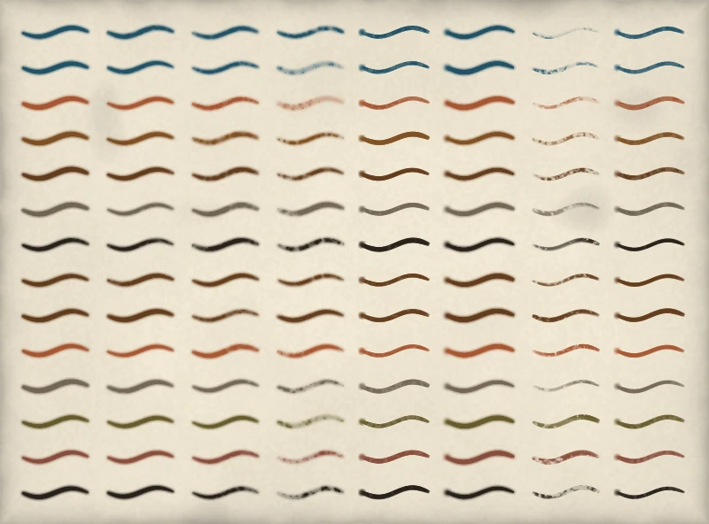

# Brushes

A brush is one mark-making tool, in render pixels: a tip of bristles stamped along a path. The brush sheet is the catalogue of brush cells. This page lists every brush id and what a row and a column of the sheet set. `brush_from_id` from `pyntpot.ink` builds a brush from an id.

*Painted by `examples/brush_sheet.py`, seed 11.* Every brush is stroked at 4 pixels wide. Each image row is one prefix and colour column from the table below; its eight strokes are treatments 1 to 8, left to right.

## Id form

A brush id is `<PREFIX><row>-<column>`, such as `MAJ2-a`: a three-letter prefix, a treatment row `1` to `8`, a hyphen and an ink colour column. The id is an opaque cell name. Which line class takes which cell is the style's `brushes` field, and the prefix is not read as a feature class. An id naming a row or a column the sheet lacks raises `ValueError`.

## Treatment rows

The row sets how the brush behaves. Widths are not part of a row: they come from `BrushStyle`.

| Row | Darkness | Bristles | Gap | Dry | Texture | Kind |
| --- | --- | --- | --- | --- | --- | --- |
| `1` | 1.8 | 26 | 0.03 | 0.15 | 0.32 | brush |
| `2` | 2.0 | 22 | 0.09 | 0.3 | 0.42 | brush |
| `3` | 2.4 | 16 | 0.14 | 0.42 | 0.55 | brush |
| `4` | 4.8 | 18 | 0.28 | 0.72 | 0.82 | brush |
| `5` | 7.2 | 5 | 0.04 | 0.22 | 0.4 | nib |
| `6` | 6.0 | 6 | 0.0 | 0.1 | 0.16 | nib |
| `7` | 7.4 | 8 | 0.44 | 0.82 | 0.86 | brush |
| `8` | 6.4 | 4 | 0.02 | 0.2 | 0.36 | nib |

- `Darkness` is the ink laid per stamp. `Bristles` is the number of tines across the tip. `Gap` is the share of bristles missing. `Dry` runs from 0, a loaded wet brush, to 1, bone dry. `Texture` is how much the bristles show.
- The rows `5`, `6` and `8` are a nib: a flat core, a touch-down blot, and a line that thins rather than breaking when it runs low. The others are brushes.
- Row `1` is the wet treatment. Rows `4` and `7` are the driest.
- `BrushStyle`'s `brush_overrides` can replace a treatment's values for one class.

## Ink colours

The colour column is read from the id's prefix.

| Prefix | Columns |
| --- | --- |
| `RIV` | `a` #255d80 |
| `STR` | `a` #255d80 |
| `MAJ` | `a` #b5623f `b` #8a5a2c `c` #6b4423 `d` #7b7266 `e` #2b2620 |
| `LAN` | `a` #6b4423 |
| `TRK` | `a` #6b4423 `b` #b5623f `c` #7d7468 `d` #6f6636 `e` #95584a `f` #2b2620 |

## Ids

| Image row | Prefix | Column | Ink | Ids, treatments 1 to 8 |
| --- | --- | --- | --- | --- |
| 1 | `RIV` | `a` | #255d80 | `RIV1-a`, `RIV2-a`, `RIV3-a`, `RIV4-a`, `RIV5-a`, `RIV6-a`, `RIV7-a`, `RIV8-a` |
| 2 | `STR` | `a` | #255d80 | `STR1-a`, `STR2-a`, `STR3-a`, `STR4-a`, `STR5-a`, `STR6-a`, `STR7-a`, `STR8-a` |
| 3 | `MAJ` | `a` | #b5623f | `MAJ1-a`, `MAJ2-a`, `MAJ3-a`, `MAJ4-a`, `MAJ5-a`, `MAJ6-a`, `MAJ7-a`, `MAJ8-a` |
| 4 | `MAJ` | `b` | #8a5a2c | `MAJ1-b`, `MAJ2-b`, `MAJ3-b`, `MAJ4-b`, `MAJ5-b`, `MAJ6-b`, `MAJ7-b`, `MAJ8-b` |
| 5 | `MAJ` | `c` | #6b4423 | `MAJ1-c`, `MAJ2-c`, `MAJ3-c`, `MAJ4-c`, `MAJ5-c`, `MAJ6-c`, `MAJ7-c`, `MAJ8-c` |
| 6 | `MAJ` | `d` | #7b7266 | `MAJ1-d`, `MAJ2-d`, `MAJ3-d`, `MAJ4-d`, `MAJ5-d`, `MAJ6-d`, `MAJ7-d`, `MAJ8-d` |
| 7 | `MAJ` | `e` | #2b2620 | `MAJ1-e`, `MAJ2-e`, `MAJ3-e`, `MAJ4-e`, `MAJ5-e`, `MAJ6-e`, `MAJ7-e`, `MAJ8-e` |
| 8 | `LAN` | `a` | #6b4423 | `LAN1-a`, `LAN2-a`, `LAN3-a`, `LAN4-a`, `LAN5-a`, `LAN6-a`, `LAN7-a`, `LAN8-a` |
| 9 | `TRK` | `a` | #6b4423 | `TRK1-a`, `TRK2-a`, `TRK3-a`, `TRK4-a`, `TRK5-a`, `TRK6-a`, `TRK7-a`, `TRK8-a` |
| 10 | `TRK` | `b` | #b5623f | `TRK1-b`, `TRK2-b`, `TRK3-b`, `TRK4-b`, `TRK5-b`, `TRK6-b`, `TRK7-b`, `TRK8-b` |
| 11 | `TRK` | `c` | #7d7468 | `TRK1-c`, `TRK2-c`, `TRK3-c`, `TRK4-c`, `TRK5-c`, `TRK6-c`, `TRK7-c`, `TRK8-c` |
| 12 | `TRK` | `d` | #6f6636 | `TRK1-d`, `TRK2-d`, `TRK3-d`, `TRK4-d`, `TRK5-d`, `TRK6-d`, `TRK7-d`, `TRK8-d` |
| 13 | `TRK` | `e` | #95584a | `TRK1-e`, `TRK2-e`, `TRK3-e`, `TRK4-e`, `TRK5-e`, `TRK6-e`, `TRK7-e`, `TRK8-e` |
| 14 | `TRK` | `f` | #2b2620 | `TRK1-f`, `TRK2-f`, `TRK3-f`, `TRK4-f`, `TRK5-f`, `TRK6-f`, `TRK7-f`, `TRK8-f` |

## Ids the default style uses

| Class | Id |
| --- | --- |
| `major` | `RIV1-a` |
| `medium` | `STR2-a` |
| `minor` | `STR3-a` |
| `coast` | `STR2-a` |
| `road_major` | `MAJ2-a` |
| `lane` | `LAN5-a` |
| `track` | `TRK4-d` |

The route's pen and the lettering's nib use `MAJ6-e`. See [Style fields](style-fields.md).
