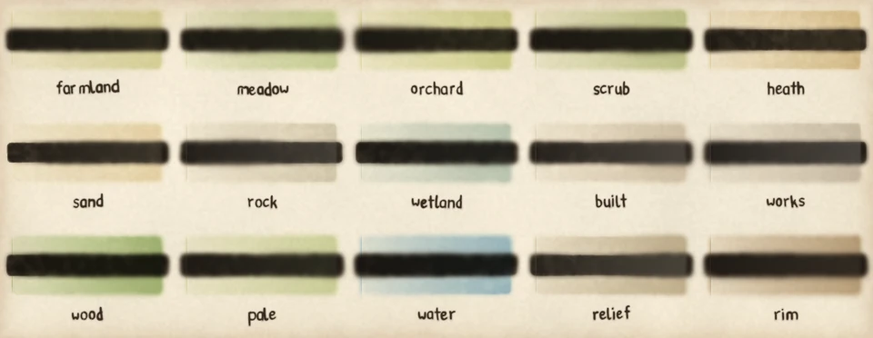

# Pigments

A pigment is a colour a wash or a mark lays, named by its key. This page lists every key of `PIGMENTS` and `TRANSPARENCY` from `pyntpot.ink`.

Painted by `examples/pigment_swatches.py`, seed 11. The discs read left to right, top to bottom, in the order of the table.

## Entries

`PIGMENTS` maps each key to the colour a full-strength wash of that pigment transmits, as `#rrggbb`. `TRANSPARENCY` maps each key to what the pigment shows over black as a share of what it shows over white. Near 0 is a staining glaze that lets the layer under it through; near 1 is a covering body colour. Only Kubelka-Munk glazing (`PaperStyle.km_glazing`) reads the transparency; multiply ignores it.

| Disc | Key | Colour | Transparency |
| --- | --- | --- | --- |
| 1 | `farmland` | `#dfe0b0` | 0.10 |
| 2 | `meadow` | `#cfdfae` | 0.09 |
| 3 | `orchard` | `#d5dda2` | 0.09 |
| 4 | `scrub` | `#c9d5a4` | 0.08 |
| 5 | `heath` | `#e0cda2` | 0.14 |
| 6 | `sand` | `#ecdfbe` | 0.16 |
| 7 | `rock` | `#dcd6c6` | 0.22 |
| 8 | `wetland` | `#bfd2cd` | 0.08 |
| 9 | `built` | `#ddd3c3` | 0.26 |
| 10 | `works` | `#d2cbc0` | 0.28 |
| 11 | `wood` | `#a8c286` | 0.05 |
| 12 | `pale` | `#d5e0b4` | 0.12 |
| 13 | `water` | `#9ec4de` | 0.04 |
| 14 | `relief` | `#c9bda4` | 0.30 |
| 15 | `rim` | `#c2ad91` | 0.18 |

## Where the keys are used

- The cover classes `farmland`, `meadow`, `orchard`, `scrub`, `heath`, `sand`, `rock`, `wetland`, `built`, `works` and `wood` are the land cover classes the basemap paints.
- `pale` is the single wash laid instead of the classes when `land_cover` is off.
- `water`, `relief` and `rim` colour the water, the relief and the pooled edge inside a wash's tear.
- `CoverStyle.pigments` and `PaperStyle.pigment_transparency` hold the same keys as the style's own fields. See [Style fields](style-fields.md).

## What the table does not hold

An unnamed pigment takes `PaperStyle.km_transparency`. The inks are not pigments: a mark's colour comes from its brush id. See [Brushes](brushes.md).
