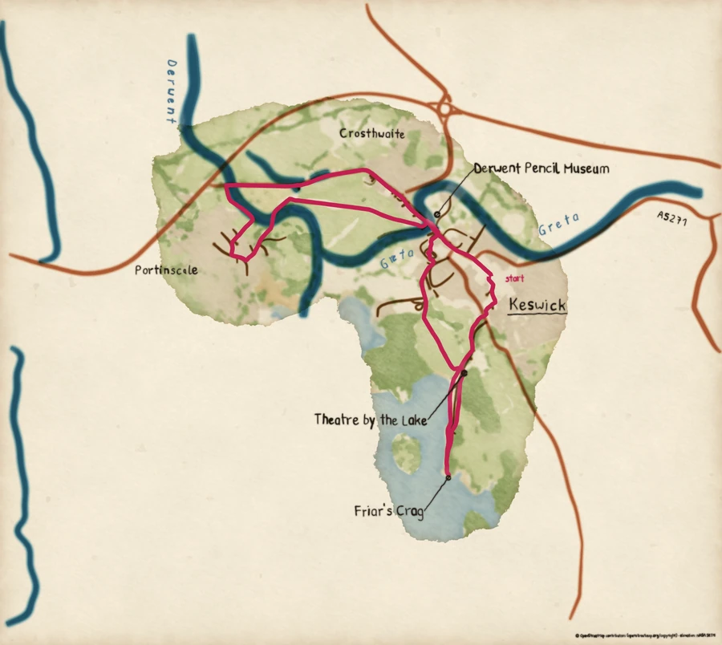

# First map



*Painted by `examples/route_map.py`.*

You have painted a paper, a wash, a brush, two pigments, a pen and a hand. This rung
asks the same of real country. You give the script a GPX track, and it fetches the
roads, rivers, woods and heights round the route, then lays the paper and washes, pulls
the brushes, takes up the pen and letters the names, in the order you have just learned.
The result is a card: one painted picture of one walk.

Nothing in the painting is new. What is new is that the shapes now come from
OpenStreetMap's data and from an elevation grid, and the engine has to decide where
each name can sit without crossing the route.

Do [Paint a watercolour](paint-a-watercolour.md) first if you have not, so that the
names below are familiar.

## Fetch the Keswick files

The first map paints a short loop round Keswick in the Lake District, from files you
download once. They are four, kept in the repository's
[`tests/fixtures/keswick`](https://github.com/findlaywebb/pyntpot/tree/main/tests/fixtures/keswick)
directory:

| File | What it holds |
| --- | --- |
| `track.gpx` | The route: a loop through Keswick and out along Derwentwater. It was made for the repository and follows public paths; it records nobody's walk. |
| `overpass-f2f4692b66d96eb9.json` | The map features round the route, as OpenStreetMap's Overpass service returned them. |
| `landcover-f2f4692b66d96eb9.json` | The land cover round the route, from the same service. |
| `elevation-f2f4692b66d96eb9.json` | The heights, as OpenTopoData returned them. |

Make a directory called `keswick` in the repository's top directory and fetch the four
files into it:

```console
$ mkdir keswick
$ cd keswick
$ for f in track.gpx overpass-f2f4692b66d96eb9.json landcover-f2f4692b66d96eb9.json elevation-f2f4692b66d96eb9.json; do
>   curl -fsSLO "https://raw.githubusercontent.com/findlaywebb/pyntpot/main/tests/fixtures/keswick/$f"
> done
$ cd ..
```

Keep the three data files' names exactly as they are. Each name ends in the fetch cache's
key for this track and these providers, and that is how the cache finds a payload it
already holds. With all three in the directory, the cache holds everything the first map
needs, and the script sends no request at all.

## Paint it from the cache

Run the script with the track, the directory that holds the cache, a directory to write
into and a contact:

```console
$ uv run python examples/route_map.py keswick/track.gpx keswick/ out/ you@example.org
INFO:__main__:wrote out/map.png
```

The contact is a placeholder here. The command line asks for one on every run because
it is what the public servers see when you fetch from them. Nothing has been fetched,
so nothing is sent. The first run takes a minute or two, because it paints every plate
of the card. The cache keeps them, in a `plates` directory beside the payloads, and a
later run reads them instead of painting again.

Open `out/map.png`. It is the picture at the top of this page. Here is the script's
`main`:

<!-- from examples/route_map.py -->
```python
def main(
    out_dir: Path,
    *,
    track: Path,
    cache_dir: Path,
    features: OverpassFeatures,
    elevation: OpenTopoData,
) -> Path:
    """Fetch what the cache lacks for a track, paint, letter and compose it, and save the card.

    Args:
        out_dir: Where `map.png` is written; created when missing.
        track: The GPX file of the route.
        cache_dir: The fetch cache: provider payloads, and the plates painted from them.
        features: The map feature and land cover provider.
        elevation: The elevation provider.

    Returns:
        The path of the saved card, `out_dir / "map.png"`.
    """
    route = Track.from_gpx(track)
    cache = Cache(cache_dir)
    style = Style.default()
    basemap = fetch(route, cache, features, elevation, style)
    plates = paint(basemap, style, cache.plates_dir(cache.key(route, features, elevation)))
    lettering = letter(plates, basemap, None, style)
    card = compose(plates, lettering, basemap, style)
    out_dir.mkdir(parents=True, exist_ok=True)
    path = out_dir / "map.png"
    card.save(path)
    log.info("wrote %s", path)
    return path
```

Read it as the four stages it is:

1. `Track.from_gpx` reads the route.
2. `fetch` builds the basemap. It asks the cache first, and the providers only for what
   the cache lacks: `OverpassFeatures` for the features and land cover, `OpenTopoData`
   for the elevation.
3. `paint` lays the paper, the washes and the pen plates in the `Style.default()` look.
   `letter` places the names and writes them with the hand.
4. `compose` stacks the plates and the lettering into one card, with the credit the data's
   licences ask for drawn at its foot.

### What to notice

- The land is washed, not filled. The greens and creams are laid as washes with the
  edge darkening and the grain you met in the second rung, and the lake lies in soft
  blue at the bottom of the card.
- The rivers are wet blue brush strokes, the Derwent and the Greta, and the roads are
  rust-coloured strokes. They are the brushes you pulled on the third rung, each chosen
  for what it draws.
- The route is a pink line, laid last over the washes and the roads, so it reads as the
  one thing on the card that was drawn on purpose.
- The names are in the hand's writing: "Keswick", "Portinscale", "Crosthwaite", "Derwent
  Bridge", "Lake Road Chapel", "The Retro Zone". The river names follow the water's
  curve, "Derwent" and "Greta", and "A5271" runs along its road. Each name is tried in
  several places and set where it crosses the least.
- At the foot, small lettering credits OpenStreetMap, whose data the card is made from.

**Try changing** the command to the one the package installs. It reads the same cache,
finds the plates already painted, says so and writes the card in a few seconds:

```console
$ uv run pyntpot map keswick/track.gpx -o out/keswick.png --cache keswick/ --contact you@example.org
```

## Paint your own track

Now a track of your own, a GPX file of a walk or a ride. The Keswick fixture's files are
a recording; the public services are where yours will come from. Two things change:

- The cache will be empty for your track, so the first run fetches from the public
  Overpass and OpenTopoData servers. They are free, shared and rate-limited. The first
  run therefore takes longer, and the shipped providers keep to the servers' usage
  limits: one request at a time, a pause when a server says it is busy, and a cap on
  how many queries one run may send.
- The contact is no longer a placeholder. It is how the servers' operators reach whoever
  is sending requests, should they ever need to, so give a way of reaching you that you
  are content for them to see: a web address for your project, for example. It is sent
  with every request and is not part of the cache's key.

With the command the package installs, from the top of the repository:

```console
$ uv run pyntpot map my-walk.gpx -o out/my-walk.png --cache cache/ --contact "you@example.org"
```

Replace `you@example.org` with your own contact. The command fills `cache/` with the
payloads your track lacks, paints, letters and writes the card. Run it a second time
and nothing is fetched. `--style` takes a TOML theme if you would like another look, and
`--no-attribution` leaves the credit off the card; if you publish the card, leave it on.

If you prefer the script, it takes the same pieces in the same order:

```console
$ uv run python examples/route_map.py my-walk.gpx cache/ out/ "you@example.org"
```

Your track is read from the file you give and not copied anywhere. The two public
servers see the box your track covers, with a margin, and your contact; they do not
see the track itself.

## Where next

The card you painted is the engine's first application, and every layer of it is one
you have already used. Open `examples/route_map.py` beside `examples/composition.py`: they
are the same work at two scales.
