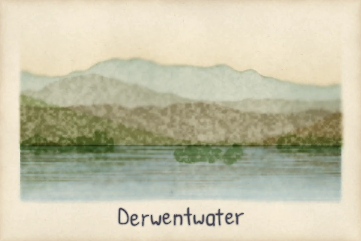

# Pictures: layered hill washes and a lettered Derwentwater

You paint a Lake District view in one script: five washes of hill receding into mist, a
lake with a faint reflection of them, a wooded island, and the name written by hand
beneath. Nothing here is a map. Every shape is a numpy mask, and `wash` turns each one
into pigment.



*Painted by `examples/derwentwater.py`, seed 21.*

The picture reads "Derwentwater". Run the script:

```bash
uv run python examples/derwentwater.py out/
```

It writes `out/derwentwater.png` and the nib plate `out/derwentwater-plate.webp`. Every
seed is fixed, so you get the same picture each time. `--size` sets the width in pixels,
and the height is two thirds of it.

## Paint far to near

A ridge is a line, not a shape. The script draws each one from a few seeded sines for the
broad fells, plus some fast, small ones for the crags. The mask is the ground below the
line, down to the shore:

```python
cover = ((yy >= ridge[None, :]) & (yy < shore + 2) & inside).astype(np.float32)
dens = wash(cover, sheet, crest, 0.25)
```

`inside` is the picture less its side margins, so no wash reaches the left or right edge.
`crest` is the density of the flat body of the wash. `0.25` is the extra pigment that
pools at its edge.

The three fells and two banks are painted in order, far to near. Each has its own
pigment from `PIGMENTS`: `wetland`, `rock` and `relief` for the fells, and `scrub` and
`heath` for the banks that frame the lake. The default `PaperStyle` composites by
multiplying, so a pixel under two washes is darker than under one. The far fell has only
its own wash and is pale. The near banks sit on the washes before them and are darker.
Nothing darkens a hill by hand.

Two touches finish each hill. The density fades towards its foot, where mist lies:

```python
mist = 0.62 + 0.38 * np.exp(-np.clip(yy - ridge[None, :], 0, None) / (0.14 * h))
```

The nearer hills also granulate. `wash` has its own granulation. The script adds more by
scaling the density with the sheet's `gran` field, which is the paper's noise, so the
pigment follows the same grain wherever it is laid. The far fell takes none of it and the
banks take the most.

## The lake and what it holds

The water is the `water` pigment under a streaked density. The streaks are random noise,
a cell for every few rows, stretched across the width, so they run level as a calm lake
does.

The reflection is not painted again. Each hill's density is already an array. The script
turns it over about the shore line and shifts each row a pixel or two sideways so the
edge ripples. It then softens the result, fades it with depth and lays it back in its own
pigment. The tree crowns, the island and both shores, are reflected the same way.

## The name

The last step is the lettering rung again. A `Hand` writes "Derwentwater" at a `Setting`
centred on the bottom margin. `nib_plate` strokes its marks onto an RGBA plate, and the
plate is laid over the painting by its alpha. It is composited normally, not multiplied,
so the ink stays dark whatever lies beneath.

## Try it

- Change `HILLS` or `BANKS`. Add a sixth hill, or swap `rock` for `heath` and the middle
  fell turns warmer.
- Change `SEED`, and the ridges, ripples and paper all change with it.
- Set `MARGIN` to `0.0`, and the washes reach the left and right edges.

The next page, [Vector drawing](vector-drawing.md), paints a picture someone else drew.
