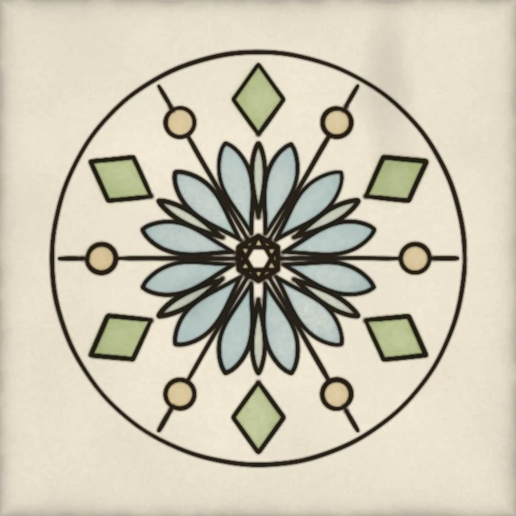

# Symmetry: one motif, repeated by mirror and rotation



*Painted by `examples/kaleidoscope.py` (seed 9).*

A kaleidoscope draws something small once and repeats it. This page paints a rosette that
way: a petal, a leaf, a diamond, a disc and a spoke are each listed once, then repeated by
two moves. The shapes are washed in pigment and the lines are inked with the pen.

Run it with `uv run python examples/kaleidoscope.py out/`; it writes `out/kaleidoscope.png`.

## The motif

Each point of the motif is a pair: a radius, as a fraction of the figure's reach, and an
angle in degrees. The wash shapes are listed by pigment, and the inked lines are the
shapes' outlines plus a spoke.

<!-- from examples/kaleidoscope.py -->
```python
#: The shapes washed, by pigment: a water petal, a wetland leaf, a wood diamond and heath shapes.
SHAPES: dict[str, list[list[Polar]]] = {
    "water": [_petal(0.12, 0.58, 14.0, 11.0)],
    "wetland": [_petal(0.20, 0.56, 30.0, 4.5)],
    "wood": [[(0.60, 30.0), (0.78, 21.0), (0.94, 30.0), (0.78, 39.0)]],
    "heath": [_disc(0.76, 0.0, 0.07), [(0.11, 30.0), (0.11, 90.0), (0.11, 150.0)]],
}

#: The lines inked: the shapes' outlines and the spokes between the petals.
LINES: list[list[Polar]] = [
    *(shape + shape[:1] for shapes in SHAPES.values() for shape in shapes),
    [(0.11, 0.0), (0.69, 0.0)],
    [(0.85, 0.0), (0.97, 0.0)],
]
```

## The two moves

- **Mirror.** Turn the angle `a` into `-a`. The motif meets its own reflection along the
  horizontal line through the centre.
- **Rotation.** Add 60 degrees to every angle, six times round. The pair repeats with
  six-fold symmetry.

Together they make twelve copies of every shape. The code builds the twelve by choosing
mirror or not, and a turn from 0 to 5, then turning each polar point into a pixel.

<!-- from examples/kaleidoscope.py -->
```python
def _to_xy(shape: list[Polar], turn: int, size: int, *, mirror: bool) -> np.ndarray:
    """Return a shape's points in pixels, mirrored about the horizontal axis or not, turned `turn` times."""
    angles = np.radians([(-a if mirror else a) + turn * 360.0 / FOLD for _r, a in shape])
    radii = np.array([r for r, _a in shape]) * REACH * size
    return np.column_stack([size / 2 + radii * np.cos(angles), size / 2 + radii * np.sin(angles)])


def _copies(shape: list[Polar], size: int) -> list[np.ndarray]:
    """Return the twelve copies of a shape: the mirror pair, turned six times round."""
    return [
        _to_xy(shape, turn, size, mirror=mirror) for mirror in (False, True) for turn in range(FOLD)
    ]
```

## Wash the shapes

Every copy of every shape of one pigment is filled into one coverage mask, so each wash
is laid once per pigment, not once per copy. Where a copy overlaps its neighbour, as the
petals do along the mirror line, the mask is simply 1, and the wash stays even.

<!-- from examples/kaleidoscope.py -->
```python
def _cover(shapes: list[list[Polar]], size: int) -> np.ndarray:
    """Return a 0 to 1 mask of every copy of every shape in `shapes`."""
    mask = Image.new("L", (size, size), 0)
    draw = ImageDraw.Draw(mask)
    for shape in shapes:
        for points in _copies(shape, size):
            draw.polygon([(float(x), float(y)) for x, y in points], fill=255)
    return np.asarray(mask, np.float32) / 255
```

## Ink the lines

The copies of each line are stamped with the narrow nib, the way the
[curves](curves.md) page draws its figures, together with one outer ring at the figure's
reach. The ring marks the edge of the figure and leaves a clear margin of bare paper
round it.

<!-- from examples/kaleidoscope.py -->
```python
    ring = _to_xy([(1.0, a) for a in np.linspace(0.0, 360.0, 361)], 0, size, mirror=False)
    for points in [ring, *(copy for line in LINES for copy in _copies(line, size))]:
        stamp(acc, _dense(points, 1.0), brush, rng)
```

## What to notice

- The petals meet along the mirror lines without a seam, because a shape and its mirror
  image fill the same mask.
- The wash is laid first and the ink over it, so the lines stay crisp over the colour.
- Every seed is fixed, so one run writes the same file again.

## Try changing

Change `FOLD` from 6 to 8 for eight-fold symmetry, and the angles in the motif that
mention 30 degrees to 22.5 so the diamonds still sit midway between two petals. Move the
petal's angle from 14 to 5 and watch the mirrored pairs fuse.
