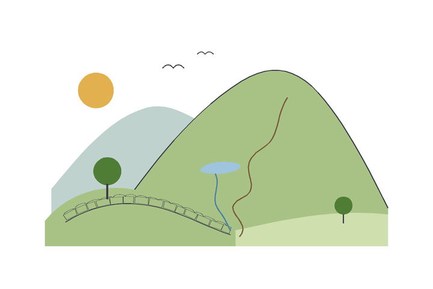
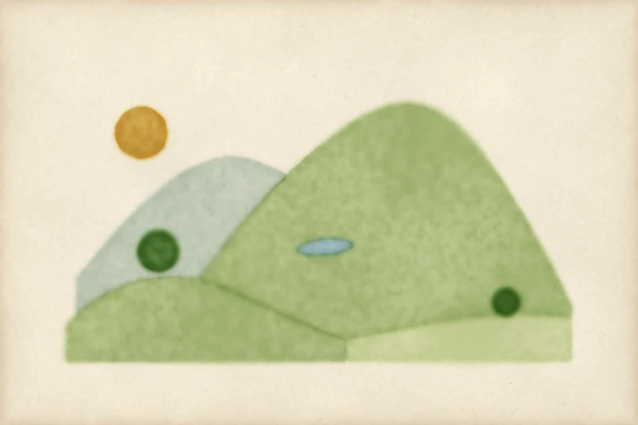
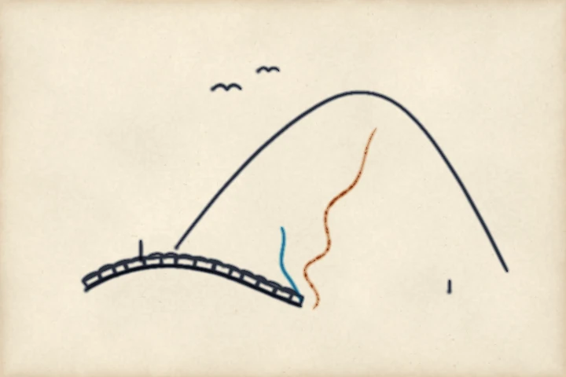

# Vector drawing: a small drawing, its filled shapes washed and its strokes inked

You hand the engine a drawing that is not yours: a small SVG of a fell, a tarn, a
dry-stone wall and two trees. This page shows the file, then the drawing flat, then each
step the script takes towards a painting. You see what each step adds and what it
changes.

pyntpot does not read SVG itself. The engine paints masks and point lists. This script
reads one file with the standard library. [The feature note](../../features/ink-read-svg-drawings.md)
says what it would look like for pyntpot to read drawings for you.


*Painted by `examples/svg_drawing.py`, seed 5.*

Run the script:

```bash
uv run python examples/svg_drawing.py out/ --figure washes
```

It reads [`examples/drawings/fell.svg`](https://github.com/findlaywebb/pyntpot/blob/main/examples/drawings/fell.svg), a drawing
made for this repository and released under its MIT licence. `--figure` picks the picture:
`flat`, `washes`, `ink` or `painting` (the default). Each run writes one image into
`out/`. It is `svg_drawing-<figure>.png`, or `svg_drawing.png` for the painting.

## The raw SVG

The drawing is a handful of `<path>` elements, listed back to front. The filled shapes
come first. Each has a `fill` colour and a `d` attribute of path data.

<!-- from examples/drawings/fell.svg -->
```xml
<svg xmlns="http://www.w3.org/2000/svg" viewBox="0 0 600 400" width="600" height="400">
  <!-- Filled shapes, back to front. The script washes each in the nearest pigment. -->
  <path id="sun" fill="#e2b04e" stroke="none"
        d="M 82 115 C 82 99 96 87 110 87 C 126 87 138 99 138 115 C 138 131 126 143 110 143 C 96 143 82 131 82 115 Z"/>
  <path id="far-fell" fill="#bfd2cd" stroke="none"
        d="M 40 270 C 90 210 130 160 190 142 C 230 132 260 160 300 175 C 340 190 380 150 430 140 C 455 134 470 148 480 170 L 480 345 L 40 345 Z"/>
  <path id="main-fell" fill="#a8c286" stroke="none"
        d="M 150 300 C 200 230 260 150 340 100 C 390 70 430 80 470 130 C 510 180 540 240 570 300 L 570 345 L 330 345 L 150 300 Z"/>
  <path id="tarn" fill="#9ec4de" stroke="none"
        d="M 276 238 C 284 227 316 224 336 231 C 344 238 322 246 304 246 C 288 246 270 245 276 238 Z"/>
  <path id="left-rise" fill="#a8c286" stroke="none"
        d="M 30 360 L 30 320 C 70 270 140 255 200 280 C 250 300 280 320 330 335 L 330 360 Z"/>
  <path id="right-field" fill="#cfdfae" stroke="none"
        d="M 330 360 L 330 335 C 400 320 480 300 570 310 L 570 360 Z"/>
  <path id="oak-crown" fill="#4f7d36" stroke="none"
        d="M 106 242 C 106 230 117 220 128 220 C 140 220 150 230 150 242 C 150 254 140 264 128 264 C 117 264 106 254 106 242 Z"/>
  <path id="hawthorn-crown" fill="#4f7d36" stroke="none"
        d="M 486 296 C 486 288 492 282 500 282 C 508 282 514 288 514 296 C 514 304 508 310 500 310 C 492 310 486 304 486 296 Z"/>
```

The strokes follow. Each has a `stroke` colour, a `stroke-width` and a `class` that names
a pen. The skyline runs along the top of the main fell. The wall is a base line with a
row of stones set on it.

<!-- from examples/drawings/fell.svg -->
```xml
  <path id="skyline" class="pen" fill="none" stroke="#3a3a46" stroke-width="1.6"
        d="M 171 271 C 217 209 271 143 340 100 C 390 70 430 80 470 130 C 510 180 540 240 570 300"/>
  <path id="wall" class="pen" fill="none" stroke="#3a3a46" stroke-width="1.4"
        d="M 62 322 C 105 296 150 286 205 298 C 245 307 275 326 322 342"/>
```

The wall's stones are one more path of short closed shapes, left out here. The file has
them. After them come the track, the beck, the two trunks and the birds.

<!-- from examples/drawings/fell.svg -->
```xml
  <path id="track" class="track" fill="none" stroke="#7a5a3a" stroke-width="1.8"
        d="M 336 345 C 360 322 300 304 340 284 C 380 266 322 236 372 206 C 402 188 392 156 412 126"/>
  <path id="beck" class="beck" fill="none" stroke="#4a7fa8" stroke-width="2"
        d="M 298 246 C 308 266 288 284 304 304 C 312 314 316 324 322 336"/>
  <path id="oak-trunk" class="pen" fill="none" stroke="#3a3a46" stroke-width="3"
        d="M 128 286 L 128 262"/>
  <path id="hawthorn-trunk" class="pen" fill="none" stroke="#3a3a46" stroke-width="2"
        d="M 500 324 L 500 310"/>
  <path id="bird-a" class="pen" fill="none" stroke="#3a3a46" stroke-width="1.5"
        d="M 215 80 C 222 72 228 74 232 80 C 236 74 242 72 249 80"/>
  <path id="bird-b" class="pen" fill="none" stroke="#3a3a46" stroke-width="1.2"
        d="M 270 58 C 275 52 279 54 282 58 C 285 54 290 52 295 58"/>
```

## What the script reads

The script reads only four commands, all absolute:

| Command | Meaning | Numbers |
| --- | --- | --- |
| `M` | start a new subpath | x y |
| `L` | a straight line | x y |
| `C` | a cubic Bezier curve | x1 y1 x2 y2 x y |
| `Z` | close the subpath | none |

A curve is flattened into `CURVE_SEGMENTS` (twelve) straight segments, so every shape is
a list of points. Any other command, a lowercase one included, raises `ValueError`. This
is deliberate. A drawing outside the subset fails at once instead of painting half of
itself. The file is written by hand with this subset in mind.

The drawing's `viewBox` is 600 by 400. The script scales it to fill 88 per cent of the
paper's width and centres it, so the picture keeps a margin of bare paper. That is the
only transform. The file has no `transform` attributes, and the script ignores any it
meets.

## The drawing flat



*Painted by `examples/svg_drawing.py`, figure flat.*

This is what a browser shows. Pillow fills each shape in its own `fill` colour and draws
each stroke in its own `stroke` colour, on white. Every edge is hard, every colour is
uniform and the near fell sits cleanly over the far one. Nothing here is pyntpot yet. It
is the drawing you are about to paint.

## Fills become washes



*Painted by `examples/svg_drawing.py`, figure washes.*

A filled path is a mask. The script draws its points with Pillow's `ImageDraw.polygon`
onto a greyscale image and hands that array to `wash`, as the rungs handed it a disc. The
`fill` colour picks the pigment. The script takes the nearest colour in `PIGMENTS` and
`PAINTERS_PIGMENTS`, so `#bfd2cd` is `wetland`, `#9ec4de` is `water` and `#4f7d36` is
`sap_green`.

This adds paper, soft edges that pool a little pigment, and grain in the body of each
wash. It also changes how shapes overlap. A shape is washed around the shapes in front of
it, so the paper is left bare under the tarn, and the far fell does not show through the
near one. The washes are glazed with Kubelka-Munk, so where two do overlap, at the wet
edges, they keep their hue. The two trees are the darkest washes.

## Strokes become ink



*Painted by `examples/svg_drawing.py`, figure ink.*

A stroked path is a list of points, which is what `stamp` lays a brush along. The path's
`class` names the pen. `pen` is a fine nib for the skyline, the wall, the trunks and the
birds. `track` is a broken line for a footpath. `beck` is a wet blue one for the stream.
The `stroke-width` sets the brush's width. `ink_density` turns what the stamps laid into
ink. The `stroke` colour picks its pigment from the same two tables, so `#3a3a46` is
`indigo`, a dark blue-black.

This adds lines with soft edges and a track that breaks into dashes where the brush
lifts. A stroke is a stamp of a brush, not a stripe of constant width, so the lines are
not as clean as the flat ones.

## The painting


*Painted by `examples/svg_drawing.py`, seed 5.*

`composite` lays the washes first and the inks over them, in the order the file lists
them. That is the whole script: the washes figure and the ink figure on one sheet of
paper. The lines sit on the pigment.

## Try it

- Add a path to `fell.svg`: a second wall, or a sheep as a short `C` curve with a fill.
- Change a `fill` to `#dcd6c6` and the shape takes `rock`.
- Change the oak's `fill` to `#2b3d8f` and it takes `ultramarine`, which makes a blue tree.
- Give a stroke a new `class` and add a pen to `PENS`.
