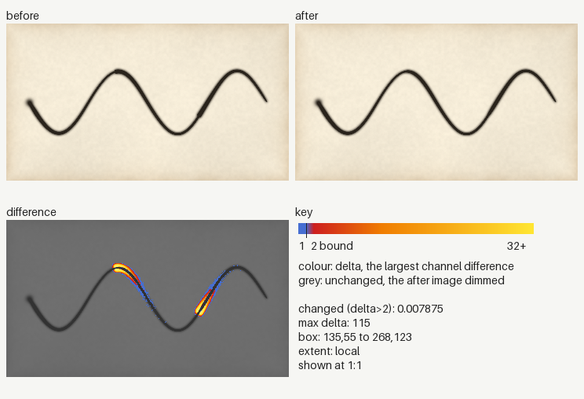
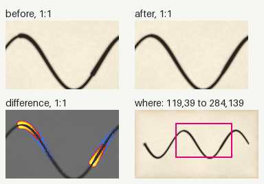
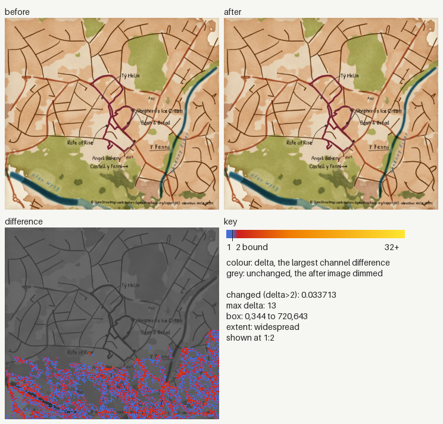
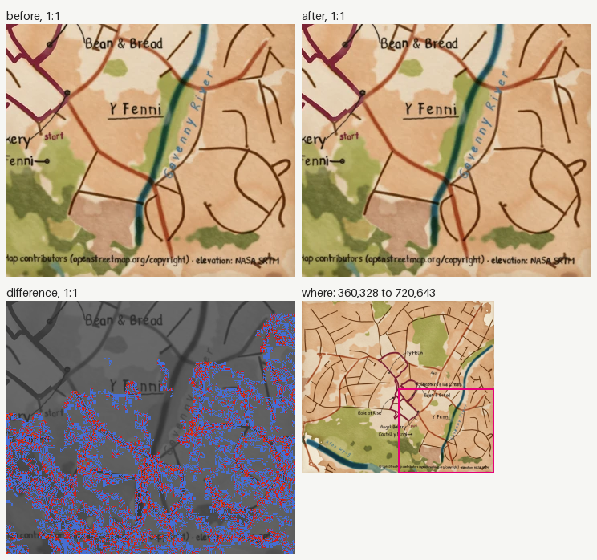
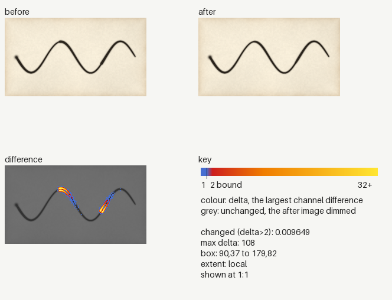
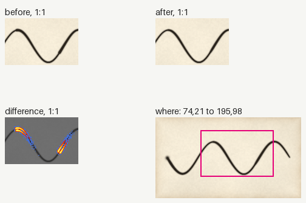
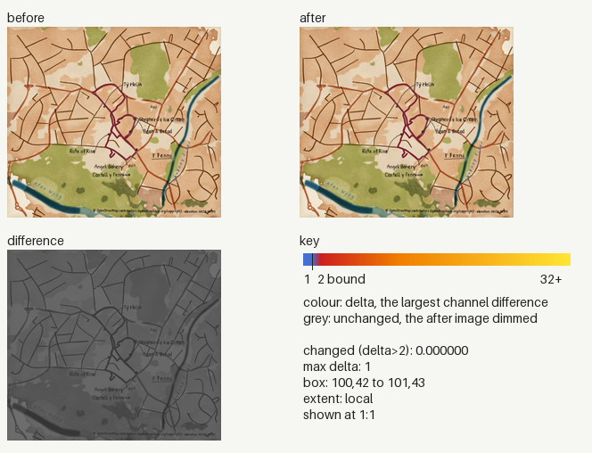
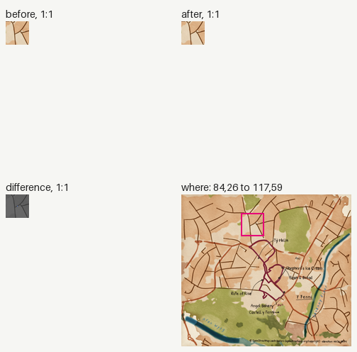
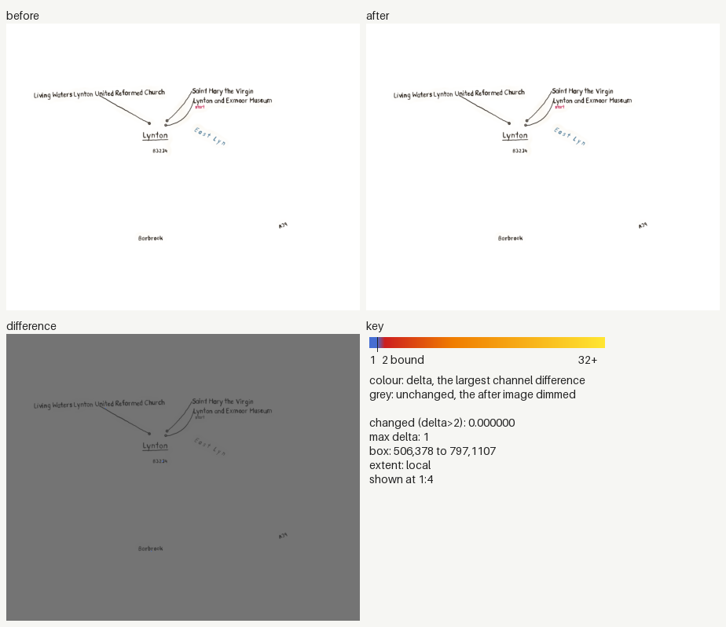
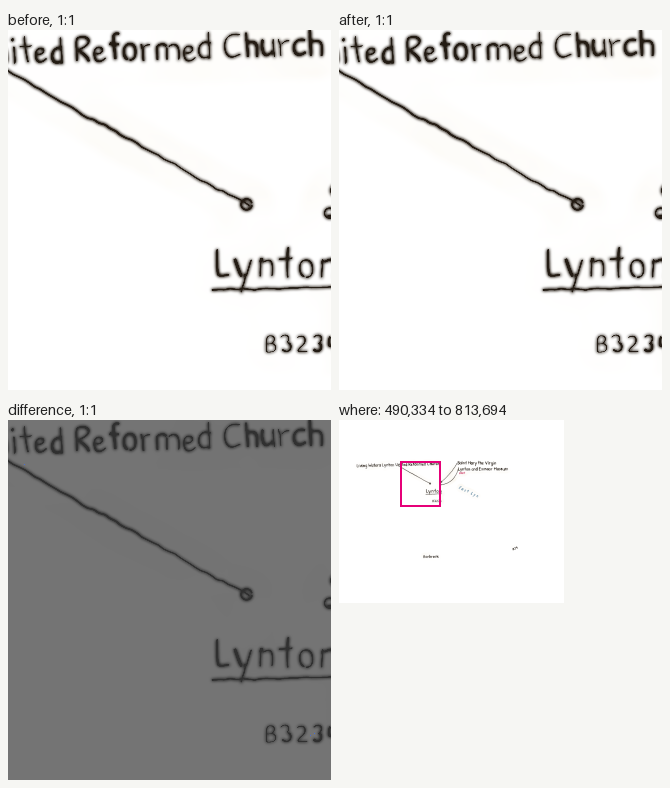

### Image changes

Before: `origin/main`. After: `working tree`. 5 changed, 0 added, 0 removed.
Changed counts the pixels past channel delta 2; the parity gate bounds it at 0.005 (ADR 0030). Local: the box covers at most a quarter of the image.

| File | Size | Changed | Max delta | Box | Extent |
|---|---|---|---|---|---|
| `docs/images/explanation/nib-runs-dry.webp` | 360x200 | 0.007875 (over 0.005) | 115 | 135,55 to 268,123 | local |
| `docs/images/places/y-fenni.webp` | 720x643 | 0.033713 (over 0.005) | 13 | 0,344 to 720,643 | widespread |
| `tests/golden/docs/explanation/nib-runs-dry.png` | 240x133 | 0.009649 (over 0.005) | 108 | 90,37 to 179,82 | local |
| `tests/golden/docs/places/y-fenni.png` | 240x214 | 0.000000 | 1 | 100,42 to 101,43 | local |
| `tests/golden/lynmouth/labels-centreline.webp` | 1800x1457 | 0.000000 | 1 | 506,378 to 797,1107 | local |

<code>docs/images/explanation/nib-runs-dry.webp</code>: local, 0.007875

<code>docs/images/places/y-fenni.webp</code>: widespread, 0.033713

<code>tests/golden/docs/explanation/nib-runs-dry.png</code>: local, 0.009649

<code>tests/golden/docs/places/y-fenni.png</code>: local, 0.000000

<code>tests/golden/lynmouth/labels-centreline.webp</code>: local, 0.000000

