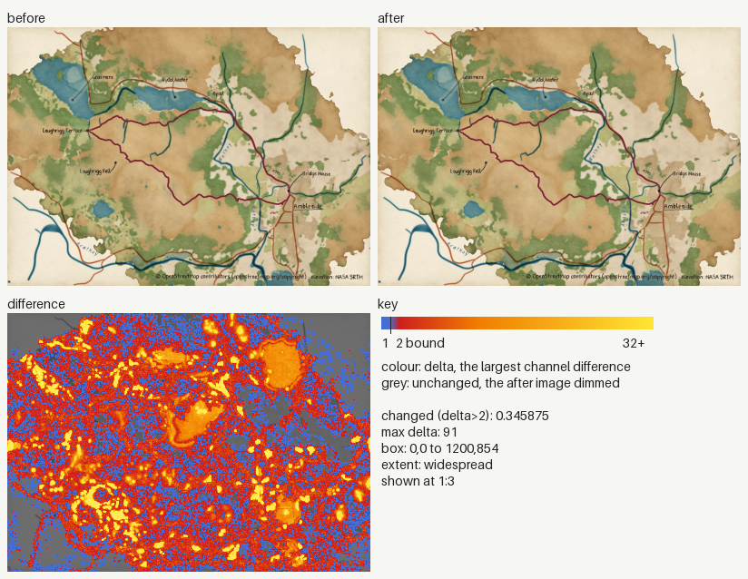
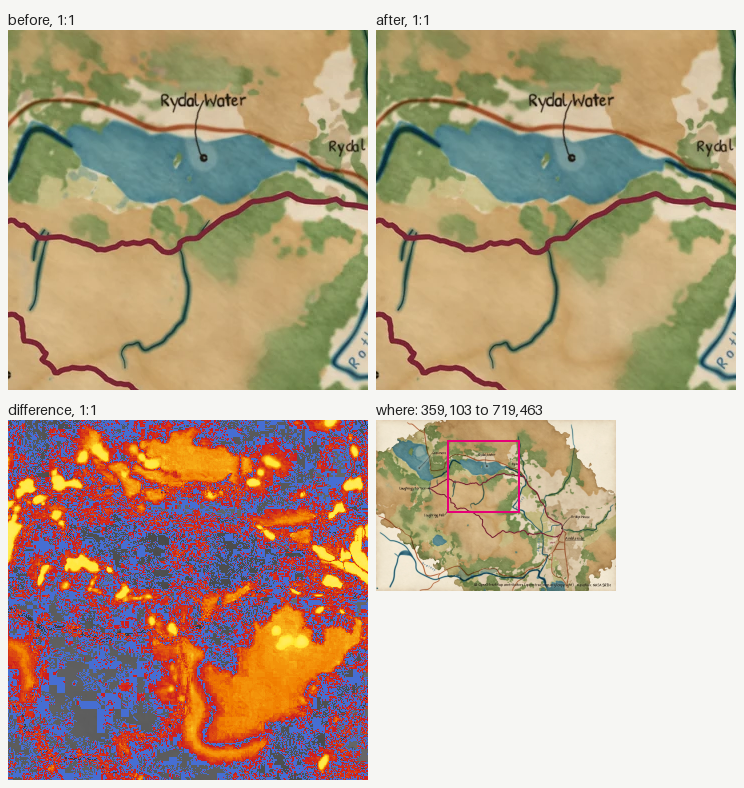
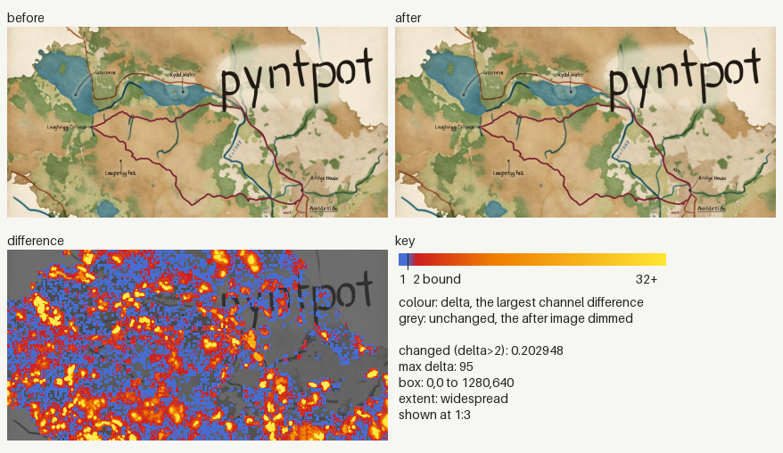
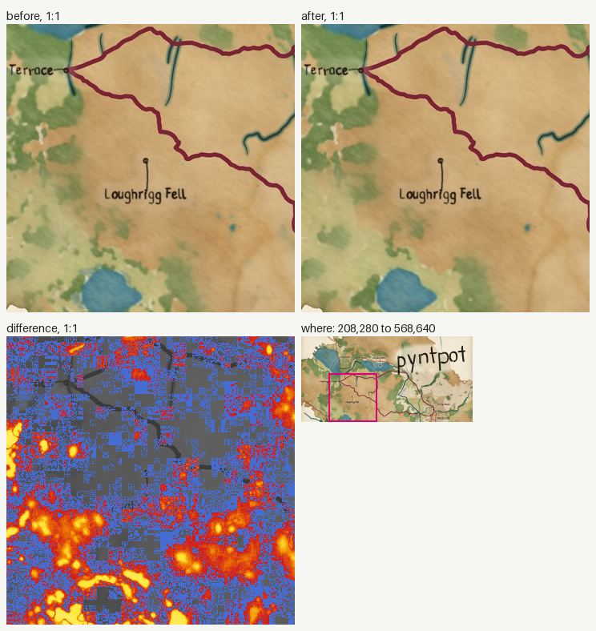
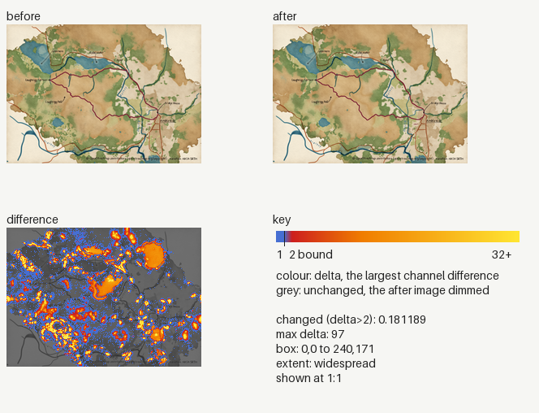
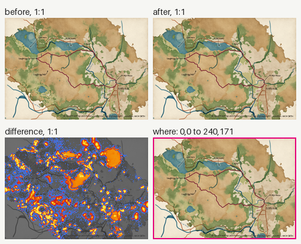
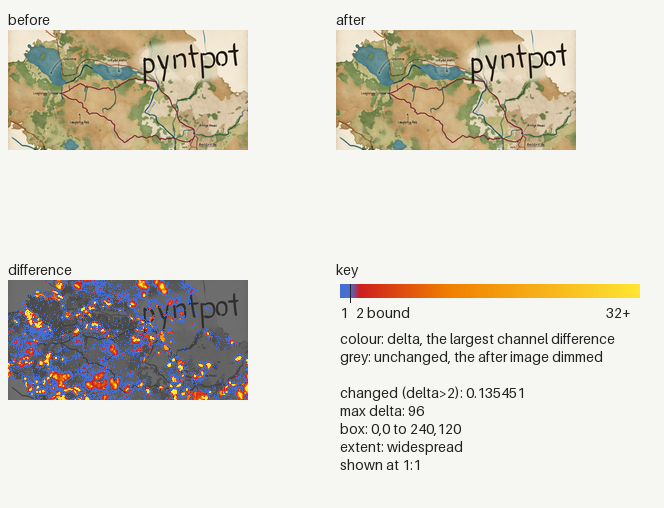
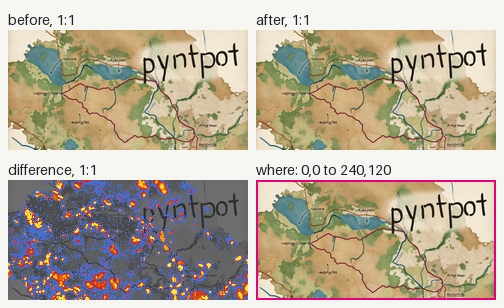

### Image changes

Before: `origin/main`. After: `working tree`. 4 changed, 0 added, 0 removed.
Changed counts the pixels past channel delta 2; the parity gate bounds it at 0.005 (ADR 0030). Local: the box covers at most a quarter of the image.

| File | Size | Changed | Max delta | Box | Extent |
|---|---|---|---|---|---|
| `docs/images/hero.webp` | 1200x854 | 0.345875 (over 0.005) | 91 | 0,0 to 1200,854 | widespread |
| `docs/images/social-preview.jpg` | 1280x640 | 0.202948 (over 0.005) | 95 | 0,0 to 1280,640 | widespread |
| `tests/golden/docs/hero.png` | 240x171 | 0.181189 (over 0.005) | 97 | 0,0 to 240,171 | widespread |
| `tests/golden/docs/social-preview.png` | 240x120 | 0.135451 (over 0.005) | 96 | 0,0 to 240,120 | widespread |

<code>docs/images/hero.webp</code>: widespread, 0.345875

<code>docs/images/social-preview.jpg</code>: widespread, 0.202948

<code>tests/golden/docs/hero.png</code>: widespread, 0.181189

<code>tests/golden/docs/social-preview.png</code>: widespread, 0.135451

