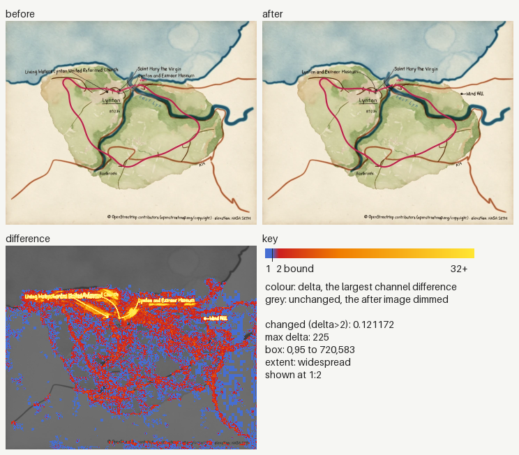
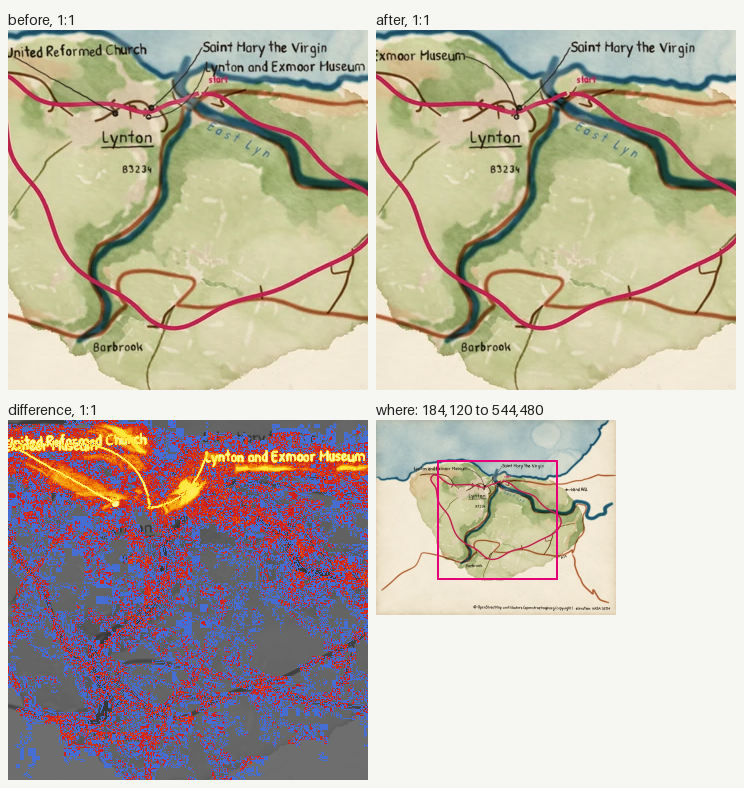
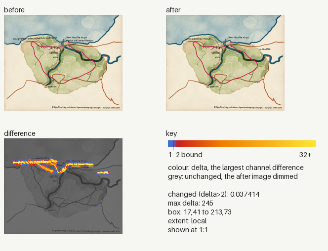
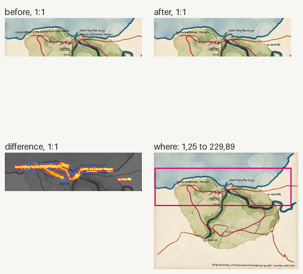
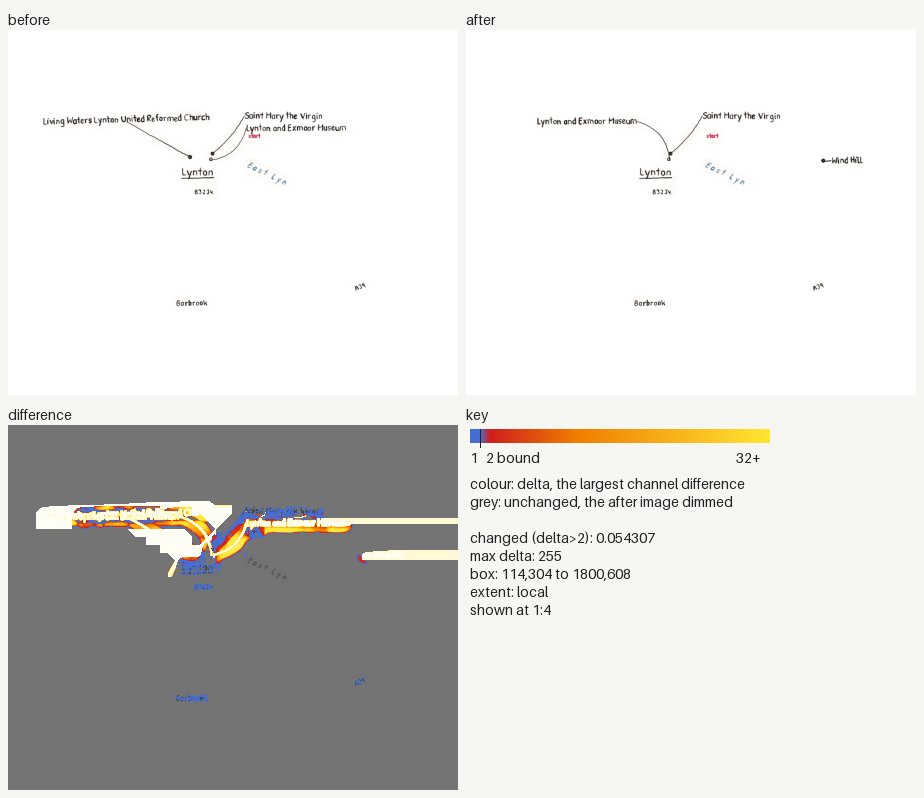
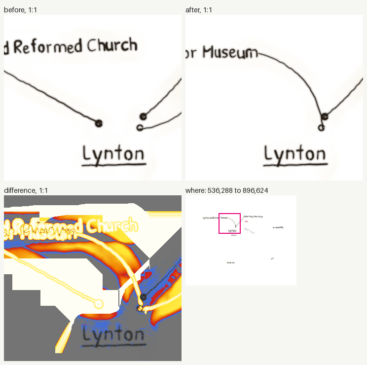
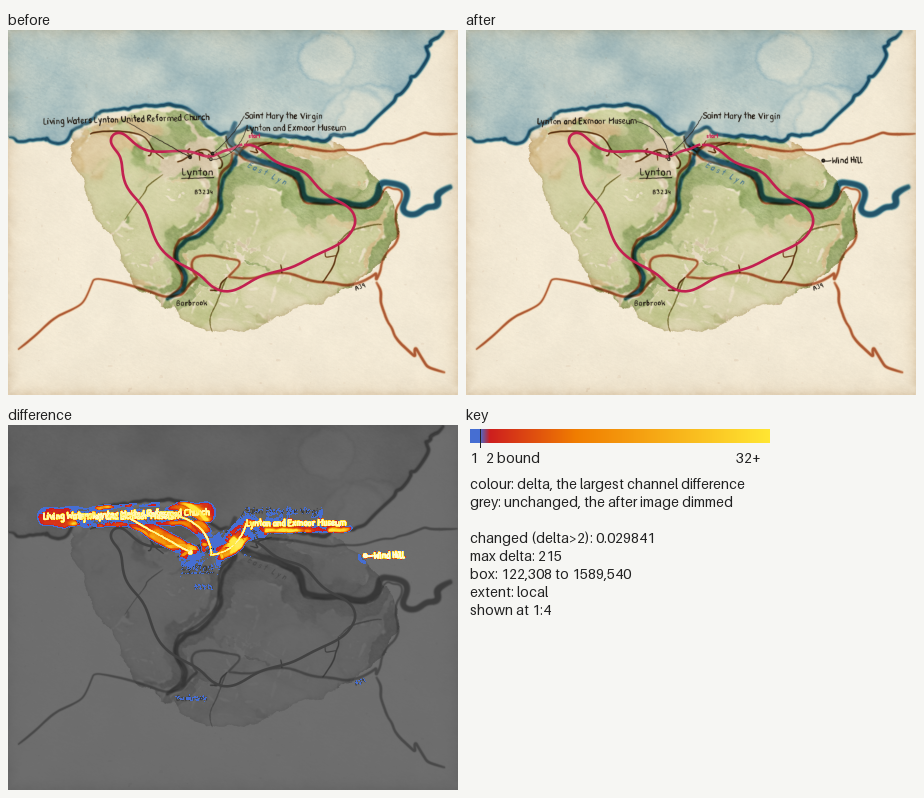
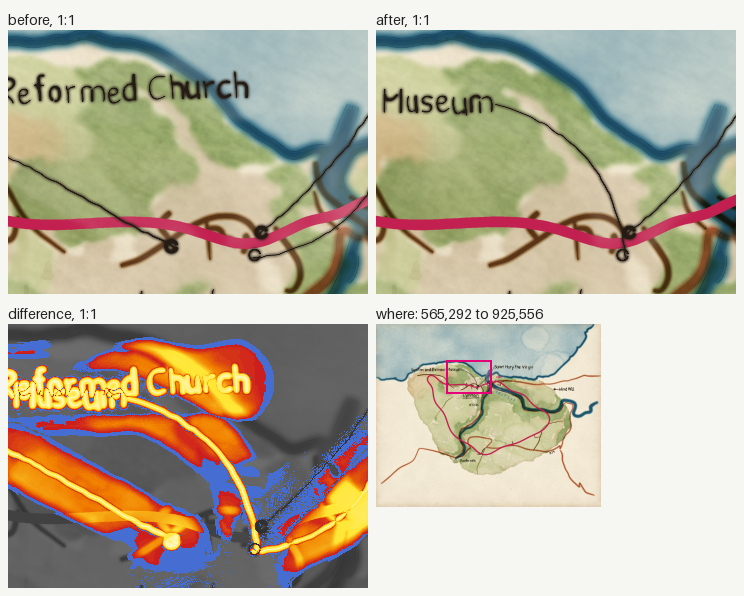

### Image changes

Before: `origin/main`. After: `working tree`. 4 changed, 0 added, 0 removed.
Changed counts the pixels past channel delta 2; the parity gate bounds it at 0.005 (ADR 0030). Local: the box covers at most a quarter of the image.

| File | Size | Changed | Max delta | Box | Extent |
|---|---|---|---|---|---|
| `docs/images/how-to/command-line.webp` | 720x583 | 0.121172 (over 0.005) | 225 | 0,95 to 720,583 | widespread |
| `tests/golden/docs/how-to/command-line.png` | 240x194 | 0.037414 (over 0.005) | 245 | 17,41 to 213,73 | local |
| `tests/golden/lynmouth/labels-centreline.webp` | 1800x1457 | 0.054307 (over 0.005) | 255 | 114,304 to 1800,608 | local |
| `tests/golden/lynmouth/map.png` | 1800x1457 | 0.029841 (over 0.005) | 215 | 122,308 to 1589,540 | local |

<code>docs/images/how-to/command-line.webp</code>: widespread, 0.121172

<code>tests/golden/docs/how-to/command-line.png</code>: local, 0.037414

<code>tests/golden/lynmouth/labels-centreline.webp</code>: local, 0.054307

<code>tests/golden/lynmouth/map.png</code>: local, 0.029841

