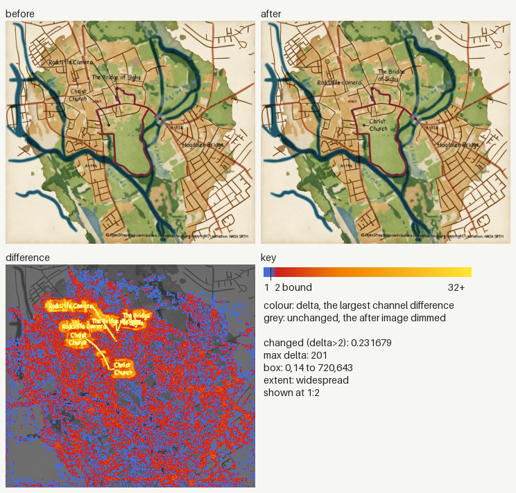
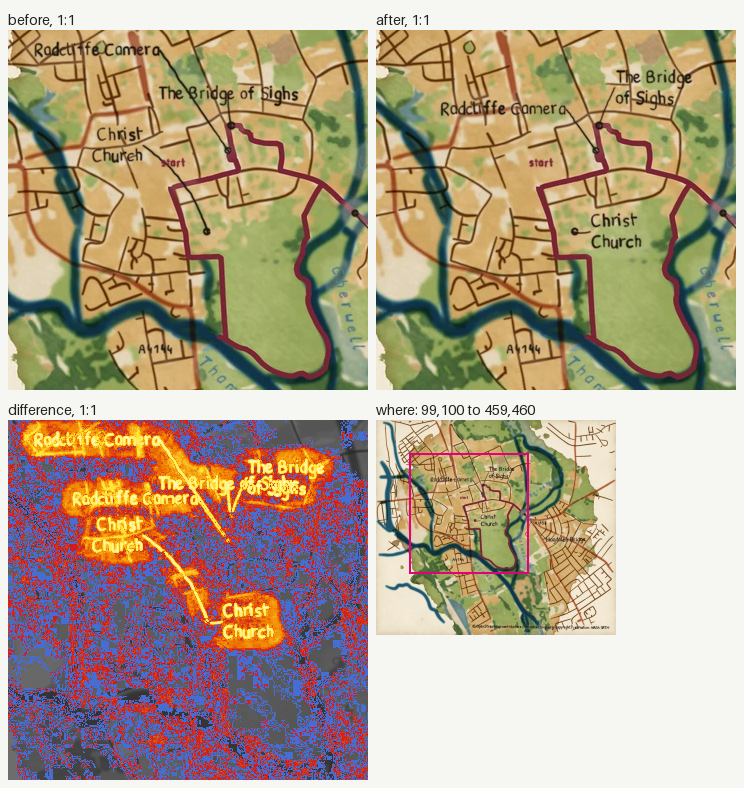
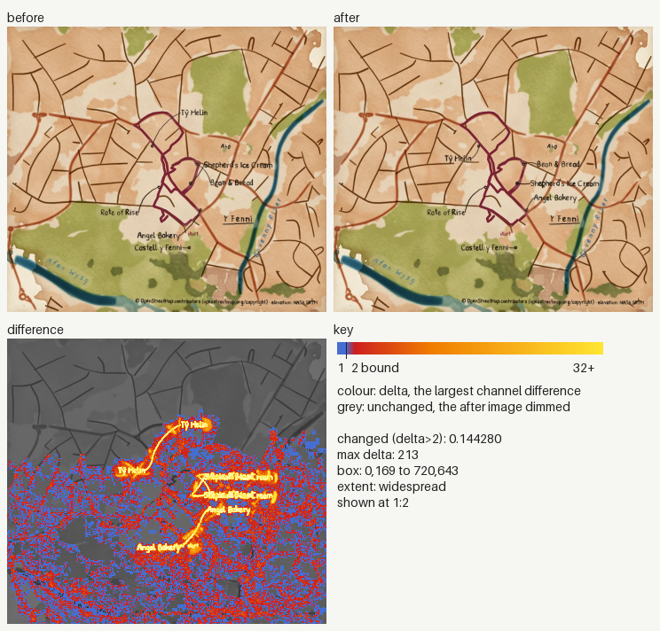
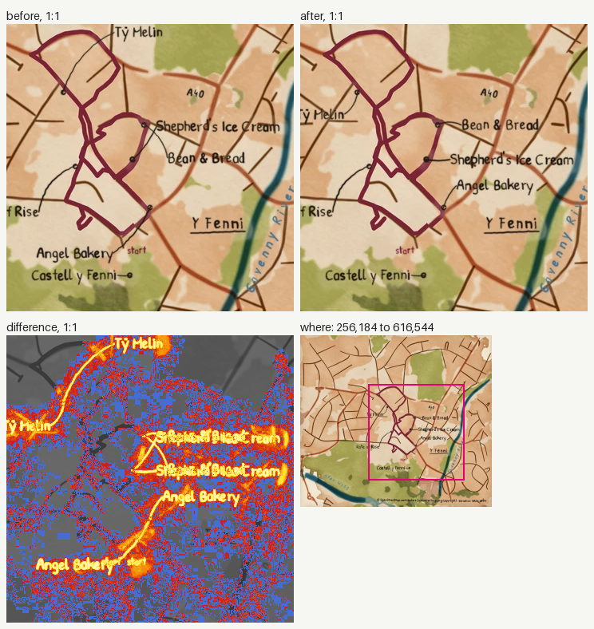
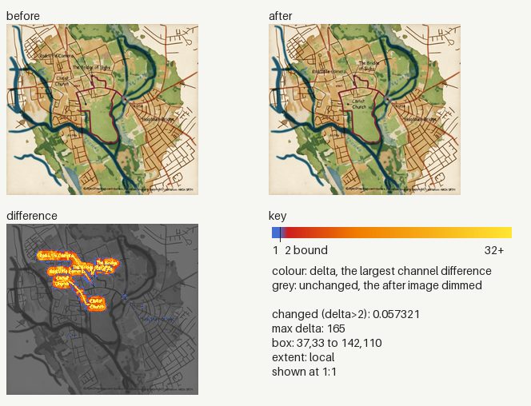
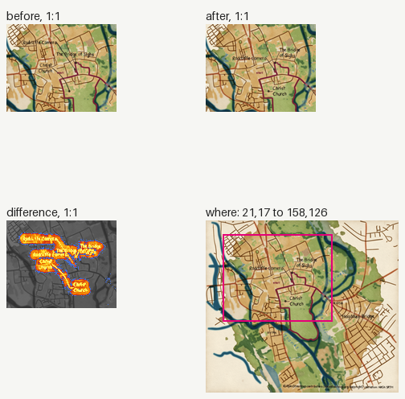
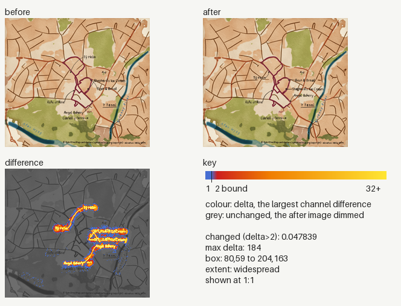
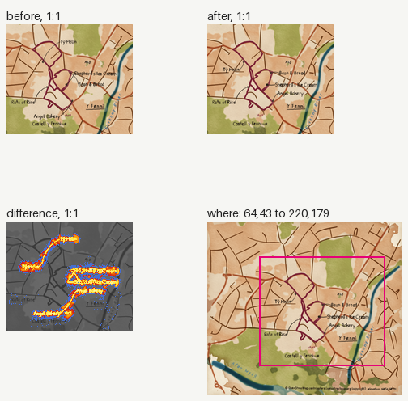

### Image changes

Before: `origin/main`. After: `working tree`. 4 changed, 0 added, 0 removed.
Changed counts the pixels past channel delta 2; the parity gate bounds it at 0.005 (ADR 0030). Local: the box covers at most a quarter of the image.

| File | Size | Changed | Max delta | Box | Extent |
|---|---|---|---|---|---|
| `docs/images/places/oxford.webp` | 720x643 | 0.231679 (over 0.005) | 201 | 0,14 to 720,643 | widespread |
| `docs/images/places/y-fenni.webp` | 720x643 | 0.144280 (over 0.005) | 213 | 0,169 to 720,643 | widespread |
| `tests/golden/docs/places/oxford.png` | 240x214 | 0.057321 (over 0.005) | 165 | 37,33 to 142,110 | local |
| `tests/golden/docs/places/y-fenni.png` | 240x214 | 0.047839 (over 0.005) | 184 | 80,59 to 204,163 | widespread |

<code>docs/images/places/oxford.webp</code>: widespread, 0.231679

<code>docs/images/places/y-fenni.webp</code>: widespread, 0.144280

<code>tests/golden/docs/places/oxford.png</code>: local, 0.057321

<code>tests/golden/docs/places/y-fenni.png</code>: widespread, 0.047839

