### Image changes

Before: `/tmp/claude-0/-home-user-pyntpot/1d79c270-6236-5bf4-82b6-e519237905dd/scratchpad/g59m/before`. After: `/tmp/claude-0/-home-user-pyntpot/1d79c270-6236-5bf4-82b6-e519237905dd/scratchpad/g59m/after`. 7 changed, 0 added, 0 removed.
Changed counts the pixels past channel delta 2; the parity gate bounds it at 0.005 (ADR 0030). Local: the box covers at most a quarter of the image.

| File | Size | Changed | Max delta | Box | Extent |
|---|---|---|---|---|---|
| `docs/images/how-to/command-line.webp` | 720x583 | 0.258791 (over 0.005) | 147 | 0,0 to 720,583 | widespread |
| `docs/images/places/skye.webp` | 720x643 | 0.740999 (over 0.005) | 230 | 0,0 to 720,643 | widespread |
| `tests/golden/docs/how-to/command-line.png` | 240x194 | 0.146843 (over 0.005) | 80 | 0,0 to 240,185 | widespread |
| `tests/golden/docs/places/skye.png` | 240x214 | 0.555004 (over 0.005) | 176 | 0,0 to 240,214 | widespread |
| `tests/golden/lynmouth/labels-centreline.webp` | 1800x1457 | 0.014197 (over 0.005) | 243 | 268,307 to 1800,1056 | widespread |
| `tests/golden/lynmouth/map.png` | 1800x1457 | 0.127123 (over 0.005) | 150 | 0,0 to 1800,1379 | widespread |
| `tests/golden/lynmouth/wash.webp` | 1800x1457 | 0.131084 (over 0.005) | 182 | 0,0 to 1800,1379 | widespread |

<code>docs/images/how-to/command-line.webp</code>: widespread, 0.258791

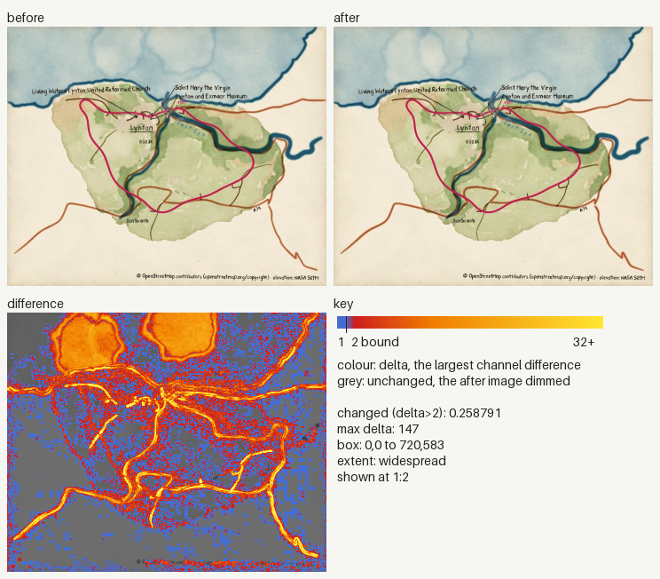

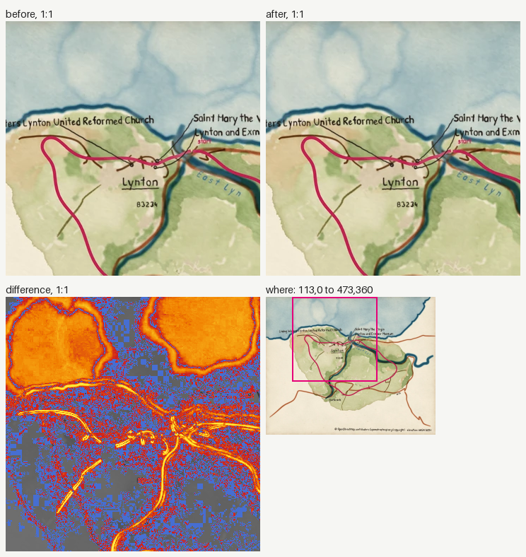

<code>docs/images/places/skye.webp</code>: widespread, 0.740999

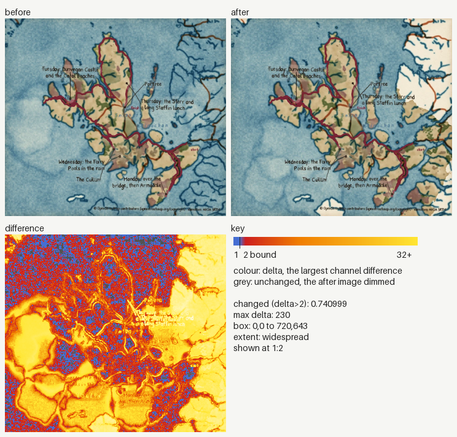

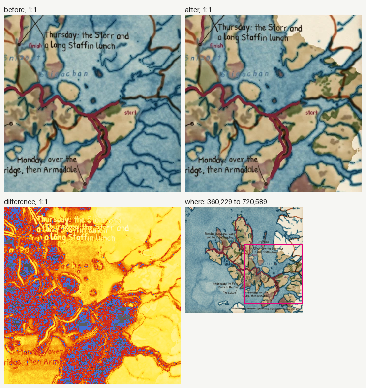

<code>tests/golden/docs/how-to/command-line.png</code>: widespread, 0.146843

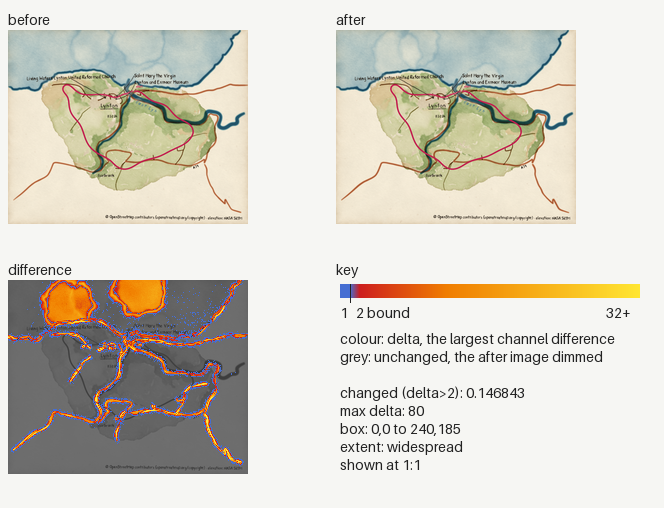

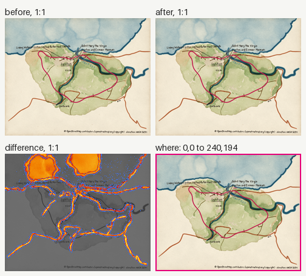

<code>tests/golden/docs/places/skye.png</code>: widespread, 0.555004

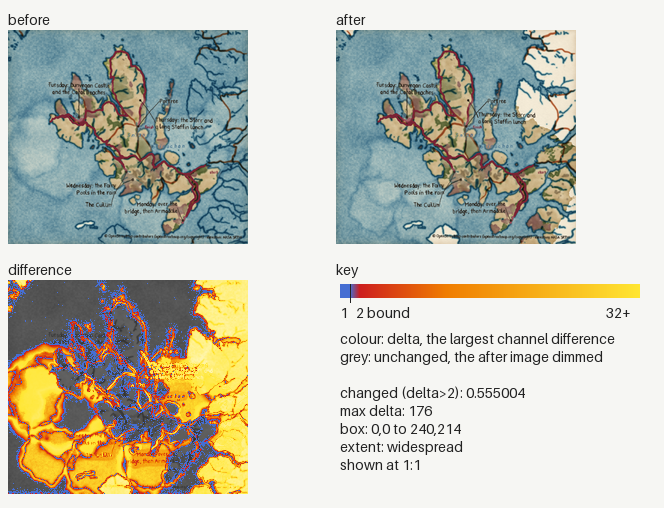

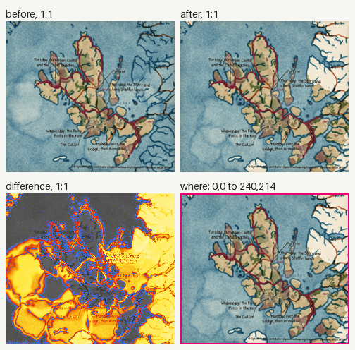

<code>tests/golden/lynmouth/labels-centreline.webp</code>: widespread, 0.014197

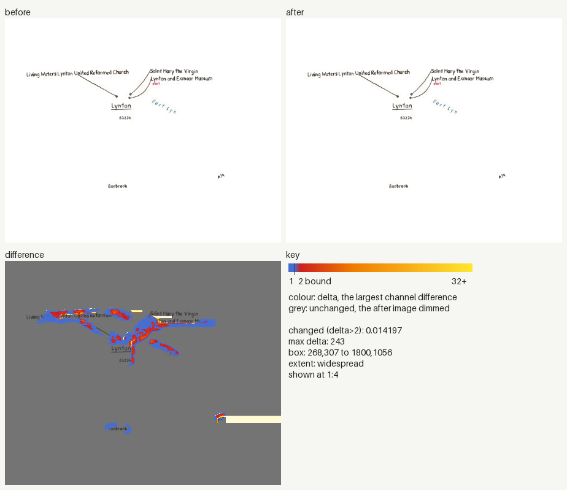

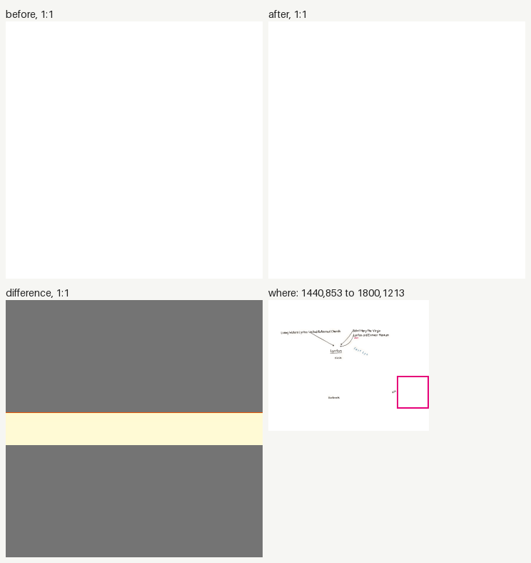

<code>tests/golden/lynmouth/map.png</code>: widespread, 0.127123

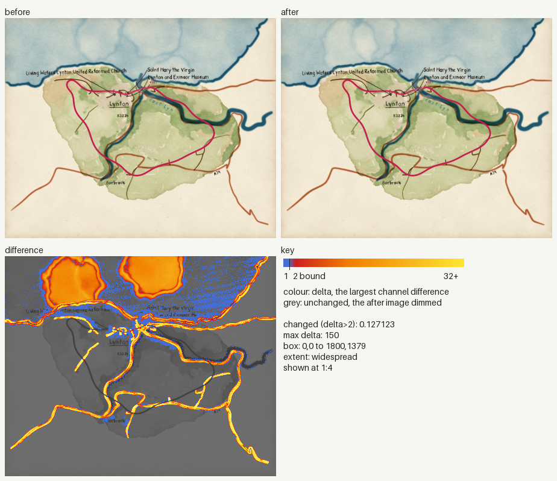

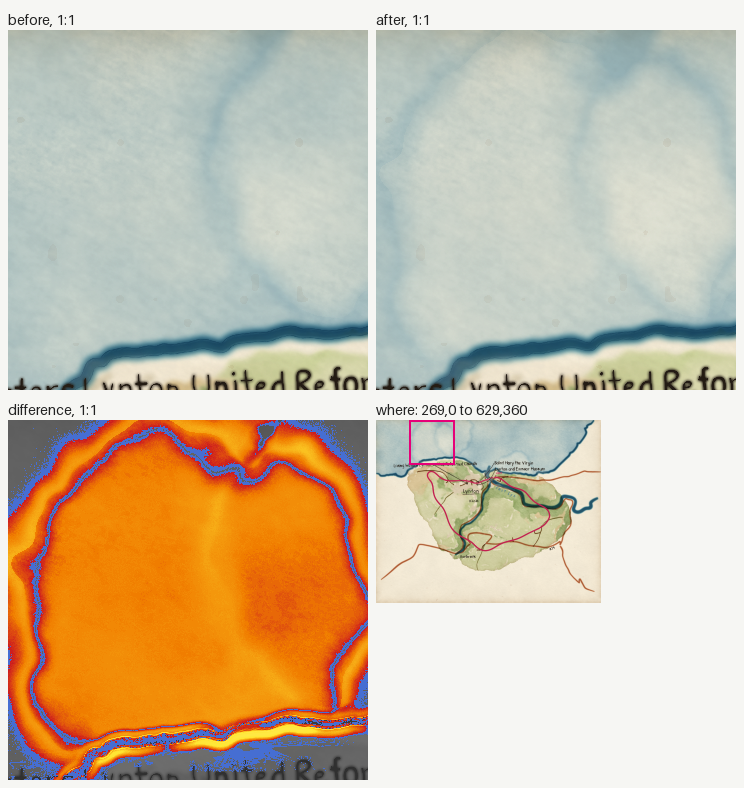

<code>tests/golden/lynmouth/wash.webp</code>: widespread, 0.131084

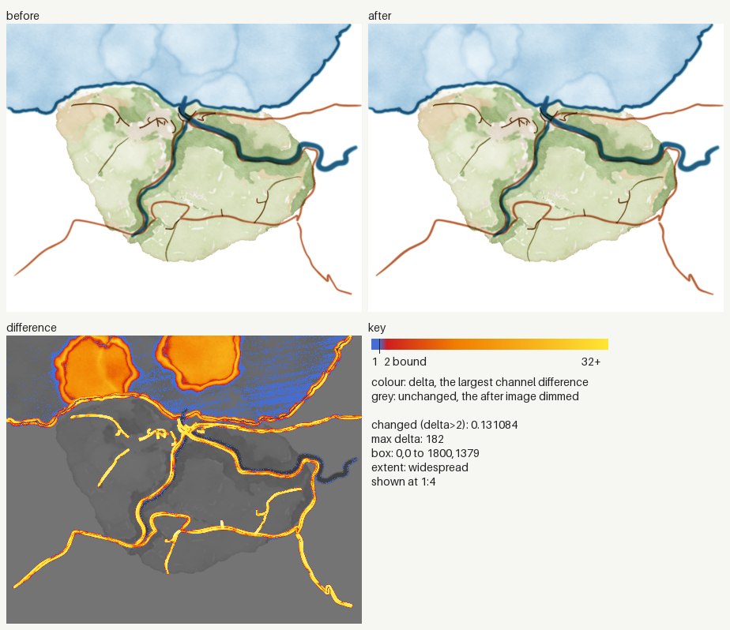

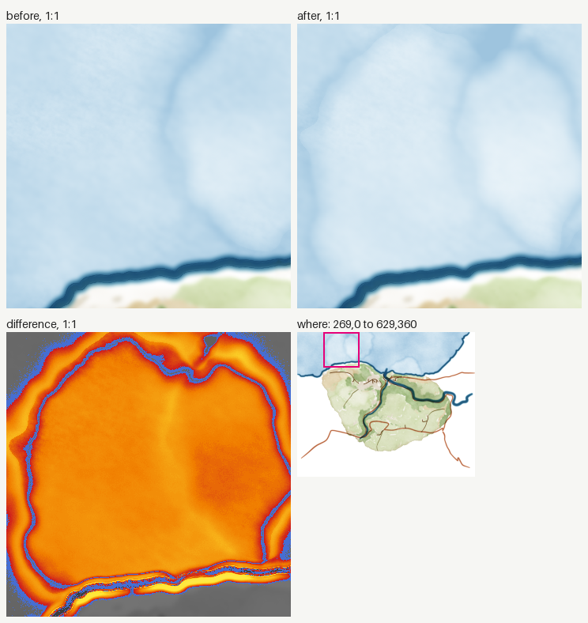

