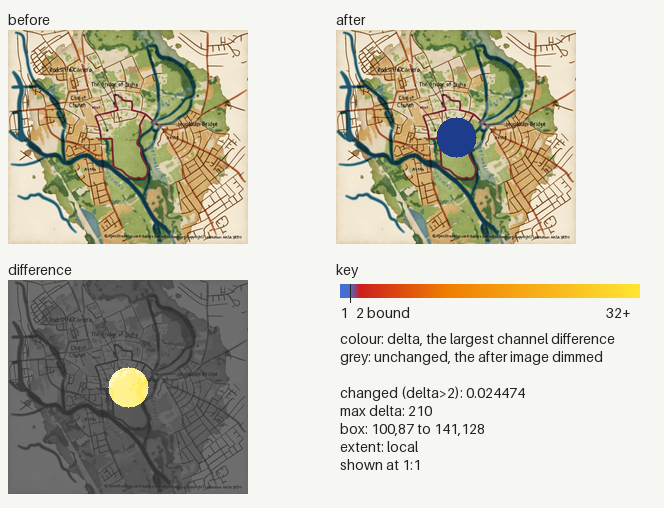
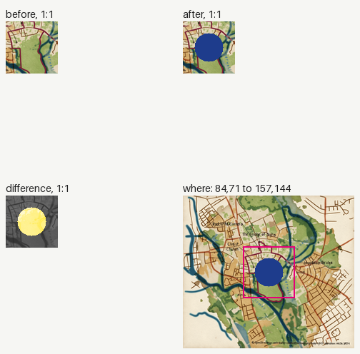

### Image changes

Before: `/tmp/claude-0/-home-user-pyntpot/1d79c270-6236-5bf4-82b6-e519237905dd/scratchpad/demo/before`. After: `/tmp/claude-0/-home-user-pyntpot/1d79c270-6236-5bf4-82b6-e519237905dd/scratchpad/demo/after`. 1 changed, 0 added, 0 removed.
Changed counts the pixels past channel delta 2; the parity gate bounds it at 0.005 (ADR 0030). Local: the box covers at most a quarter of the image.

| File | Size | Changed | Max delta | Box | Extent |
|---|---|---|---|---|---|
| `tests/golden/docs/places/oxford.png` | 240x214 | 0.024474 (over 0.005) | 210 | 100,87 to 141,128 | local |

<code>tests/golden/docs/places/oxford.png</code>: local, 0.024474

