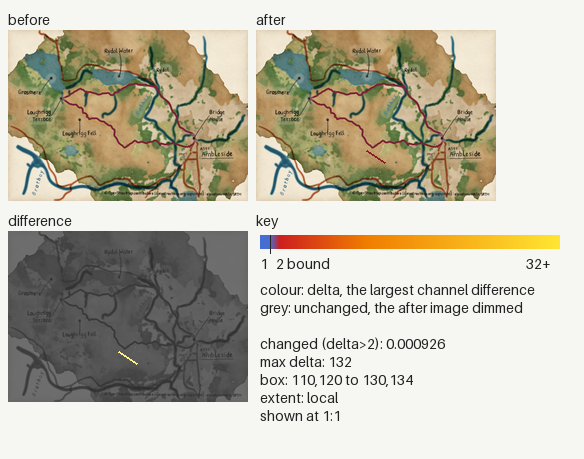
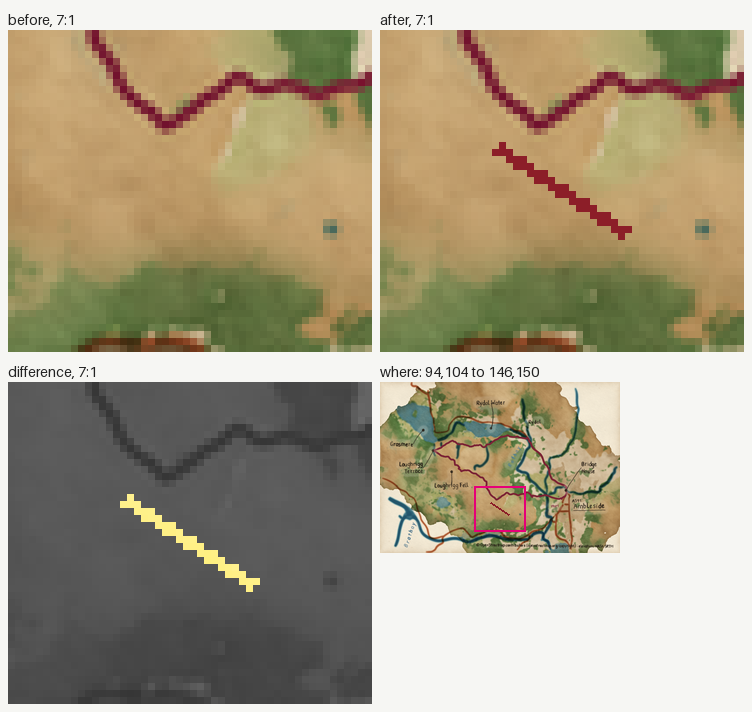

### Image changes

Before: `/tmp/claude-0/-home-user-pyntpot/1d79c270-6236-5bf4-82b6-e519237905dd/scratchpad/crop-demo/before`. After: `/tmp/claude-0/-home-user-pyntpot/1d79c270-6236-5bf4-82b6-e519237905dd/scratchpad/crop-demo/after`. 1 changed, 0 added, 0 removed.
Changed counts the pixels past channel delta 2; the parity gate bounds it at 0.005 (ADR 0030). Local: the box covers at most a quarter of the image.

| File | Size | Changed | Max delta | Box | Extent |
|---|---|---|---|---|---|
| `places/ambleside.png` | 240x171 | 0.000926 | 132 | 110,120 to 130,134 | local |

<code>places/ambleside.png</code>: local, 0.000926

